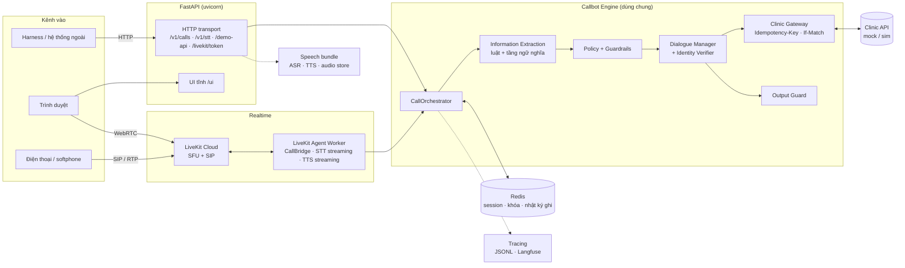
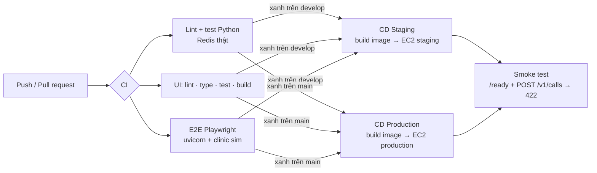

<div align="center">

# Vinmec Callbot

**Tổng đài viên AI tiếng Việt: xác minh danh tính, xác nhận, hủy, đổi lịch và đặt lịch khám qua điện thoại.**

[](https://github.com/phamtuanviet/callbot-vinmec/actions/workflows/ci.yml)


</div>

---

## Mục lục

- [Giới thiệu](#giới-thiệu)
- [Tính năng nổi bật](#tính-năng-nổi-bật)
- [Kiến trúc hệ thống](#kiến-trúc-hệ-thống)
- [Kịch bản nghiệp vụ](#kịch-bản-nghiệp-vụ)
- [Công nghệ sử dụng](#công-nghệ-sử-dụng)
- [Bắt đầu nhanh](#bắt-đầu-nhanh)
- [Cài đặt môi trường phát triển](#cài-đặt-môi-trường-phát-triển)
- [Cấu hình](#cấu-hình)
- [Chạy ứng dụng](#chạy-ứng-dụng)
- [Tài liệu API](#tài-liệu-api)
- [Giao diện web](#giao-diện-web)
- [Voice pipeline](#voice-pipeline)
- [Observability](#observability)
- [Kiểm thử](#kiểm-thử)
- [Đánh giá chất lượng](#đánh-giá-chất-lượng)
- [Triển khai](#triển-khai)
- [Cấu trúc thư mục](#cấu-trúc-thư-mục)
- [Tài liệu chi tiết](#tài-liệu-chi-tiết)
- [Quy trình đóng góp](#quy-trình-đóng-góp)
- [Xử lý sự cố](#xử-lý-sự-cố)
- [Bảo mật và quyền riêng tư](#bảo-mật-và-quyền-riêng-tư)

---

## Giới thiệu

**Vinmec Callbot** là callbot tiếng Việt hiện thực hợp đồng nghiệp vụ **AIHR-PC-001 (Rev 1.1)**. Bot nói chuyện với
bệnh nhân bằng giọng nói tự nhiên để xử lý lịch khám:

- **Outbound**: bot gọi ra cho một lịch hẹn có sẵn (`appointment_id`) để xác nhận đến khám, hủy, đổi lịch, hoặc ghi
  nhận không liên lạc được.
- **Inbound**: bệnh nhân gọi vào (`caller_number`) để đặt lịch khám mới.

Mọi thao tác đọc/ghi lịch hẹn đi qua **Clinic API**, nguồn dữ liệu duy nhất có thẩm quyền: bot không bịa khung giờ,
không tạo hồ sơ bệnh nhân và không báo thành công khi Clinic chưa xác nhận.

Một engine hội thoại dùng chung phục vụ ba kênh:

| Kênh | Mục đích | Dữ liệu vào / ra |
|---|---|---|
| **HTTP theo lượt** (`/v1/calls`) | Harness chấm điểm, tích hợp hệ thống | `text` hoặc `audio_url` (WAV) → `utterance` + `audio_url` |
| **LiveKit WebRTC** | Gọi thử realtime trên trình duyệt | Luồng âm thanh hai chiều 16 kHz, hỗ trợ ngắt lời (barge-in) |
| **LiveKit SIP** | Cuộc gọi điện thoại qua SIP trunk (đã kiểm chứng với softphone) | G.711 8 kHz, cùng `CallBridge` với WebRTC |

---

## Tính năng nổi bật

### Nghiệp vụ

- Đủ **7 nhóm kịch bản** của hợp đồng: xác minh danh tính, xác nhận đến khám, hủy lịch, đổi lịch, đặt lịch mới,
  chuyển nhân viên và không liên lạc được.
- **Xác minh danh tính** bằng họ tên + ngày sinh. Hai giá trị chỉ được đối chiếu **một lần, khi đã có đủ**; bot
  không tiết lộ yếu tố nào sai và không đọc thông tin lịch trước khi xác minh xong.
- **Hủy lịch hai bước**: yêu cầu và xác nhận ở hai lượt riêng (lần xác nhận phải có chữ "hủy"), ghi nhận lý do hủy.
- **Đổi lịch / đặt lịch** chỉ đề xuất khung giờ mà `GET /slots` trả về trong chính cuộc gọi, đọc lại khung đã chọn
  và xin xác nhận trước khi ghi; xử lý `SLOT_TAKEN` khi khung bị người khác lấy mất.
- **Chuyển nhân viên** với lý do chuẩn hóa: câu hỏi lâm sàng, khách yêu cầu, ngoài phạm vi, xác minh thất bại,
  không hiểu hai lượt liên tiếp, lỗi hệ thống...

### Hiểu ngôn ngữ

- **Luật trước, model sau**: bộ trích xuất theo luật đọc họ tên, ngày sinh (cả số đọc bằng chữ, năm nói tắt như
  "hai linh tư", định dạng tiếng Anh), ý định, đồng ý/từ chối, khung giờ, tín hiệu đường dây và câu hỏi lâm sàng.
- **Tầng ngữ nghĩa tùy chọn** cho các câu luật không chắc: TypeSafe Jev làm provider chính, LLM làm dự phòng
  (DeepSeek, OpenAI, Gemini, Groq, OpenRouter). Ngân sách cứng **4 giây/lượt**, một request, không retry. Model không
  bao giờ tự nâng câu trả lời lên "đồng ý" để ghi Clinic.
- **Name slot filling** bằng LLM khi luật không tách được họ tên.
- Hiểu câu tiếng Anh và câu trộn Anh–Việt ở các câu có/không và khi khai danh tính.

### Giọng nói

- **ASR**: ZipFormer self-host (gipformer1.5, 68M tham số, chạy bằng sherpa-onnx) là mặc định; hỗ trợ thêm Gemini Live,
  ElevenLabs Scribe Realtime, Gemini và PhoWhisper.
- **TTS**: Vbee (mặc định, PCM 8 kHz, streaming, giữ kết nối), ElevenLabs và OpenAI; có provider dự phòng. Các câu cố
  định dùng **catalog audio tĩnh đã duyệt nghe** nên không phải gọi TTS.
- **Realtime**: Silero VAD v6, `TurnController` (chốt lượt, gộp lượt, lọc từ đệm, chống tiếng vọng), Turn Validator
  (SNR + độ ổn định transcript), barge-in có xác nhận, tăng âm cho giọng nhỏ.
- **Phục hồi vòng đời cuộc gọi**: khách cúp máy giữa chừng không sinh thêm lệnh ghi (R-36); TTS lỗi giữa cuộc gọi thì
  bot phát câu chuyển máy thu sẵn và chuyển `SYSTEM_ERROR` (R-39).

### An toàn và độ tin cậy

- **Output Guard** dùng allow-list theo trạng thái cho mọi câu bot nói (HTTP lẫn LiveKit): không lộ số điện thoại, mã hồ
  sơ hay tên bác sĩ, không đọc lịch trước khi xác minh.
- **Clinic Gateway** gửi lệnh ghi kèm `Idempotency-Key` và `If-Match`; lệnh ghi chưa rõ kết quả thì chặn phiên để đối
  soát (`CALL_RECONCILIATION_REQUIRED`), không gửi lại hay chuyển máy thay thế.
- **Session trên Redis**: khóa theo cuộc gọi, kiểm tra thứ tự lượt, replay idempotent, TTL tự xóa dữ liệu. Chạy được nhiều
  worker.

### Vận hành

- **Tracing ẩn danh** (HMAC `call_key`), ghi JSONL và xuất OTLP sang Langfuse; dashboard nội bộ cho độ trễ, lỗi, chất
  lượng STT/TTS và chi phí.
- **Docker multi-stage** (UI + model ASR/VAD đóng gói sẵn), CI ba job, CD tự động GHCR → EC2 cho staging và production,
  có smoke test và rollback.

---

## Kiến trúc hệ thống



**Nguyên tắc thiết kế**

1. **Một engine, nhiều transport.** HTTP, WebRTC và SIP cùng gọi `CallOrchestrator`; transport chỉ chuyển đổi định
   dạng vào/ra, không chứa luật nghiệp vụ.
2. **Clinic là nguồn sự thật.** Session chỉ giữ ngữ cảnh hội thoại và bản đọc tạm; trạng thái lịch hẹn luôn lấy từ
   Clinic API.
3. **Luật trước, model sau.** Model chỉ đọc câu mà luật không chắc, có deadline, lỗi thì hỏi lại; model không vượt qua
   được Policy, write gate hay Gateway.
4. **Mọi câu bot nói đều qua Output Guard** trước khi commit vào session và trước khi tổng hợp giọng.
5. **Không giữ dữ liệu cá nhân lâu dài.** Session hết hạn sau 30 phút không hoạt động, tối đa 2 giờ; trace không chứa
   tên, ngày sinh, số điện thoại, transcript hay audio.

**Một lượt hội thoại** đi qua các bước: nạp phiên và khóa theo `call_id` → (audio) chuẩn hóa → VAD → ASR → kiểm tra tín
hiệu im lặng/đường dây → trích xuất thông tin theo câu bot vừa hỏi → Policy quyết định tiếp tục, hỏi lại, chuyển máy
hay kết thúc → Dialogue Manager chọn bước tiếp theo, gọi Clinic qua Gateway khi cần → Output Guard kiểm câu trả lời →
lưu phiên + ghi trace → (audio) TTS đúng nguyên văn `utterance`.

Sơ đồ đầy đủ (luồng inbound/outbound, xử lý lỗi, đối soát) ở
[docs/reference/ai-callbot-architecture.md](docs/reference/ai-callbot-architecture.md).

---

## Kịch bản nghiệp vụ

| Kịch bản | Hướng | Kết quả (`outcome`) | Lệnh Clinic API |
|---|---|---|---|
| Xác minh danh tính | Cả hai | Điều kiện để đi tiếp | `GET /appointments/{id}` (outbound), `GET /patients?phone=` (inbound) |
| Xác nhận đến khám | Outbound | `CONFIRMED` | `POST /appointments/{id}/confirm` |
| Hủy lịch | Outbound | `CANCELLED` | `POST /appointments/{id}/cancel` |
| Đổi lịch | Outbound | `RESCHEDULED` | `GET /slots` → `POST /appointments/{id}/reschedule` |
| Đặt lịch mới | Inbound | `BOOKED` | `GET /slots` → `POST /appointments` |
| Chuyển nhân viên | Cả hai | `TRANSFERRED` | `POST /appointments/{id}/transfer` (chỉ outbound; inbound chưa có lịch nên không ghi) |
| Không liên lạc được | Outbound | `UNREACHABLE` | `POST /appointments/{id}/unreachable` |

**Trạng thái hội thoại** (`state`): `AWAITING_IDENTITY` → `AWAITING_INTENT` → `AWAITING_CONFIRMATION` / `OFFERING_SLOTS`
→ `CLOSING` → `ENDED`.

**Lý do chuyển máy** (`transfer_reason`): `IDENTITY_FAILED`, `PATIENT_NOT_FOUND`, `OUT_OF_SCOPE`, `CLINICAL_QUESTION`,
`NOT_UNDERSTOOD`, `PATIENT_REQUEST`, `SYSTEM_ERROR`.

**Lý do không liên lạc được** (`unreachable_reason`): `SILENCE`, `VOICEMAIL`, `NO_ANSWER`, `LINE_BUSY`. `NO_ANSWER` và
`LINE_BUSY` chỉ đến từ tín hiệu quay số của nhà mạng (`PhoneStatusAdapter`), không bao giờ suy ra từ transcript.

**Ngưỡng mặc định** ([config/engine.yaml](config/engine.yaml)): chuyển máy sau **2** lượt không hiểu liên tiếp; kết thúc
sau **3** lượt im lặng liên tiếp.

**Ví dụ một cuộc gọi outbound xác nhận lịch** (chạy trên clinic giả, chỉ dùng luật):

| Lượt | Người gọi | Bot | `state` |
|---|---|---|---|
| 0 | | Em chào anh chị. Em là trợ lý ảo AI của tổng đài Vinmec. Anh chị cho em xin họ và tên đầy đủ ạ? | `AWAITING_IDENTITY` |
| 1 | Nguyễn Văn A | Em xin thêm ngày, tháng, năm sinh để xác minh thông tin ạ. | `AWAITING_IDENTITY` |
| 2 | 14/03/1978 | Cảm ơn anh chị. Lịch khám Nội tổng quát của anh chị là 9 giờ sáng, thứ Tư ngày 14 tháng 10, tại Vinmec Times City ạ. Anh chị có đến khám được theo lịch này không ạ? | `AWAITING_INTENT` |
| 3 | đúng rồi | Em đã xác nhận lịch khám 9 giờ sáng, thứ Tư ngày 14 tháng 10, tại Vinmec Times City cho anh chị. Hẹn gặp anh chị ạ. | `ENDED` · `CONFIRMED` |

---

## Công nghệ sử dụng

| Lớp | Công nghệ |
|---|---|
| Backend | Python 3.11+ (image Docker dùng 3.12), FastAPI, Uvicorn, Pydantic v2, pydantic-settings, httpx |
| Session | Redis 7 (không persist, `noeviction`) |
| Realtime voice | LiveKit Agents 1.8, LiveKit Cloud (SFU + SIP) |
| ASR | ZipFormer gipformer1.5 qua sherpa-onnx (mặc định), Gemini Live, ElevenLabs Scribe v2 Realtime, Gemini 2.5 Flash, PhoWhisper |
| VAD và tiền xử lý | Silero VAD v6.2.3 (onnxruntime) / v4 (sherpa-onnx), WebRTC VAD, GTCRN (khử nhiễu chỉ cho bộ phân loại tiếng nói) |
| TTS | Vbee, ElevenLabs Flash v2.5, OpenAI `tts-1` |
| NLU model | TypeSafe Jev, DeepSeek, OpenAI, Gemini, Groq, OpenRouter |
| Frontend | React 19, TypeScript 5.9, Vite 8, React Router 7, livekit-client, Vitest, Testing Library, MSW, Playwright |
| Observability | Trace JSONL, Langfuse (OTLP/HTTP) |
| Hạ tầng | Docker multi-stage, Docker Compose, Caddy (HTTPS tự động), GitHub Actions, GHCR, AWS EC2 |
| Chất lượng mã | Ruff (lint + format), pytest, pytest-asyncio, fakeredis, ESLint, Prettier |

---

## Bắt đầu nhanh

Cách nhanh nhất để chạy bot là Docker Compose với **clinic giả trong bộ nhớ** (`CLINIC_BACKEND=sim`): không cần mạng tới
Clinic, không cần key Clinic.

**Yêu cầu:** Docker và Docker Compose ≥ 2.24.

```bash
git clone https://github.com/phamtuanviet/callbot-vinmec.git
cd callbot-vinmec
cp .env.example .env
```

Sửa `.env` tối thiểu:

```dotenv
# Bắt buộc: chuỗi ngẫu nhiên dài, chỉ gồm chữ và số
# Tạo bằng: python -c "import secrets; print(secrets.token_hex(24))"
REDIS_PASSWORD=<chuỗi-ngẫu-nhiên>
# TTS mặc định là Vbee. Chỉ thử mode=text thì điền giá trị bất kỳ (provider dựng lúc khởi động nhưng không được gọi)
VBEE_API_TOKEN=...
VBEE_APP_ID=...
# Không có key LLM: chạy chỉ-luật
NAME_FALLBACK_PROVIDER=none
SEMANTIC_FALLBACK_ENABLED=false
```

Khởi động Redis và bot (bỏ `livekit-worker` nếu chưa có key LiveKit):

```bash
docker compose up -d --build redis bot
```

Mở <http://localhost:8000/ui/> để gọi thử, hoặc kiểm tra bằng `curl http://localhost:8000/ready`.

> Lần build đầu tải khoảng 200 MB model (ZipFormer, Silero, GTCRN) vào image. Các lần sau dùng lại cache nếu không đổi
> `Dockerfile`.

---

## Cài đặt môi trường phát triển

### Yêu cầu

| Thành phần | Phiên bản | Ghi chú |
|---|---|---|
| Python | ≥ 3.11 | CI và Docker dùng 3.12 |
| Redis | ≥ 7 | Bắt buộc cấu hình `save ""`, `appendonly no`, `maxmemory` > 0, `maxmemory-policy noeviction` |
| Node.js | 22 | Chỉ khi phát triển UI |
| Docker | Compose ≥ 2.24 | Tùy chọn |

### Cài package Python

```bash
python -m venv .venv
source .venv/bin/activate              # Windows: .venv\Scripts\activate

# Tối thiểu cho engine + test
pip install -e ".[dev,speech]"

# Đầy đủ như image Docker (ASR ZipFormer, VAD, LiveKit worker)
pip install -e ".[dev,speech,speech-zipformer,livekit,vad-webrtc,vad-silero]"
```

| Extra | Gói chính | Khi nào cần |
|---|---|---|
| `dev` | pytest, pytest-asyncio, fakeredis, ruff | Phát triển, chạy test |
| `speech` | numpy, soxr, google-genai, rapidfuzz | `mode=audio`, ASR Gemini, test của CI |
| `speech-zipformer` | sherpa-onnx, soundfile | ASR ZipFormer (mặc định) |
| `speech-local` | transformers, torch | ASR PhoWhisper self-host |
| `vad-silero` | sherpa-onnx, onnxruntime | Silero VAD (mặc định của đường LiveKit) |
| `vad-webrtc` | webrtcvad-wheels | `VAD_PROVIDER=webrtc` |
| `llm` | google-genai | LLM Gemini |
| `livekit` | livekit-agents, livekit-api, elevenlabs | LiveKit worker, ASR ElevenLabs Realtime |

Repo cũng có `uv.lock` cho ai dùng [uv](https://docs.astral.sh/uv/), ví dụ `uv sync --extra dev --extra speech`.

### Tải model (chỉ khi chạy ngoài Docker)

Model ONNX bị `.gitignore` vì nặng. Image Docker tự tải lúc build; chạy trực tiếp trên máy thì tải về đúng đường dẫn
mặc định trong [config/asr.yaml](config/asr.yaml) và [config/speech.yaml](config/speech.yaml):

```bash
pip install huggingface_hub

# ASR ZipFormer (gipformer1.5, ~75 MB)
python -c "from huggingface_hub import hf_hub_download as d; [d('g-group-ai-lab/gipformer1.5-68M-rnnt', f, local_dir='src/inference/asr/providers/assets/zipformer') for f in ('encoder.int8.onnx', 'decoder.onnx', 'joiner.int8.onnx', 'tokens.txt')]"

# Silero VAD v4 và v6.2.3
mkdir -p src/speech/asr/vad/assets
curl -L -o src/speech/asr/vad/assets/silero_vad.onnx \
  https://github.com/k2-fsa/sherpa-onnx/releases/download/asr-models/silero_vad.onnx
curl -L -o src/speech/asr/vad/assets/silero_vad_v6.onnx \
  https://github.com/snakers4/silero-vad/raw/v6.2.3/src/silero_vad/data/silero_vad.onnx

# Tùy chọn: GTCRN cho vad_frontend=gtcrn
curl -L -o src/speech/asr/vad/assets/gtcrn_simple.onnx \
  https://github.com/k2-fsa/sherpa-onnx/releases/download/speech-enhancement-models/gtcrn_simple.onnx
```

> Đổi model ASR phải sửa **cả** `Dockerfile` lẫn hai file `docker-compose*.yml` (đường dẫn `ZIPFORMER_*_PATH` được ghi cứng),
> không chỉ `.env`. Xem [livekit-merge-to-main.md](docs/reference/livekit-merge-to-main.md).

---

## Cấu hình

### Nguyên tắc

- Giá trị mặc định nằm trong [config/](config/), mỗi module một file YAML. Code không chứa giá trị mặc định riêng.
- Secret chỉ đặt trong `.env` (mẫu: [.env.example](.env.example)), không bao giờ commit.
- **Thứ tự ưu tiên:** biến môi trường > `.env` > YAML. Ghi đè một khóa bằng biến cùng tên viết hoa
  (vd. `VAD_PROVIDER=webrtc`); khóa nào có tên biến riêng thì được ghi ngay cạnh khóa đó trong YAML. Để trống
  (`KEY=`) nghĩa là dùng giá trị YAML.
- Cài package không ở chế độ editable (như trong Docker) thì đặt `CALLBOT_CONFIG_DIR` trỏ tới thư mục `config/`.

| File | Nội dung |
|---|---|
| [`engine.yaml`](config/engine.yaml) | Name fallback, tầng ngữ nghĩa (provider, dự phòng, timeout, ngưỡng), chọn khung bằng model, `clinic_id`, ngưỡng không hiểu / im lặng |
| [`llm.yaml`](config/llm.yaml) | Endpoint, model, timeout, max tokens của từng LLM provider và TypeSafe Jev |
| [`speech.yaml`](config/speech.yaml) | Chọn ASR/TTS, VAD, chốt lượt, chống vọng, tăng âm, speaker gate, Turn Validator, ghi đè cho điện thoại, `public_base_url` |
| [`asr.yaml`](config/asr.yaml) | Cấu hình từng ASR provider (model, đường dẫn asset, pre-speech, timeout) |
| [`tts.yaml`](config/tts.yaml) | Cấu hình từng TTS provider (voice, tốc độ, sample rate, timeout) |
| [`tts_static.yaml`](config/tts_static.yaml) | Bật/tắt catalog audio tĩnh và thư mục release |
| [`session.yaml`](config/session.yaml) | Redis URL, TTL, giới hạn kích thước, lease của khóa |
| [`http.yaml`](config/http.yaml) | Clinic backend (`mock` \| `sim`), dataset/scenario của sim, thư mục UI, dashboard observability |
| [`livekit.yaml`](config/livekit.yaml) | Frame, hàng đợi, sample rate, timeout im lặng, `agent_name`, chế độ debug demo |
| [`tracing.yaml`](config/tracing.yaml) | Tracing, Langfuse, bảng giá duyệt, publish điểm đánh giá |

### Biến môi trường chính

Chỉ cần key của provider đang bật.

| Biến | Bắt buộc khi | Mô tả |
|---|---|---|
| `VBEE_API_TOKEN`, `VBEE_APP_ID` | `tts_provider=vbee` (mặc định) | Token Vbee TTS |
| `ELEVENLABS_API_KEY`, `ELEVENLABS_VOICE_ID` | TTS hoặc ASR ElevenLabs | |
| `OPENAI_API_KEY` | TTS OpenAI hoặc LLM OpenAI | |
| `GEMINI_API_KEY` | ASR Gemini / Gemini Live hoặc LLM Gemini | |
| `TYPESAFE_API_KEY` | `semantic_provider=jev` (mặc định) | Thiếu thì tầng ngữ nghĩa dùng provider dự phòng, không chặn khởi động |
| `DEEPSEEK_API_KEY` | Provider DeepSeek (mặc định cho dự phòng và name fallback) | |
| `GROQ_API_KEY`, `OPENROUTER_API_KEY` | Provider tương ứng | |
| `CLINIC_BACKEND` | | `mock` (Clinic thật qua HTTP) hoặc `sim` (clinic giả trong bộ nhớ) |
| `CLINIC_MOCK_BASE_URL`, `CLINIC_MOCK_API_KEY` | `CLINIC_BACKEND=mock` | URL kết thúc bằng `/v1`, key dạng `sk_...` |
| `BOT_API_KEYS` | Khi cần bật xác thực | Danh sách Bearer key `sk_...` cách nhau dấu phẩy; trống = tắt auth |
| `REDIS_PASSWORD` | Docker Compose | Compose dựng `REDIS_URL` từ biến này |
| `REDIS_URL` | Redis có mật khẩu, chạy ngoài Docker | |
| `LIVEKIT_URL`, `LIVEKIT_API_KEY`, `LIVEKIT_API_SECRET` | Đường LiveKit | |
| `LIVEKIT_AGENT_NAME` | Dùng chung project LiveKit | Đặt tên riêng cho cả FastAPI lẫn worker để cuộc gọi không rơi vào worker của người khác |
| `LIVEKIT_ASR_PROVIDER` | | ASR riêng cho LiveKit (vd. `gemini_live`); trống = `ASR_PROVIDER` |
| `PUBLIC_BASE_URL` | Deploy | URL công khai để dựng `audio_url` |
| `TRACE_ENABLED`, `TRACE_PSEUDONYMIZATION_KEY`, `TRACE_JSONL_DIR` | Bật tracing | Key HMAC tối thiểu 32 byte |
| `LANGFUSE_*` | Xuất trace sang Langfuse | Xem [Observability](#observability) |
| `STT_EVAL_ENABLED` | Mở API thử STT | Bắt buộc có `BOT_API_KEYS` |
| `DEMO_CLINIC_ADMIN_ENABLED` | | Bật nút reset/danh sách dữ liệu clinic trên UI (cần `BOT_API_KEYS`) |
| `WEB_CONCURRENCY` | | Số process uvicorn; với `sim` image tự ép về 1 |

Danh sách đầy đủ và chú thích: [.env.example](.env.example).

### Ma trận provider

| ASR provider | HTTP (batch) | LiveKit (streaming) | Ghi chú |
|---|:---:|:---:|---|
| `zipformer` | ✅ | ✅ | Mặc định, self-host, không cần key |
| `gemini_live` | | ✅ | Chọn qua `LIVEKIT_ASR_PROVIDER` |
| `elevenlabs_realtime` | | ✅ | WebSocket streaming |
| `gemini` | ✅ | | |
| `phowhisper` | ✅ | | Cần extra `speech-local` (torch) |

| TTS provider | Định dạng | Ghi chú |
|---|---|---|
| `vbee` | PCM 8 kHz, streaming | Mặc định, giọng `hn_female_ngochuyen`, tốc độ 1.15 |
| `elevenlabs` | `pcm_8000` qua WebSocket | Phù hợp làm `tts_fallback_provider` |
| `openai` | `tts-1` | |

---

## Chạy ứng dụng

### 1. Redis

```bash
docker run --rm -p 127.0.0.1:6379:6379 redis:7.4-alpine redis-server \
  --save "" --appendonly no --maxmemory 256mb --maxmemory-policy noeviction
```

Bot kiểm tra cấu hình Redis lúc khởi động và **từ chối chạy** nếu Redis có thể persist dữ liệu hoặc tự xóa key khi đầy bộ
nhớ.

### 2. HTTP server

```bash
# Clinic giả trong bộ nhớ: không cần CLINIC_MOCK_*. Chỉ chạy 1 process khi dùng sim.
CLINIC_BACKEND=sim uvicorn callbot.transports.http.main:app --reload
```

Server chạy tại <http://localhost:8000>, OpenAPI tại <http://localhost:8000/docs>.

### 3. Giao diện web (tùy chọn)

```bash
cd ui && npm ci && npm run build && cd ..
UI_DIST_DIR=ui/dist uvicorn callbot.transports.http.main:app --reload
```

### 4. LiveKit worker (tùy chọn)

Cần `LIVEKIT_URL`, `LIVEKIT_API_KEY`, `LIVEKIT_API_SECRET` trong `.env` và extra `livekit`, `speech-zipformer`, `vad-silero`.

```bash
python -m callbot.transports.livekit.worker start   # hoặc `dev` khi phát triển
```

Worker là process riêng, không chia sẻ state với FastAPI: FastAPI chỉ cấp token (`POST /livekit/token`), worker nhận job từ
LiveKit Cloud và tạo một `CallBridge` cho mỗi cuộc gọi. Worker đọc `.env` một lần lúc khởi động, sửa cấu hình thì phải
khởi động lại worker.

### 5. Docker Compose

```bash
docker compose up -d --build                 # redis + bot + livekit-worker
docker compose logs -f bot
docker compose restart bot                   # với sim: dữ liệu clinic về ban đầu
```

| Service | Vai trò | Cổng |
|---|---|---|
| `redis` | Session store, có mật khẩu, không persist | `127.0.0.1:6379` |
| `bot` | FastAPI + UI, mặc định `CLINIC_BACKEND=sim`, 1 worker | `8000` |
| `livekit-worker` | Agent worker cho WebRTC/SIP | healthcheck nội bộ `8081` |

Muốn gọi Clinic mock đã deploy thì đặt `CLINIC_BACKEND=mock`, `CLINIC_MOCK_BASE_URL`, `CLINIC_MOCK_API_KEY` trong `.env`.
Cách demo edge case trên sim: [src/clinic_mock_sim/README.md](src/clinic_mock_sim/README.md#demo-bằng-docker-local).

---

## Tài liệu API

### Endpoint

| Method | Endpoint | Xác thực | Mô tả |
|---|---|:---:|---|
| `POST` | `/v1/calls` | ✅ | Mở cuộc gọi, trả câu chào |
| `POST` | `/v1/calls/{call_id}/turn` | ✅ | Gửi một lượt của người gọi, nhận câu trả lời của bot |
| `GET` | `/health` | | Liveness: process còn sống |
| `GET` | `/ready` | | Readiness: Redis và tác vụ dọn session hoạt động |
| `GET` | `/audio/{file}` | | Audio TTS của từng lượt (`audio_url`) |
| `GET` | `/audio-static/{sha256}.wav` | | Audio câu tĩnh đã duyệt, cache bất biến |
| `POST` | `/livekit/token` | | Cấp JWT cho trình duyệt vào phòng LiveKit (`mode=call` hoặc `stt`) |
| `PUT` | `/demo-api/audio/{call_id}/{turn}.wav` | ✅ | Upload WAV ghi âm từ UI để dùng làm `audio_url` |
| `GET` | `/demo-api/clinic-fixtures` | ✅ | Dữ liệu clinic giả cho dropdown của UI |
| `POST` | `/demo-api/clinic-reset` | ✅ | Reset clinic giả (cần `DEMO_CLINIC_ADMIN_ENABLED=true`) |
| `POST` | `/v1/stt/turn`, `/v1/stt/turn/upload` | ✅ | Thử STT trên một lượt nói (cần `STT_EVAL_ENABLED=true`) |
| `POST` | `/v1/stt/transcribe`, `/v1/stt/transcribe/upload` | ✅ | Thử STT trên file dài nhiều câu |
| `GET` | `/internal/observability/*` | | Dashboard API chỉ đọc (`OBSERVABILITY_API_ENABLED=true`, chỉ dùng mạng nội bộ) |

Khi `BOT_API_KEYS` có giá trị, các endpoint có dấu ✅ yêu cầu header `Authorization: Bearer <key>`.

### Ví dụ

Mở cuộc gọi outbound:

```bash
curl -s -X POST http://localhost:8000/v1/calls \
  -H "Content-Type: application/json" \
  -d '{
        "call_id": "c_demo_001",
        "direction": "outbound",
        "appointment_id": "apt_00417",
        "caller_number": null,
        "locale": "vi-VN",
        "mode": "text",
        "max_turns": 20
      }'
```

```json
{
  "call_id": "c_demo_001",
  "utterance": "Em chào anh chị. Em là trợ lý ảo AI của tổng đài Vinmec. Anh chị cho em xin họ và tên đầy đủ ạ?",
  "audio_url": null,
  "state": "AWAITING_IDENTITY",
  "turn": 0
}
```

Gửi lượt 1:

```bash
curl -s -X POST http://localhost:8000/v1/calls/c_demo_001/turn \
  -H "Content-Type: application/json" \
  -d '{"turn": 1, "text": "Nguyễn Văn A", "audio_url": null, "silence_ms": 0}'
```

```json
{
  "utterance": "Em xin thêm ngày, tháng, năm sinh để xác minh thông tin ạ.",
  "audio_url": null,
  "state": "AWAITING_IDENTITY",
  "ended": false,
  "outcome": null
}
```

### Hợp đồng dữ liệu

| Trường | Kiểu | Ghi chú |
|---|---|---|
| `direction` | `inbound` \| `outbound` | Outbound bắt buộc `appointment_id`; inbound không được có `appointment_id` |
| `caller_number` | `string` \| `null` | Inbound nhận `null`: bot báo chuyển máy ngay ở lượt 1, không tra Clinic |
| `mode` | `text` \| `audio` | `audio`: lượt gửi `audio_url` (WAV), bot trả `audio_url` đã sẵn sàng |
| `max_turns` | `int > 0` | Trần số lượt của cuộc gọi |
| `turn` | `int ≥ 1` | Phải đúng `lượt hoàn tất cuối + 1` |
| `silence_ms` | `int ≥ 0` | `> 0` cho lượt im lặng; khi đó `text` và `audio_url` có thể `null` |
| `outcome` | `CONFIRMED` \| `CANCELLED` \| `RESCHEDULED` \| `BOOKED` \| `TRANSFERRED` \| `UNREACHABLE` \| `SCHEDULED` \| `null` | Chỉ có khi cuộc gọi kết thúc |

Mỗi lượt phải phản hồi trong **8 giây**, tính cả thời gian harness tải `audio_url`.

### Idempotency và mã lỗi

- Gửi lại **cùng** `call_id` với cùng cấu hình khi phiên còn hoạt động trả nguyên phản hồi mở phiên đã lưu.
- Gửi lại **cùng lượt, cùng đầu vào** trả nguyên kết quả cũ, không chạy lại trích xuất, Policy hay lệnh Clinic.

| HTTP | `code` | Khi nào |
|---|---|---|
| `401` | `BAD_KEY` | Thiếu hoặc sai Bearer key |
| `404` | `CALL_NOT_FOUND` | Không có phiên |
| `409` | `TURN_OUT_OF_ORDER` | Lượt nhảy số (kèm `expected_turn`) |
| `409` | `TURN_CONFLICT` / `CALL_CONFLICT` | Cùng lượt / cùng `call_id` nhưng khác đầu vào hoặc cấu hình |
| `409` | `CALL_BUSY` | Lượt khác của cùng cuộc gọi đang xử lý |
| `409` | `CALL_ENDED` | Cuộc gọi đã kết thúc |
| `409` | `CALL_RECONCILIATION_REQUIRED` | Lệnh ghi Clinic chưa rõ kết quả, phiên bị chặn tới khi đối soát |
| `422` | `AUDIO_URL_NOT_ALLOWED` / `TEXT_NOT_ALLOWED` | Đầu vào không khớp `mode` |
| `503` | `OUTBOUND_START_FAILED` | Không đọc được lịch hẹn hợp lệ từ Clinic khi mở phiên outbound |
| `503` | `SESSION_STORE_UNAVAILABLE` | Redis lỗi hoặc hết bộ nhớ |
| `503` | `UPSTREAM` / `AUDIO_OUTPUT_UNAVAILABLE` | ASR hoặc TTS lỗi; gửi lại cùng request để phục hồi |
| `502` / `504` | `UPSTREAM_ERROR` / `UPSTREAM_TIMEOUT` | Clinic lỗi / timeout ngoài lượt xử lý |

Lỗi nghiệp vụ trong lượt (Clinic từ chối, guardrail chặn) vẫn trả `200` với `outcome=TRANSFERRED`,
`transfer_reason=SYSTEM_ERROR`. Chi tiết đầy đủ: [docs/reference/http-api.md](docs/reference/http-api.md).

---

## Giao diện web

UI viết bằng Vite + React + TypeScript, build ra file tĩnh và được chính FastAPI phục vụ tại `/ui` (không thêm process).
Mở <http://localhost:8000/ui/> (hoặc `/`, tự chuyển hướng):

| Trang | Dùng để |
|---|---|
| `/ui/call` | Gọi thử qua HTTP: gõ lời người gọi hoặc ghi âm từ micro (tự upload WAV và gửi `audio_url`); xem bảng trích xuất, request/response, kịch bản mẫu |
| `/ui/livekit` | Nói chuyện trực tiếp với bot qua WebRTC/LiveKit, xem lời thoại từng lượt |
| `/ui/stt` | Chỉ thử STT: xem chữ tạm thời và chữ chốt của từng lượt qua đúng pipeline LiveKit, không có bot |
| `/ui/observability` | Độ trễ, lỗi, chất lượng STT/TTS, chi tiết cuộc gọi và từng lượt (đọc từ trace ẩn danh) |

Link cũ `/demo/`, `/demo/livekit-demo.html` tự chuyển hướng. Micro chỉ hoạt động trên HTTPS hoặc `localhost`.

**Phát triển UI** (backend chạy ở `localhost:8000`, Vite chuyển tiếp request API):

```bash
cd ui
npm install
npm run dev        # http://localhost:5173/ui/
npm run check      # lint + format check + typecheck + test
npm run e2e        # Playwright, cần backend thật (xem ui/playwright.config.ts)
```

**Hợp đồng API với UI:** type của UI sinh từ OpenAPI của backend. Đổi schema hoặc route thì chạy `make openapi` (ghi
`ui/openapi.json`), rồi `npm run api:types` trong `ui/`, và commit cả hai file. CI báo đỏ nếu hai file lệch backend.

Thêm thư viện npm thì kiểm tra lockfile bằng `docker build --target ui .` (npm 10 đi kèm Node 22): npm 11 có thể ghi
lockfile mà `npm ci` của npm 10 từ chối.

Thiết kế UI: [docs/plans/ui-vite-react.md](docs/plans/ui-vite-react.md).

---

## Voice pipeline

### Đường HTTP `mode=audio` (batch)

```text
audio_url (WAV người gọi)
  → tải + giải mã (WAV / G.711), giữ tần số gốc, resample một lần về 16 kHz
  → ASR transcribe (ZipFormer / Gemini / PhoWhisper)
  → Engine → Output Guard
  → TTS: catalog tĩnh (khớp nguyên văn) hoặc provider (Vbee → dự phòng)
  → lưu WAV 8 kHz băng hẹp, trả audio_url khi file đã sẵn sàng
```

### Đường LiveKit (streaming)

```text
Micro trình duyệt (16 kHz) / SIP (G.711 8 kHz)
  → tăng âm giọng nhỏ (web) → Silero VAD v6
  → ASR streaming (ZipFormer / Gemini Live / ElevenLabs Realtime), kèm audio trước điểm VAD báo bắt đầu nói
    (ZipFormer 1 s) để không mất chữ đầu câu
  → TurnController: chốt lượt, gộp lượt (700 ms), lọc từ đệm, xử lý tiếng vọng
  → Turn Validator: loại lượt ảo giác theo SNR và độ ổn định transcript
  → Engine → Output Guard
  → TTS streaming (catalog tĩnh → Vbee → dự phòng) → AudioSource
  ↺ barge-in: người gọi nói chen thì dừng phát ngay, giữ phần đầu câu để đưa lại vào ASR
```

Mỗi tham số của pipeline (VAD, ngưỡng, thời gian chờ) được ghi chú trong [config/speech.yaml](config/speech.yaml) kèm số
đo và link tới evidence. Cuộc gọi SIP dùng thêm các khóa trong `phone_overrides`.

### Catalog audio tĩnh

Câu cố định của bot được thu sẵn bằng đúng giọng và tốc độ Vbee, lưu ở [assets/tts/static/](assets/tts/static/) và dùng
chung cho HTTP lẫn LiveKit. Câu chỉ khớp khi trùng nguyên văn **và** cấu hình giọng; đổi giọng hay tốc độ thì tự quay về
gọi provider. Quy trình phát hành:

```bash
python scripts/tts_static_shortlist.py     # xuất danh sách câu chuẩn của Engine
python scripts/tts_build_static.py         # sinh audio ứng viên bằng Vbee
# ... nghe duyệt thủ công ...
python scripts/tts_release_static.py       # đóng gói release đã duyệt (không gọi TTS)
```

Tài liệu: [stt-flow.md](docs/reference/stt-flow.md),
[livekit-architecture.md](docs/reference/livekit-architecture.md),
[livekit-audio-architecture-2026-09-28.md](docs/reference/livekit-audio-architecture-2026-09-28.md).

---

## Observability

Tracing tắt mặc định. Bật bằng:

```dotenv
TRACE_ENABLED=true
TRACE_PSEUDONYMIZATION_KEY=<python -c "import secrets; print(secrets.token_hex(32))">
TRACE_JSONL_DIR=temp/traces          # tạo thư mục trước khi chạy
OBSERVABILITY_API_ENABLED=true       # dashboard /ui/observability đọc từ JSONL
```

Mỗi lượt (HTTP hay LiveKit) là một trace với các span con:

```text
callbot.turn
├── speech.stt.transcribe
├── core.handle_turn / core.start_call
│   ├── core.extract
│   │   └── llm.semantic_extract | llm.name_slot_fill   (GENERATION, nếu có gọi model)
│   ├── core.dialogue
│   │   └── clinic.<operation>                          (kèm sự kiện từng lần thử)
│   └── core.output_guard
└── speech.tts.synthesize
```

- **Đo được:** độ trễ provider STT/LLM/TTS, TTFA của TTS, token usage, fallback, ngắt lời, retry và xung đột version của
  Clinic, trạng thái/outcome từng lượt, chi phí (chỉ khi có bảng giá duyệt trong `config/tracing.yaml`; thiếu giá thì
  ghi "unknown", không bao giờ ghi 0).
- **Langfuse:** `LANGFUSE_EXPORT_ENABLED=true`, `LANGFUSE_OTLP_ENDPOINT`, `LANGFUSE_PUBLIC_KEY`, `LANGFUSE_SECRET_KEY`.
  Xuất qua hàng đợi, lỗi mạng không làm hỏng cuộc gọi.
- **Dashboard API** `/internal/observability/*` không có xác thực: chỉ bật ở local hoặc mạng nội bộ.

Chi tiết: [docs/reference/observability.md](docs/reference/observability.md).

---

## Kiểm thử

```bash
make check     # ruff lint + format check + pytest + ui/openapi.json khớp backend (giống CI)
make test      # chỉ pytest; truyền thêm tham số: make test PYTEST_ARGS="-k cancel"
make format    # tự sửa lint + format
```

Không có `make` (Windows):

```bash
python -m ruff check src tests
python -m ruff format --check src tests
python -X utf8 -m pytest -q
python scripts/export_openapi.py --check
```

| Biến | Tác dụng |
|---|---|
| `TEST_REDIS_URL=redis://localhost:6379/15` | Bật test tích hợp với Redis thật (các test khác dùng fakeredis) |
| `REQUIRE_REDIS_TESTS=1` | Fail thay vì skip khi thiếu `TEST_REDIS_URL` |
| `REQUIRE_LIVEKIT_TESTS=1` | Fail thay vì skip khi thiếu extra `livekit` |

**Clinic trong test:** test không bao giờ gọi Clinic thật. Fixture `clinic` (và `client`) chạy trên `clinic_mock_sim`;
edge case dựng sẵn qua `clinic_scenario("slot_race")`, gây lỗi một lần bằng `clinic.fail_next(...)`, kiểm tra lệnh ghi qua
`clinic.writes`. Fixture autouse `block_live_clinic` chặn mọi request tới host của `CLINIC_MOCK_BASE_URL`. Hướng dẫn:
[src/clinic_mock_sim/README.md](src/clinic_mock_sim/README.md).

**UI:** `npm run check` trong `ui/` (Vitest + Testing Library, API giả bằng MSW); `npm run e2e` chạy Playwright trên backend
thật với clinic giả.

---

## Đánh giá chất lượng

Bộ dữ liệu nằm trong [eval/](eval/), script trong [scripts/](scripts/). Các bộ đánh giá hội thoại chạy được ở chế độ chỉ
luật (`--baseline`, không gọi API) và có thể bật tầng ngữ nghĩa để so sánh. Kết quả lưu trong `result/<ngày>/<kịch bản>/`.

| Script | Đánh giá |
|---|---|
| [`identity_eval.py`](scripts/identity_eval.py) | Xác minh danh tính (`eval/identity/`) |
| [`confirm_eval.py`](scripts/confirm_eval.py) | Xác nhận đến khám, hỏi lại, rẽ nhánh (`eval/confirm/`) |
| [`cancel_eval.py`](scripts/cancel_eval.py) | Hủy lịch: chỉ luật so với có tầng ngữ nghĩa (`eval/cancel/`) |
| [`reschedule_eval.py`](scripts/reschedule_eval.py) | Chọn khung khi đổi lịch / đặt lịch (`eval/reschedule/`) |
| [`booking_scenarios_eval.py`](scripts/booking_scenarios_eval.py) | Kịch bản đặt lịch inbound mức cuộc gọi (`eval/book/`) |
| [`no_answer_eval.py`](scripts/no_answer_eval.py) | Hộp thư thoại, im lặng, tín hiệu tổng đài (`eval/no_answer/`) |
| [`eval_compare.py`](scripts/eval_compare.py) | So sánh hai lần chạy: chỉ số tổng và các câu đổi hành vi |
| [`audio_smoke.py`](scripts/audio_smoke.py) | Smoke test `mode=audio` như harness: response + tải `audio_url` ≤ 8 s |
| [`tts_bench.py`](scripts/tts_bench.py), [`tts_fidelity_audit.py`](scripts/tts_fidelity_audit.py) | Chất lượng và độ trung thực TTS |
| [`scripts/bench/`](scripts/bench/) | Benchmark độ trễ TTS / HTTP / LiveKit đầu-cuối ([hướng dẫn](docs/reference/latency-benchmark.md)) |

Ví dụ:

```bash
python scripts/confirm_eval.py --baseline
python scripts/eval_compare.py result/<ngày>/confirm/rule result/<ngày>/confirm/semantic
```

Bộ đo âm thanh (STT, VAD, nhiễu, streaming, TTS) nằm trong `eval/stt-bench/`, `eval/vad-bench/`, `eval/noise-bench/`,
`eval/streaming-bench/`, `eval/tts-bench/`. Mọi quyết định cấu hình đều có báo cáo đo trong
[docs/evidence/](docs/evidence/).

---

## Triển khai

### CI/CD



| Workflow | Kích hoạt | Việc làm |
|---|---|---|
| [`ci.yml`](.github/workflows/ci.yml) | Push / PR có thay đổi ở `src/`, `tests/`, `ui/`, `config/`, file build | Ruff + pytest (Redis thật, SDK LiveKit thật), kiểm tra `openapi.json` và type UI, build UI, E2E Playwright |
| [`cd-staging.yml`](.github/workflows/cd-staging.yml) | CI xanh trên `develop` | Build image `ghcr.io/<repo>:<sha>` + `:develop`, deploy EC2 staging |
| [`cd.yml`](.github/workflows/cd.yml) | CI xanh trên `main` | Build image `ghcr.io/<repo>:<sha>` + `:latest`, deploy EC2 production |

Commit chỉ sửa tài liệu không kích hoạt CI/CD.

### Hạ tầng production

[`docker-compose.prod.yml`](docker-compose.prod.yml) chạy trên EC2 tại `/opt/callbot`:

- `caddy`: nhận cổng 80/443, tự xin chứng chỉ Let's Encrypt cho `BOT_DOMAIN`, reverse proxy tới `bot:8000`.
- `bot`: image bất biến theo SHA, `CLINIC_BACKEND=mock` (ghi cứng), 2 worker, audio tạm trong `tmpfs`.
- `livekit-worker`: cùng image, chạy agent worker.
- `redis`: có mật khẩu, không persist, `noeviction`.

`.env` trên server do người vận hành quản lý: CD chỉ tạo file này ở lần deploy đầu, không bao giờ ghi đè. Các khóa CD không
sinh (Vbee, TypeSafe, DeepSeek, LiveKit, tracing...) thì thêm trực tiếp vào `/opt/callbot/.env` rồi `up -d` lại. Image của mỗi
lần deploy nằm ở `image.env`, bản trước ở `image.env.prev`.

```bash
# Khởi động lại với cấu hình hiện tại
docker compose --env-file .env --env-file image.env up -d

# Rollback về bản deploy trước
cp image.env.prev image.env && docker compose --env-file .env --env-file image.env up -d
```

### GitHub secrets và variables

| Loại | Tên |
|---|---|
| Secrets | `EC2_HOST`, `EC2_SSH_KEY`, `REDIS_PASSWORD`, `CLINIC_MOCK_API_KEY`, `BOT_API_KEYS`, `OPENAI_API_KEY`, `GEMINI_API_KEY`, `GROQ_API_KEY`, `OPENROUTER_API_KEY` |
| Variables | `BOT_DOMAIN`, `EC2_USER`, `CLINIC_MOCK_BASE_URL`, `NAME_FALLBACK_PROVIDER`, `NAME_FALLBACK_MODEL`, `NAME_FALLBACK_MAX_TOKENS`, `NAME_FALLBACK_TIMEOUT_S`, `LIVEKIT_ASR_PROVIDER` |
| Chỉ staging | `BOT_SCHEME` (`http` khi chưa có domain), `LIVEKIT_AGENT_NAME` |

Secret `BOT_API_KEYS` phải chứa một key mà server đang chấp nhận: smoke test dùng key đầu tiên.

---

## Cấu trúc thư mục

```text
callbot-vinmec/
├── src/
│   ├── appconfig/                  # nạp config/*.yaml + env cho mọi module
│   ├── callbot/
│   │   ├── engine/                 # engine hội thoại, không phụ thuộc transport
│   │   │   ├── orchestrator.py     # điều phối một lượt
│   │   │   ├── session/            # session Redis: TTL, khóa, thứ tự lượt, tombstone
│   │   │   ├── extraction/         # IE: luật, ngày sinh, họ tên, đồng ý, khung giờ, tầng ngữ nghĩa
│   │   │   ├── dialogue/           # Dialogue Manager, luồng inbound/outbound, lời thoại mẫu
│   │   │   ├── policy/             # Policy, guardrails, Output Guard
│   │   │   ├── verification/       # Identity Verifier
│   │   │   ├── tools/              # Clinic Gateway, client Clinic API
│   │   │   └── write_gate.py       # chặn ghi khi chưa đủ bằng chứng hoặc cần đối soát
│   │   ├── transports/
│   │   │   ├── http/               # FastAPI: calls, demo-api, stt eval, livekit token, UI, observability
│   │   │   ├── livekit/            # agent worker, CallBridge, phiên STT
│   │   │   └── phone/              # PhoneStatusAdapter (NO_ANSWER / LINE_BUSY)
│   │   ├── tracing/                # trace ẩn danh, JSONL, Langfuse, bảng giá
│   │   └── observability/          # truy vấn/tổng hợp trace cho dashboard
│   ├── speech/                     # voice pipeline
│   │   ├── audio/                  # codec WAV/G.711, tiền xử lý, tăng âm, speaker gate, lưu audio
│   │   ├── asr/                    # VAD, STT pipeline, recognizer
│   │   ├── turn/                   # TurnController, Turn Validator, ngắt lời
│   │   ├── tts/                    # catalog audio tĩnh, câu dự phòng khi TTS lỗi
│   │   └── bundle.py               # ghép ASR/TTS gateway + audio store
│   ├── inference/                  # provider model dùng chung
│   │   ├── asr/                    # ZipFormer, Gemini, Gemini Live, PhoWhisper, ElevenLabs Realtime
│   │   ├── llm/                    # LLM gateway, prompt, provider (OpenAI, DeepSeek, Gemini, Groq, OpenRouter)
│   │   └── tts/                    # Vbee, ElevenLabs, OpenAI + fallback
│   └── clinic_mock_sim/            # clinic giả trong bộ nhớ cho test và demo local
├── ui/                             # Vite + React + TypeScript, phục vụ tại /ui
├── tests/                          # cùng cấu trúc với src/
├── config/                         # cấu hình mặc định (YAML)
├── assets/tts/static/              # catalog audio tĩnh đã duyệt
├── eval/                           # bộ dữ liệu đánh giá và benchmark âm thanh
├── scripts/                        # script đánh giá, benchmark, công cụ TTS, export OpenAPI
├── docs/
│   ├── reference/                  # tài liệu thiết kế và vận hành
│   ├── plans/                      # kế hoạch triển khai từng task
│   ├── evidence/                   # bằng chứng nghiệm thu, số đo
│   ├── qa/  reports/               # QA và báo cáo tích hợp
│   └── task-breakdown.md           # phạm vi task, ownership, điều kiện hoàn thành
├── Dockerfile                      # multi-stage: build UI → image Python có sẵn model
├── docker-compose.yml              # local: redis + bot (sim) + livekit-worker
├── docker-compose.prod.yml         # production: + caddy, image từ GHCR
├── Makefile                        # install, lint, format, test, check, openapi
└── pyproject.toml                  # dependency, extras, cấu hình ruff/pytest
```

---

## Tài liệu chi tiết

| Chủ đề | Tài liệu |
|---|---|
| Kiến trúc tổng thể, luồng inbound/outbound | [ai-callbot-architecture.md](docs/reference/ai-callbot-architecture.md) |
| HTTP API, idempotency, mã lỗi | [http-api.md](docs/reference/http-api.md) |
| Retry audio và phục hồi output | [audio-input-core.md](docs/reference/audio-input-core.md) |
| Information Extraction | [information-extraction-design.md](docs/reference/information-extraction-design.md) |
| Slot filling họ tên | [name-slot-filling.md](docs/reference/name-slot-filling.md) |
| LLM gateway | [llm-gateway.md](docs/reference/llm-gateway.md) |
| Biến thể lời thoại | [dialogue-variants.md](docs/reference/dialogue-variants.md) |
| Clinic API | [clinic-mock.md](docs/reference/clinic-mock.md) |
| Clinic giả cho test và demo | [src/clinic_mock_sim/README.md](src/clinic_mock_sim/README.md) |
| Vận hành session, đối soát lệnh ghi | [session-operations.md](docs/reference/session-operations.md) |
| Luồng STT | [stt-flow.md](docs/reference/stt-flow.md) |
| API thử chất lượng STT | [stt-eval-api.md](docs/reference/stt-eval-api.md) |
| Gemini Live STT | [gemini-live-stt.md](docs/reference/gemini-live-stt.md) |
| Kiến trúc LiveKit | [livekit-architecture.md](docs/reference/livekit-architecture.md) |
| Deploy sau khi đổi model / bật LiveKit | [livekit-merge-to-main.md](docs/reference/livekit-merge-to-main.md) |
| Điện thoại thật và SIP | [phone-leg-architecture.md](docs/reference/phone-leg-architecture.md), [phone-status.md](docs/reference/phone-status.md) |
| Observability | [observability.md](docs/reference/observability.md), [voice-observability-dashboard.md](docs/voice-observability-dashboard.md) |
| Benchmark độ trễ | [latency-benchmark.md](docs/reference/latency-benchmark.md) |
| Phạm vi task và ownership | [task-breakdown.md](docs/task-breakdown.md) |

---

## Quy trình đóng góp

1. **Nhánh:** tách từ `develop`, đặt tên theo loại và mã task, vd. `feat/...`, `fix/...`, `feature/<mã-task>-...`.
   Mã task (F-xx, T-xx, R-xx...) là định danh chính thức, dùng trong tên nhánh, commit và evidence.
2. **Commit:** theo Conventional Commits, có phạm vi: `feat(engine): ...`, `fix(tts): ...`, `docs: ...`.
3. **Trước khi push:** `make check` (và `npm run check` trong `ui/` nếu sửa UI). Đổi schema/route thì chạy lại `make openapi`
   và `npm run api:types`.
4. **Evidence:** task hoàn thành cần một file trong [docs/evidence/](docs/evidence/) theo
   [TEMPLATE.md](docs/evidence/TEMPLATE.md): tiêu chí nghiệm thu, file liên quan, test chứng minh, số đo nếu có.
5. **Luồng merge:** PR vào `develop` → tự deploy staging → kiểm thử trên staging → gom `develop` vào `main` → tự deploy
   production.
6. **Cấu hình:** giá trị mặc định mới đặt trong `config/*.yaml` kèm chú thích lý do và số đo; secret chỉ thêm vào
   `.env.example` dưới dạng khóa rỗng.

---

## Xử lý sự cố

| Triệu chứng | Nguyên nhân và cách xử lý |
|---|---|
| Bot không khởi động: `Cấu hình Redis không an toàn` | Redis đang persist hoặc thiếu `maxmemory` / `noeviction`. Chạy Redis với `--save "" --appendonly no --maxmemory 256mb --maxmemory-policy noeviction` |
| `/ready` trả `503 SESSION_STORE_UNAVAILABLE` | Redis không kết nối được hoặc sai mật khẩu; kiểm tra `REDIS_URL` / `REDIS_PASSWORD` |
| `FileNotFoundError` khi khởi tạo ZipFormer | Chưa tải model ra `src/inference/asr/providers/assets/zipformer/`, xem [Tải model](#tải-model-chỉ-khi-chạy-ngoài-docker) |
| Bot không khởi động vì thiếu token TTS | `tts_provider=vbee` cần `VBEE_API_TOKEN`, `VBEE_APP_ID`; chỉ thử `mode=text` thì đặt giá trị bất kỳ |
| `docker compose ps` báo `livekit-worker` unhealthy | Thiếu `LIVEKIT_URL` / `LIVEKIT_API_KEY` / `LIVEKIT_API_SECRET`. Không ảnh hưởng `bot`; chạy `docker compose up -d redis bot` nếu không dùng LiveKit |
| Cuộc gọi LiveKit rơi vào worker của người khác | Dùng chung project LiveKit: đặt `LIVEKIT_AGENT_NAME` riêng cho cả FastAPI lẫn worker |
| Sửa `.env` nhưng worker LiveKit không đổi hành vi | Worker chỉ đọc cấu hình lúc khởi động; khởi động lại worker |
| Dữ liệu clinic `sim` lệch giữa các lượt | Clinic giả nằm trong bộ nhớ từng process; chạy uvicorn với 1 worker (image Docker tự ép 1) |
| Micro không hoạt động trên UI | Trình duyệt chỉ cho micro trên HTTPS hoặc `localhost` |
| Lỗi mã hóa ký tự khi chạy script/test trên Windows | Chạy Python với `-X utf8` hoặc đặt `PYTHONIOENCODING=utf-8` |
| `npm ci` lỗi trong Docker/CI sau khi thêm thư viện | Lockfile ghi bằng npm 11; tạo lại bằng npm 10 và kiểm tra với `docker build --target ui .` |
| Đổi `ZIPFORMER_*_PATH` trong `.env` không có tác dụng trong Docker | Compose ghi cứng các biến này; đổi model phải sửa `Dockerfile` và cả hai file compose |

---

## Bảo mật và quyền riêng tư

- **Secret** chỉ nằm trong `.env` (đã `.gitignore`) hoặc GitHub secrets; không đặt trong YAML hay code.
- **Xác thực API** bằng Bearer key (`BOT_API_KEYS`). `/health`, `/ready`, `/audio/*`, `/audio-static/*`, `/ui/*` luôn mở để harness
  tải `audio_url` không cần header.
- **Session** chỉ là dữ liệu tạm trong Redis không persist: tự xóa sau 30 phút không hoạt động hoặc tối đa 2 giờ.
- **Trace** dùng `call_key` là HMAC của `call_id`; không lưu tên, ngày sinh, số điện thoại, mã bệnh nhân/lịch hẹn,
  transcript, audio, prompt hay nội dung Clinic. Log ứng dụng không ghi exception chứa transcript.
- **Output Guard** chặn mọi câu có trường không nằm trong allow-list của trạng thái hiện tại; hộp thư thoại không được mở
  bất kỳ thông tin lịch hẹn nào.
- **Chế độ debug demo** (`X-Demo-Debug: 1`, `LIVEKIT_DEMO_DEBUG=true`) trả kèm dữ liệu trích xuất có PII cho UI; phải tắt với
  cuộc gọi thật.
- **Dashboard observability** không có xác thực, chỉ bật trong mạng nội bộ.
