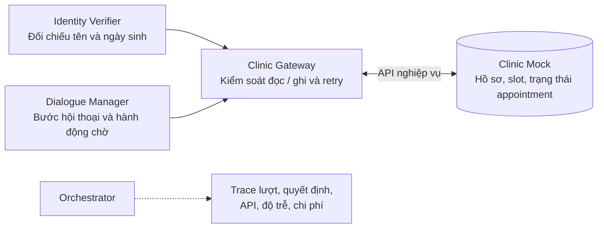

# Plan F-05 — Hoàn thiện Clinic Client/Gateway

**Owner:** B (Hưng) · **Trạng thái:** Đã thực thi 17-09-2026 — xem `docs/evidence/f05-clinic-gateway.md`; đã duyệt (Q-1 fake ở `src/`, Q-2 Protocol từng trang; chuẩn hóa số điện thoại chuyển sang T-01) · **Ngày:** 17-09-2026
**Nguồn:** `docs/task-breakdown.md` §2 (F-05), contract AIHR-PC-001 rev 1.1 §4.2, repo clinic-mock (mentor, commit `5f16851`)

## 1. Mục tiêu và điều kiện hoàn thành

Theo task-breakdown:

> Đối chiếu endpoint, authentication, wrapper và phân trang; chuẩn hóa patient/appointment/slot; bổ sung `unreachable`; thống nhất kết quả lỗi; cung cấp fake theo interface.
> **Điều kiện hoàn thành:** Các thao tác Gateway tương thích Mock thực tế; A có fake để phát triển song song.

Diễn giải thành tiêu chí kiểm được:

| # | Tiêu chí | Cách chứng minh |
| --- | --- | --- |
| AC-1 | Mọi endpoint nghiệp vụ (9 endpoint Bảng 3, trừ `/_harness/*`) gọi đúng path, method, header, body và **đọc hết mọi trang** kết quả | Contract test chạy trên fake **và** trên mock thật (`CLINIC_MOCK_LIVE=1`) cùng pass |
| AC-2 | Thời gian, slot/patient/appointment được chuẩn hóa về một dạng duy nhất trước khi vào engine (số điện thoại: T-01) | Unit test normalizer + Gateway trả đúng khóa canonical |
| AC-3 | Lỗi từ mock (400/401/404/409/422/429/5xx, timeout, mất kết nối) được phân loại thành một tập lỗi cố định; Gateway không rò `httpx` ra ngoài | Unit test từng mã lỗi → đúng exception; `grep httpx` ngoài `tools/` không còn |
| AC-4 | `POST /appointments/{id}/unreachable` đúng §4.2.5 (body chỉ có reason, If-Match, replay cùng key không tăng attempt) | Test trên fake + live |
| AC-5 | `FakeClinicAPI` mô phỏng đúng mock (envelope, mã lỗi, version, idempotency, lifecycle) và A dùng được mà không cần docker | Cùng bộ contract test AC-1 pass trên fake; `tests/engine/test_identity.py`, `test_orchestrator.py` hiện có vẫn pass |
| AC-6 | Bot không bao giờ gọi `/_harness/*` (§4.2.4) | Test `test_contract_clinic_client_never_requests_harness_paths` hiện có giữ nguyên và mở rộng cho endpoint mới |

## 2. Ràng buộc contract liên quan

| Điều khoản | Nội dung áp dụng cho Gateway |
| --- | --- |
| §4.2.2 | Mock là nguồn duy nhất về trạng thái lịch hẹn. Gateway chỉ giữ bản sao chỉ đọc trong `CallContext` (`slots`, `version` đọc gần nhất). |
| §4.2.3 | Mọi write mang `Idempotency-Key` (MUST) và `If-Match` (SHOULD). |
| §4.2.4 | Không gọi `/_harness/*`. |
| §4.2.5 | `/unreachable`: body chỉ `unreachable_reason`; gửi `attempt_count` → 400; mock kiểm tra key trước If-Match; sau 409 VERSION_CONFLICT đọc lại và retry **cùng key**. |
| §1.1.6, SF-02 | Slot đề xuất phải đến từ `GET /slots` trong chính cuộc gọi. |
| §1.1.9 | `GET /patients?phone=` chỉ là tra cứu, không phải bằng chứng danh tính; không tạo patient. |
| Phụ lục A | Mã lỗi HTTP: 400 INVALID_REQUEST · 401 BAD_KEY · 404 NOT_FOUND · 409 SLOT_TAKEN/VERSION_CONFLICT · 429 RATE_LIMITED · 503 UPSTREAM. |

## 3. Hiện trạng (đối chiếu code ngày 17-09)

### 3.1 Bot — `src/callbot/engine/tools/`

| File | Có gì | Ghi chú |
| --- | --- | --- |
| `ports.py` | `Protocol ClinicAPI` 9 phương thức, trả `dict[str, Any]` thô | Chưa có tham số `cursor`/`limit`; docstring chưa định nghĩa shape trả về |
| `clinic_mock_client.py` | `ClinicMockClient(httpx)`: đủ 9 endpoint, Bearer, `Idempotency-Key`/`If-Match` qua `_write_headers`, `mark_unreachable` đúng body §4.2.5 | `raise_for_status()` → rò `httpx.HTTPStatusError` ra ngoài; một `timeout=5.0` chung; không phân trang; không chuẩn hóa phone; không log request_id |
| `clinic_gateway.py` | `ClinicGateway`: đọc (`get_appointment`, `find_patients_by_phone`, `list_open_slots`) + ghi qua `_write` (journal, key `call_id:turn:op`, retry 1 lần khi VERSION_CONFLICT, phân loại 5xx/timeout → `WriteOutcomeUnknown`, connect error → `ClinicWriteRejected`) | Phần **ghi** đã khá hoàn chỉnh (F-03 làm). Phần **đọc** chỉ lấy trang đầu và parse "bao dung" (`data`/`patients`/`items`/`slots`) — dấu hiệu chưa chốt shape |
| `engine/errors.py` | `ClinicWriteRejected(status, code)`, `SlotTaken`, `WriteOutcomeUnknown` | Chỉ cho write; read chưa có lỗi typed |
| `tests/engine/fake_clinic.py` | `FakeClinicAPI` in-memory, có idempotency replay, `writes` log | Xem lệch ở §4.3 |

### 3.2 Mock thật — `clinic-mock/src/clinic_mock/`

Đọc trực tiếp `routes.py`, `schemas.py`, `errors.py`, `lifecycle.py`, `auth.py`, `store.py`:

- Prefix `/v1`; auth Bearer `sk_*` → 401 `BAD_KEY`; cross-tenant → 404 (ẩn tồn tại).
- **Danh sách** (`/patients`, `/slots`, `/appointments?date=`): `{"data": [...], "next_cursor": str|null, "has_more": bool}`; `limit` mặc định 25, kẹp `[1, 100]`; cursor base64 offset.
- `/patients?phone=`: regex `^(02|03|05|07|08|09)\d{8}$` — sai dạng → **400 `INVALID_REQUEST`** (mock có handler `RequestValidationError` → envelope `error` kèm `details[]`). `Patient`: `patient_id, display_name, phone, dob, verify{full_name, dob} | null`.
- `/slots`: `from`/`to` phải RFC3339 đủ giây + offset; `to - from ≤ 14 ngày`; `Slot`: `slot_id, clinic_id, start_time, end_time, provider_id` (**không có** `starts_at`).
- `GET /appointments/{id}`: Listing 3 + `ends_at`, `cancel_reason`, `transfer_reason`, `unreachable_reason`, `confirmed_at`, `confirmed_via`, `new_slot_id`, `attempt_count`, `version`.
- Write: idempotency cache key = `endpoint:Idempotency-Key`; payload hash của confirm/cancel/transfer/reschedule **gồm cả `if_match`**, của unreachable/create **chỉ body**. Cùng key khác payload → **422 `IDEMPOTENCY_CONFLICT`**. Chỉ lưu cache sau khi thành công (409 không được cache → retry với If-Match mới OK).
- Lifecycle (`lifecycle.py`): confirm/cancel/transfer/reschedule từ `{SCHEDULED, BOOKED, CONFIRMED}`; unreachable từ `{SCHEDULED, BOOKED, UNREACHABLE}`; sai → **409 `INVALID_STATE_TRANSITION`**.
- Cancel thiếu `confirmed: true` → **409 `CONFIRMATION_REQUIRED`**.
- Reschedule: slot không còn → 409 `SLOT_TAKEN`; response **tối giản** (`status, new_slot_id, released_slot_id, version`), không phải appointment đầy đủ.
- Create: **201**, replay có header `Idempotent-Replayed: true`; slot bị tiêu thụ khỏi `db.slots`.
- Envelope lỗi: `{"error": {"code", "message", "request_id", "details"?}}`.

## 4. Khoảng cách cần xử lý

### 4.1 Client / Gateway

| # | Vấn đề | Bằng chứng | Ảnh hưởng |
| --- | --- | --- | --- |
| G-1 | Không phân trang: `list_open_slots` và `find_patients_by_phone` chỉ đọc trang đầu (25 bản ghi) | `clinic_gateway.py:57-76`; mock `paginate()` limit 25 | Slot hợp lệ trang 2 không vào `ctx.slots` → bot nói "hết slot" sai; SF-02 chặn slot thật |
| G-2 | Không chuẩn hóa số điện thoại | mock regex chỉ nhận `0xxxxxxxxx`; harness/telephony có thể đưa `+84…` | **Chuyển sang T-01** (`Verifier.prepare()` chuẩn hóa trước khi gọi Gateway). Gateway nhận số đã chuẩn; nếu mock vẫn 400 → lỗi đọc xác định (§5.4) |
| G-3 | Read rò `httpx.HTTPStatusError` lên Dialogue | `clinic_mock_client.py` dùng `raise_for_status()`; `dialogue/manager.py:86` phải `except httpx.HTTPError` | Dialogue (của A) phụ thuộc httpx; lỗi 404/401 khi đọc không phân biệt được |
| G-4 | Parse "bao dung" nhiều khóa (`data`/`patients`/`items`/`slots`) | `clinic_gateway.py:53,70` | Che lỗi shape; fake và mock lệch nhau mà test vẫn xanh |
| G-5 | Slot chỉ chuẩn hóa `starts_at`, không `ends_at`; patient/appointment không chuẩn hóa | `_normalize_slot` | Chưa có định nghĩa shape canonical để A tin cậy |
| G-6 | Timeout đơn 5s, không tách connect/read; không cấu hình được | `ClinicMockClient.__init__` | Ngân sách 8s/lượt (S-03): một read chậm ăn hết lượt |
| G-7 | Không log `request_id`/latency mỗi request | — | R-02 khó truy nguyên khi đối chiếu với writelog của mock |
| G-8 | Mã lỗi ngoài Phụ lục A (`CONFIRMATION_REQUIRED`, `INVALID_STATE_TRANSITION`, `IDEMPOTENCY_CONFLICT`) chưa được nhận diện tường minh | `_write` chỉ xét `VERSION_CONFLICT`, `SLOT_TAKEN` | Rơi vào `ClinicWriteRejected` chung — chấp nhận được, nhưng cần test để chắc không bị coi là "unknown" |
| G-9 | 429 RATE_LIMITED bị coi như từ chối vĩnh viễn | `_write`: `status < 500` → `ClinicWriteRejected` | Lệnh chưa được áp dụng nhưng có thể thử lại — F-05 chỉ phân loại, T-12 quyết định retry |
| G-10 | API key không kiểm tra prefix `sk_` lúc khởi tạo | — | Lỗi cấu hình chỉ lộ khi cuộc gọi đầu tiên 401 |

### 4.2 `/unreachable` (yêu cầu "bổ sung unreachable")

Đã có ở cả Client và Gateway (F-03 làm trước). F-05 chỉ cần **xác nhận bằng test** với mock thật: body chỉ reason, If-Match gửi kèm, replay cùng key + If-Match cũ vẫn 200 và `attempt_count` không tăng, gửi `attempt_count` → 400. Hành vi retry/timeout sâu hơn thuộc T-07.

### 4.3 Fake lệch mock

| # | Fake hiện tại | Mock thật | Hậu quả với A |
| --- | --- | --- | --- |
| K-1 | `{"patients": [...]}`, `{"slots": [...]}` | `{"data": [...], "next_cursor", "has_more"}` | Code A test xanh trên fake, đỏ trên mock |
| K-2 | Slot có `starts_at` | Slot có `start_time`, `end_time`, `provider_id`, `clinic_id` | Normalizer không được test thật |
| K-3 | **Bỏ qua `version`** | 409 VERSION_CONFLICT khi If-Match lệch | Nhánh retry của `_write` chưa từng được chạy trên fake |
| K-4 | Không kiểm tra lifecycle | 409 INVALID_STATE_TRANSITION | A không thấy lỗi khi confirm một lịch đã CANCELLED |
| K-5 | Không có 404 appointment/patient, không có 422 IDEMPOTENCY_CONFLICT, không kiểm tra regex phone | Có | Thiếu nhánh lỗi để A viết policy |
| K-6 | `mark_unreachable` không kiểm tra status trước | Chỉ từ SCHEDULED/BOOKED/UNREACHABLE | — |
| K-7 | Tạo lỗi bằng `httpx.HTTPStatusError` thủ công | — | Fake phụ thuộc httpx; nếu Client đổi sang lỗi typed thì fake phải đổi theo |
| K-8 | Nằm trong `tests/` | — | Chỉ dùng được trong pytest; không chạy được HTTP app local không cần mock |


## 5. Thiết kế — bám theo kiến trúc đã chốt

Thiết kế đích đã có trong `tailieu/AI-callbot-architecture.svg` (Mermaid, node **Clinic Gateway — "Kiểm soát đọc / ghi và retry"**), `tailieu/Luồng nghiệp vụ Callbot.pdf` và `docs/reference/ai-callbot-architecture.md` §1, §3, §4. Mục này **không đề xuất kiến trúc mới**; nó chỉ chỉ ra F-05 phải hoàn thiện những gì để code khớp với thiết kế đó.

### 5.1 Vị trí của Gateway trong kiến trúc

Trích từ SVG (giữ nguyên tên node và cạnh):



Hệ quả cho F-05:

| Thiết kế nói | F-05 phải bảo đảm |
| --- | --- |
| Chỉ **Dialogue Manager** và **Identity Verifier** gọi Gateway | Không module nào khác import `ClinicMockClient`/`httpx`; Gateway là public API duy nhất của `tools/` |
| Gateway **kiểm soát đọc** | Đọc phải đủ (hết trang), đúng shape, và trả dữ liệu Session lưu được (xem 5.3) |
| Gateway **kiểm soát ghi** | Guardrail SF-01/02/05 + FSM + bằng chứng trước mọi write (đã có từ F-03, giữ) |
| Gateway **retry** | Retry là việc của Gateway, không phải Dialogue — F-05 cài phần retry mà contract quy định tường minh (VERSION_CONFLICT), T-12 mở rộng cho lỗi tạm thời |
| Cạnh `GW ↔ MOCK` là "API nghiệp vụ" | `ClinicMockClient` (httpx) và `FakeClinicAPI` chỉ là hai cách cài cạnh này — chi tiết bên trong ô Gateway, không phải thành phần kiến trúc riêng |
| Trace ghi "API, độ trễ, chi phí" | Gateway phải **cung cấp dữ liệu** mỗi API call cho trace của Orchestrator, không chỉ `log.debug` |

### 5.2 Ánh xạ luồng nghiệp vụ → phương thức Gateway

Từ `Luồng nghiệp vụ Callbot.pdf`, mọi ô "…từ hệ thống" hoặc "Ghi…" là một lần đi qua Gateway:

| Ô trong luồng | Hướng | Gateway | Endpoint | F-05 phải làm |
| --- | --- | --- | --- | --- |
| "Lấy hồ sơ bệnh nhân ứng viên từ hệ thống — tra cứu bằng số điện thoại gọi đến" → "Có hồ sơ ứng viên?" | Inbound, **đầu cuộc gọi** | `find_patients_by_phone(phone)` | `GET /patients?phone=` | Nhận số **đã chuẩn hóa** từ Verifier (T-01), đọc hết trang, trả danh sách canonical `{patient_id, full_name, dob, verifiable}` để Session giữ làm "dữ liệu chuẩn nội bộ". Rỗng → Dialogue chuyển máy ngay, không ghi |
| "Lấy lịch hẹn và hồ sơ bệnh nhân từ hệ thống theo mã lịch hẹn đầu vào — giữ họ tên chuẩn và ngày sinh chuẩn" | Outbound, **đầu cuộc gọi** | `get_appointment(ctx)` | `GET /appointments/{id}` | Không đòi `identity_verified` khi **đọc** (SF-03 là cấm *tiết lộ*, không cấm đọc — Output Guard/`assert_can_disclose` lo phần tiết lộ). Trả appointment canonical, `version` để làm If-Match |
| "Tìm và đề xuất giờ trống từ hệ thống" / "Đề xuất giờ trống từ hệ thống" | Cả hai | `list_open_slots(ctx, now)` | `GET /slots` | Đọc hết trang, thay toàn bộ `ctx.slots` (nguồn duy nhất — SF-02), slot canonical có `starts_at`/`ends_at` |
| "Ghi xác nhận đến khám → CONFIRMED" | Outbound | `confirm(ctx)` | `POST …/confirm` | Giữ như hiện tại |
| "Ghi nhận lý do → xác nhận hủy lần hai → Ghi hủy lịch → CANCELLED" | Outbound | `cancel(ctx, reason)` | `POST …/cancel` | Giữ; gửi `confirmed: true` theo mock mentor (`clinic-mock.md` §4 #3) |
| "Đổi lịch nguyên tử — đặt giờ mới và giải phóng giờ cũ → RESCHEDULED" | Outbound | `reschedule(ctx, slot_id)` | `POST …/reschedule` | Giữ; `SLOT_TAKEN` → trả lỗi xác định để Dialogue **đọc lại slot và hỏi lại**, Gateway không tự chọn giờ khác (architecture §4) |
| "Tạo đúng một lịch hẹn → thông báo sau khi ghi thành công → BOOKED" | Inbound | `book(ctx, slot_id)` | `POST /appointments` | Giữ guard `created_appointment_id is None`; xử lý 201 + replay `Idempotent-Replayed` |
| "Ghi nhận chuyển nhân viên trên lịch hẹn của cuộc gọi → TRANSFERRED" | Outbound | `transfer(ctx, reason)` | `POST …/transfer` | Giữ |
| "Chuyển nhân viên — không tạo lịch và không ghi Mock → TRANSFERRED" | Inbound chưa tạo lịch | `transfer(ctx, reason)` | *(không gọi)* | **Mới:** Gateway tự quyết theo hướng gọi và `created_appointment_id` → trả `None`, không gửi gì. Hiện Dialogue phải tự kiểm `ctx.target_appointment_id` (`manager.py:81`); chuyển kiểm tra này vào Gateway để đúng vai "kiểm soát ghi" |
| "Ghi nhận không liên lạc được → UNREACHABLE" | Outbound | `mark_unreachable(ctx, reason)` | `POST …/unreachable` | Giữ (đã chặn inbound); xác nhận §4.2.5 bằng test trên mock thật |
| "Kiểm tra ở mọi bước" (lâm sàng / người thật / ngoài phạm vi / 2 lượt không hiểu) | Cả hai | → `transfer` | — | Không phải việc Gateway; chỉ cần `transfer` đúng hai hàng trên |

Code cũ tra cứu **sau** khi có DOB (`identity.py:64`); luồng đã chốt tra cứu ở **lượt 0** rồi giữ dữ liệu chuẩn trong Session. F-05 bảo đảm hai phương thức đọc trên chạy được ở lượt 0 (không đòi `identity_verified`, không cần journal) và trả dữ liệu serializable; T-01 (`docs/plans/t01-identity-verifier.md` §5) chuyển Verifier sang gọi chúng trong `prepare()` ở lượt 0.

### 5.3 Dữ liệu Gateway trả về — "dữ liệu chuẩn nội bộ"

Luồng nghiệp vụ gọi phần Session giữ là "Mã bệnh nhân, họ tên chuẩn, ngày sinh chuẩn". Contract §4.2.2 cho phép bản sao **chỉ đọc** trong ngữ cảnh cuộc gọi. F-03 yêu cầu mọi trường trong `CallContext` tuần tự hóa được. Vì vậy Gateway trả **dict phẳng, khóa cố định**, không object:

| Loại | Khóa canonical | Nguồn trong mock | Ghi chú |
| --- | --- | --- | --- |
| Ứng viên (inbound) | `patient_id`, `full_name`, `dob` (ISO), `verifiable: bool` | `Patient.patient_id`, `Patient.verify.full_name`, `Patient.verify.dob` | `verify` null → `verifiable=False`, không bịa từ `display_name`. **Không** giữ `phone`/`display_name` trong Session — không cần cho đối chiếu |
| Appointment (outbound) | Listing 3 nguyên khóa + `ends_at`, `version:int`, `attempt_count:int`, `patient.verify` giữ nguyên hoặc `None` | `Appointment` | Session chỉ giữ `appointment_id` và `version`; các trường khác đọc lại khi cần (§4.2.2) |
| Slot | `slot_id`, `clinic_id`, `provider_id`, `starts_at`, `ends_at` (+ `start_time`, `end_time` gốc) | `Slot` | A đang đọc `slot_id`, `starts_at` (`slot_choice.py:316`, `manager.py:253-266`) — giữ tương thích |

Chuẩn hóa nằm ở `tools/normalize.py`: `normalize_slot`, `normalize_patient_candidate`, `normalize_appointment`, `iso_local` (đủ giây + offset cho `from`/`to`). Số điện thoại: `verification/phone.py` (T-01). Không đổi sang dataclass trong F-05 để không chạm code của A.

### 5.4 Kiểm soát lỗi và retry — theo bảng ngoại lệ architecture §4

Bảng §4 của `ai-callbot-architecture.md` đã định hành vi. Gateway đưa mọi lỗi từ mock về **ba lớp kết quả** mà Dialogue/Policy đã biết (`engine/errors.py`):

| Lớp | Khi nào | Gateway làm gì | Dialogue/Policy làm gì (theo §4) |
| --- | --- | --- | --- |
| **Thành công có bằng chứng** | 200/201 | Ghi journal `succeeded`, trả body mock | Chỉ lúc này mới nói "đã ghi nhận" |
| **Từ chối xác định** — `ClinicWriteRejected(status, code, retryable)` | 4xx có envelope; mock chắc chắn **chưa** áp dụng | `VERSION_CONFLICT`: đọc lại version, gửi lại **một lần** cùng key (đã có). `SLOT_TAKEN` → `SlotTaken`. `RATE_LIMITED` → `retryable=True`. `CONFIRMATION_REQUIRED`/`INVALID_STATE_TRANSITION`/`IDEMPOTENCY_CONFLICT`/`NOT_FOUND`/`BAD_KEY` → `retryable=False` | `SlotTaken` → đọc lại slot, đề xuất lại, không tự chọn. Còn lại → `SYSTEM_ERROR`, không báo thành công |
| **Không rõ kết quả** — `WriteOutcomeUnknown` | read timeout, 5xx, mất kết nối giữa chừng | Journal `unknown`; **không** gửi lại, **không** phát sinh lệnh khác (đã có) | Phiên chặn đối soát (F-03); không báo thành công |

Hai bổ sung của F-05 so với hiện tại: (1) phân loại lỗi **đọc** cũng theo cùng cách (hiện đọc rò `httpx`); (2) cờ `retryable` để T-12 cài retry có giới hạn/backoff mà không phải sửa lại phân loại. Bên trong ô Gateway, `ClinicMockClient` và `FakeClinicAPI` cùng raise một `ClinicAPIError(status, code, message, request_id, outcome_known)`; Gateway là nơi duy nhất dịch nó sang ba lớp trên. `httpx` không xuất hiện ngoài `tools/`.

### 5.5 Cạnh "API nghiệp vụ" — `ports.ClinicAPI` (cần A đồng ý, chạm F-01)

Protocol mô phỏng mock **1:1**: một trang mỗi lần gọi, shape thô, cùng mã lỗi — để một bộ contract test chạy được trên cả `FakeClinicAPI` và mock thật.

```python
class Page(TypedDict):
    data: list[dict[str, Any]]
    next_cursor: Optional[str]
    has_more: bool

class ClinicAPI(Protocol):
    def find_patient_by_phone(self, phone: str, cursor: Optional[str] = None, limit: int = 100) -> Page: ...
    def get_slots(self, clinic_id: str, from_: str, to: str, cursor: Optional[str] = None, limit: int = 100) -> Page: ...
    # 7 phương thức còn lại giữ chữ ký hiện tại; mọi phương thức raise ClinicAPIError thay cho httpx.*
```

`phone` truyền vào Protocol đã chuẩn hóa (Verifier lo — T-01). Gateway có `_all_pages(fetch)` lặp cursor tới `has_more == False`, trần 20 trang.

`ClinicMockClient`: `httpx.Timeout(connect=2, read=5, write=5, pool=2)` đọc từ `Settings.clinic_mock_timeout_s` (số cụ thể chốt ở F-01 theo ngân sách 8 s); kiểm tra `sk_` lúc khởi tạo; `_request()` chung đo latency, đọc envelope `error`, raise `ClinicAPIError`; không log body (PII).

### 5.6 Cấp dữ liệu cho Trace

Node Trace trong SVG ghi "API, độ trễ, chi phí". Gateway ghi mỗi API call thành một bản ghi không PII:

```python
@dataclass(frozen=True)
class ApiCallRecord:
    operation: str        # get_appointment | find_patients | list_slots | confirm | ...
    method: str
    path: str
    status: Optional[int]
    code: Optional[str]
    request_id: Optional[str]
    latency_ms: int
    attempt: int
    outcome: Literal["ok", "rejected", "unknown"]
```

Gom theo lượt bằng ContextVar cùng cơ chế với `journal.current_journal()` (đã có ở F-03): Gateway `append`, Orchestrator đọc ra khi dựng event `turn`. F-05 cung cấp bản ghi và hàm đọc; nối vào trace của Orchestrator là R-02 (A).

### 5.7 `FakeClinicAPI` — bản thay thế node Clinic Mock

Kiến trúc không có node "fake"; fake chỉ là cách cài cạnh "API nghiệp vụ" khi không có mock. Vì vậy fake phải **hành xử như `routes.py` của mock**, không có httpx:

- Store `patients/slots/appointments` đúng shape mock; seed = fixture canonical (`pt_3391`/`0912345600`, `apt_00417` v3, `slot_91d2`, `slot_77aa` bị chiếm) + `seed_patient()`, `seed_slot()`, `seed_appointment()`.
- Đọc: phân trang `data/next_cursor/has_more`; regex phone → 400 `INVALID_REQUEST`; `from/to` RFC3339, `to > from`, ≤ 14 ngày → 400; appointment không có → 404.
- Ghi: idempotency cache `endpoint:key` với payload hash **giống mock** (confirm/cancel/transfer/reschedule gồm `if_match`; unreachable/create chỉ body) → 422 `IDEMPOTENCY_CONFLICT`; kiểm tra key **trước** If-Match; If-Match lệch → 409 `VERSION_CONFLICT`; lifecycle → 409 `INVALID_STATE_TRANSITION`; cancel thiếu `confirmed` → 409 `CONFIRMATION_REQUIRED`; reschedule giải phóng slot cũ / `SLOT_TAKEN`; create 201 BOOKED v1 và tiêu thụ slot; unreachable tăng `attempt_count`, replay không tăng.
- Núm cho A và T-12: `fail_next(operation, ClinicAPIError)`, `fail_next(operation, outcome_unknown=True)`, `latency_ms`.
- Quan sát: `requests` (mọi request kể cả replay), `writes` (tương đương `/_harness/writelog`).
- Vị trí: `src/callbot/engine/tools/fake_clinic.py`; `tests/engine/fake_clinic.py` giữ lại như re-export để test của A không đổi import.

### 5.8 Contract test dùng chung fake ↔ mock thật

`tests/engine/tools/test_clinic_api_contract.py`, fixture `api` parametrize `fake` (luôn chạy) và `live` (`ClinicMockClient` thật, skip nếu thiếu `CLINIC_MOCK_LIVE=1`; reset qua `/_harness/reset` **từ fixture test**, không từ Client; báo kênh team theo `clinic-mock.md` §6).

Case: phân trang (>25 bản ghi), phone regex, slot window, 404, VERSION_CONFLICT → retry cùng key, IDEMPOTENCY_CONFLICT, CONFIRMATION_REQUIRED, INVALID_STATE_TRANSITION, SLOT_TAKEN, create 201 + replay, unreachable §4.2.5 (replay không tăng attempt; `attempt_count` trong body → 400), Client không bao giờ chạm `/_harness/*`.

## 6. Các bước thực hiện

| Bước | Việc | File | Phụ thuộc |
| --- | --- | --- | --- |
| 1 | Chốt với A: `ClinicAPIError`, `Page`, `cursor/limit`, timeout, `ApiCallRecord`, Gateway.transfer tự bỏ qua inbound chưa tạo lịch | `ports.py`, evidence F-01 | Trước khi code |
| 2 | `tools/normalize.py` + unit test | `src/callbot/engine/tools/normalize.py`, `tests/engine/tools/test_normalize.py` | — |
| 3 | `ClinicAPIError`, `Page`, `ApiCallRecord` + collector ContextVar; cập nhật Protocol | `ports.py`, `tools/telemetry.py` | 1 |
| 4 | Viết lại `ClinicMockClient` (`_request`, timeout, auth check, telemetry) | `clinic_mock_client.py`, `transports/http/config.py` | 3 |
| 5 | Viết lại `FakeClinicAPI` theo §5.7; re-export ở `tests/engine/fake_clinic.py` | `src/callbot/engine/tools/fake_clinic.py`, `tests/engine/fake_clinic.py` | 3 |
| 6 | Contract test §5.8 trên fake | `tests/engine/tools/test_clinic_api_contract.py` | 4, 5 |
| 7 | Sửa `ClinicGateway`: `_all_pages`, normalize, dịch `ClinicAPIError` → ba lớp §5.4 (+`retryable`), `transfer` tự bỏ qua inbound chưa tạo lịch, bỏ parse bao dung | `clinic_gateway.py`, `engine/errors.py` | 2–5 |
| 8 | Gỡ `httpx` khỏi `dialogue/manager.py` (`except httpx.HTTPError` → `ClinicWriteRejected`); bỏ kiểm tra `target_appointment_id` ở `manager.py:81` nếu A đồng ý — **sửa trong file của A, A review** | `dialogue/manager.py` | 7 |
| 9 | Chạy contract test trên mock thật sau khi báo team | — | 6 |
| 10 | Cập nhật `docs/reference/clinic-mock.md` §5.2/§5.4 (shape canonical, phân lớp lỗi); viết `docs/evidence/f05-clinic-gateway.md` | docs | 9 |
| 11 | `make check` xanh | — | tất cả |

Bước 2→6 không đụng Gateway, làm song song với A; bước 7–8 là điểm hợp nhất, một PR ngắn.

## 7. Phối hợp với A

| A cần từ B | Khi nào |
| --- | --- |
| `FakeClinicAPI` mới (`callbot.engine.tools.fake_clinic`) với seed helper và `fail_next` | Sau bước 5 |
| Bảng khóa canonical (§5.3) để viết template/IE | Sau bước 2 |
| Danh sách `ClinicAPIError.code` và cờ `retryable` cho T-06/T-12 | Sau bước 3 |
| `ApiCallRecord` + hàm đọc theo lượt cho R-02 | Sau bước 3 |

| B cần từ A | Khi nào |
| --- | --- |
| Duyệt thay đổi Protocol (§5.5) và timeout | Bước 1 |
| Đồng ý chuyển kiểm tra "inbound chưa tạo lịch → không ghi transfer" từ Dialogue vào Gateway | Bước 1 |
| Review sửa nhỏ ở `dialogue/manager.py` | Bước 8 |
| Xác nhận IE/templates chỉ đọc `slot_id`, `starts_at` từ slot | Bước 2 |

## 8. Rủi ro và điểm cần duyệt

| # | Điểm cần quyết | Đề xuất của B | Phương án khác |
| --- | --- | --- | --- |
| Q-1 | Vị trí fake | `src/callbot/engine/tools/fake_clinic.py` — chạy app local không cần mock, A import không cần `tests` trong path | Giữ ở `tests/` |
| Q-2 | Protocol trả từng trang hay Client tự gộp? | Từng trang (§5.5) — fake buộc phải mô phỏng phân trang, contract test chung | Client gộp, Protocol trả `list` |
| Q-3 | Chuyển kiểm tra "inbound chưa tạo lịch → không ghi" vào Gateway | Có — đúng vai "kiểm soát ghi" trong SVG; Dialogue gọi `transfer` vô điều kiện | Giữ ở Dialogue như hiện tại |
| Q-5 | `/patients` phone sai định dạng → mock 400 INVALID_REQUEST | Gateway trả lỗi đọc xác định; contract test có case để khóa fake = mock. Chuẩn hóa để không xảy ra: T-01 | — |
| Q-6 | `list_open_slots` cửa sổ `now → now+14d` — dữ liệu mock là 14-10-2026 nên test live tuần này trống | Không sửa trong F-05; ghi cho T-09 (cửa sổ quanh ngày lịch hẹn / theo yêu cầu khách) | — |
| R-1 | Test live trên instance chung có thể phá phiên test của người khác | Báo kênh team trước; mặc định skip | — |
| R-2 | Image chính thức khác bản mentor (cờ `confirmed`, mã lỗi ngoài danh sách) | Client bám contract; mã ngoài danh sách chỉ để phân loại, không rẽ nhánh nghiệp vụ | — |
| R-3 | `find_patients_by_phone` / `get_appointment` được gọi ở lượt 0 trong `opening()` — chưa có journal lệnh (journal chỉ bind trong `run_turn`) | Hai phương thức này là **đọc**, không đi qua `_write`/journal nên không phụ thuộc `current_journal()`; thêm test gọi chúng ngoài `run_turn` để khóa | — |

## 9. Ngoài phạm vi F-05

- Retry có giới hạn/backoff cho `retryable=True` và outcome-unknown → **T-12**.
- `/unreachable` khi timeout chưa rõ kết quả, retry cùng key nhiều lần → **T-07**.
- Cửa sổ slot theo yêu cầu khách, đổi lịch nguyên tử, tạo đúng một appointment → **T-09**.
- Chuẩn hóa số điện thoại, Verifier `prepare()` ở lượt 0 và đối chiếu với dữ liệu đã giữ → **T-01** (`docs/plans/t01-identity-verifier.md`); hook vào `opening()` → **T-02** (A).
- Nối `ApiCallRecord` vào trace lượt → **R-02** (A).

## 10. Định nghĩa hoàn thành → evidence

`docs/evidence/f05-clinic-gateway.md` theo `TEMPLATE.md`: mỗi AC ở §1 một dòng (vị trí code + tên test); bảng §5.2 đánh dấu từng ô luồng đã có phương thức Gateway tương ứng và test; kết quả `make check`; lệnh chạy live (`CLINIC_MOCK_LIVE=1 python -m pytest tests/engine/tools -q`) kèm ngày giờ và người đã được báo trên kênh team.
