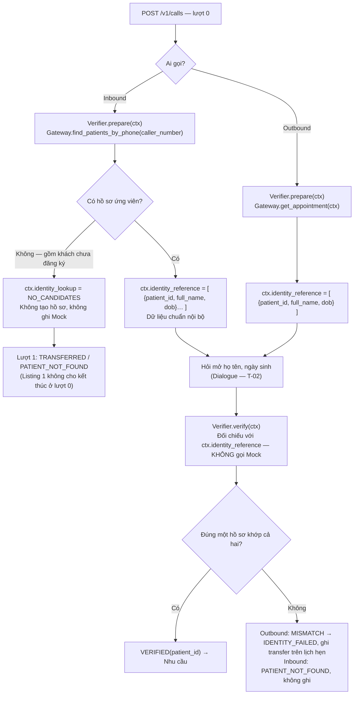

# Plan T-01 — Identity Verifier

**Owner:** B (Hưng) · **Trạng thái:** Đã duyệt 17-09-2026 (chuẩn hóa số điện thoại thuộc T-01, nằm trong `prepare()`) · **Ngày:** 17-09-2026
**Nguồn:** `docs/task-breakdown.md` §3 (T-01); `tailieu/Luồng nghiệp vụ Callbot.pdf` (nhánh Inbound/Outbound tới "Nhu cầu"); `tailieu/AI-callbot-architecture.svg` (node Identity Verifier → Clinic Gateway); contract AIHR-PC-001 rev 1.1 §1.1.1–1.1.2, §1.1.9, §4.2.2, SF-03
**Phụ thuộc:** F-05 (phân trang `/patients`, dữ liệu canonical, `FakeClinicAPI` mới) — `docs/plans/f05-clinic-gateway.md`

## 1. Mục tiêu và điều kiện hoàn thành

Theo task-breakdown:

> Đọc hồ sơ outbound; tra cứu ứng viên inbound; đối chiếu tên và DOB; trả kết quả **khớp / không khớp / không xác định được hồ sơ**; không tạo patient.
> **Điều kiện hoàn thành:** Xác minh đúng theo từng hướng gọi; **không tự chọn hồ sơ đầu tiên**.

Luồng nghiệp vụ đã chốt (PDF) quy định **thứ tự**: đọc hồ sơ từ hệ thống **ngay đầu cuộc gọi** → giữ "dữ liệu chuẩn nội bộ" (mã bệnh nhân, họ tên chuẩn, ngày sinh chuẩn) trong Session → hỏi mở tên/DOB → đối chiếu với dữ liệu đã giữ. Code hiện tại làm ngược (hỏi xong mới tra cứu) — plan này đưa code về đúng luồng.

Tiêu chí kiểm được:

| # | Tiêu chí | Luồng PDF | Cách chứng minh |
| --- | --- | --- | --- |
| AC-1 | **Inbound, đầu cuộc gọi:** tra cứu bằng số gọi đến (đã chuẩn hóa, đủ trang); không có ứng viên (gồm khách chưa đăng ký) → kết quả `PATIENT_NOT_FOUND`, **không hỏi tên/DOB**, không ghi Mock | "Lấy hồ sơ bệnh nhân ứng viên…" → "Có hồ sơ ứng viên?" → Không → "Cần nhân viên hỗ trợ — Bot không tạo hồ sơ" | Unit test `prepare()`; test qua orchestrator: lượt 1 `TRANSFERRED/PATIENT_NOT_FOUND`, `fake.writes == []` |
| AC-2 | **Inbound, có ứng viên:** giữ `{patient_id, full_name, dob}` của **mọi** ứng viên trong Session; chỉ sau đó mới hỏi tên/DOB | "Giữ thông tin đối chiếu của các hồ sơ" | `ctx.identity_reference` có N phần tử sau `prepare()`; opening vẫn là câu hỏi mở tên |
| AC-3 | **Outbound, đầu cuộc gọi:** đọc lịch hẹn theo `appointment_id`; giữ họ tên chuẩn + ngày sinh chuẩn của bệnh nhân lịch hẹn | "Lấy lịch hẹn và hồ sơ bệnh nhân… theo mã lịch hẹn đầu vào" | `ctx.identity_reference` có 1 phần tử; `fake.requests` có đúng 1 `GET /appointments/{id}` ở lượt 0 |
| AC-4 | **Đối chiếu** dùng dữ liệu đã giữ, **không gọi Mock lần nữa**; outbound: khớp cả hai → `VERIFIED`, khác → `MISMATCH`; inbound: **đúng một** hồ sơ khớp cả hai → `VERIFIED(patient_id)`, 0 hoặc ≥2 → `PATIENT_NOT_FOUND` | "Đối chiếu… với thông tin chuẩn từ hệ thống" → "Đúng một hồ sơ khớp cả hai?" / "Danh tính khớp?" | Unit test `verify()` với fake: số request tới mock **không tăng** khi verify |
| AC-5 | Không bao giờ chọn hồ sơ đầu tiên khi có nhiều ứng viên | "Đúng một hồ sơ khớp cả hai?" | 2 ứng viên cùng số, 1 khớp → VERIFIED đúng người; 2 khớp → PATIENT_NOT_FOUND |
| AC-6 | Không tạo patient, không ghi gì vào Mock trong toàn bộ quá trình tra cứu + đối chiếu | "Bot không tạo hồ sơ bệnh nhân" | `fake.writes == []`; `fake.requests` chỉ có GET |
| AC-7 | Dữ liệu chuẩn nội bộ **không lọt** vào IE, trace, `BotAction`, `repr` kết quả (SF-03, §1.1.2) | "Dữ liệu chuẩn nội bộ" (đường chấm trong PDF) | Test `build_turn_context(ctx)` không chứa `identity_reference`; `repr(result)`/`to_trace()` không chứa `full_name`/`dob`; test disclosure hiện có trong `test_identity.py` giữ nguyên |
| AC-8 | Hồ sơ thiếu `verify`/`dob` sai định dạng → không khớp (fail-closed), không ném ngoại lệ | — | Unit test |
| AC-9 | Không có `caller_number` hoặc số không hợp lệ → không gọi Mock, `PATIENT_NOT_FOUND` | "Không — gồm khách chưa đăng ký" | `fake.patient_lookups == []` |

## 2. Ràng buộc contract liên quan

| Điều khoản | Áp dụng cho Verifier |
| --- | --- |
| §1.1.1 | Outbound: số được gọi **không** là bằng chứng; phải có họ tên + ngày sinh, **đối chiếu cả hai**; thất bại → chuyển máy không tiết lộ gì. |
| §1.1.2 | Hỏi mở, không đọc thông tin ra rồi hỏi "đúng không" → dữ liệu chuẩn giữ trong Session **không được** đi vào câu thoại, IE, trace. |
| §1.1.9 | Inbound: phải tìm được bản ghi trước khi đề xuất; vẫn hỏi tên + DOB; **"không có bản ghi nào khớp duy nhất" → `PATIENT_NOT_FOUND`**; không tạo patient. |
| §4.2.2 | Cho phép bản sao **chỉ đọc** trong ngữ cảnh cuộc gọi — cơ sở để giữ `{patient_id, full_name, dob}` trong Session; không lưu trạng thái lịch hẹn. |
| §2.1 rev 1.1 | Inbound TRANSFERRED: harness chấm `outcome` và writelog rỗng; `transfer_reason` không chấm. |
| Listing 1 | Response `POST /v1/calls` **không có** `ended`/`outcome` → cuộc gọi không thể kết thúc ở lượt 0; "chuyển nhân viên" khi không có ứng viên chỉ phát ra được ở **lượt 1**. |
| SF-03 | Không tiết lộ chi tiết lịch hẹn trước khi xác minh. |

## 3. Hiện trạng (code cũ — `src/callbot/engine/verification/`)

| File | Có gì | So với luồng PDF |
| --- | --- | --- |
| `identity.py` | `VerificationStatus {VERIFIED, MISMATCH, PATIENT_NOT_FOUND}`; `matches()` bool; `verify(ctx)` **tự gọi Gateway** lúc đối chiếu (outbound `get_appointment`, inbound `find_patients_by_phone`) | **Sai thứ tự**: tra cứu sau khi đã hỏi xong DOB; không có bước "Có hồ sơ ứng viên?" ở đầu; không giữ gì trong Session |
| `names.py` | `normalize_name` (NFC, lowercase, bỏ dấu, gộp khoảng trắng) | Dùng lại nguyên |
| `session/context.py` (A) | `identity_step`, `claimed_name`, `claimed_dob`, `patient_id` | **Thiếu** trường giữ "dữ liệu chuẩn nội bộ" |
| `dialogue/manager.py:70-73` (A) | `opening()` chỉ chào + hỏi tên | **Thiếu** bước tra cứu đầu cuộc gọi |
| `dialogue/manager.py:141-147` (A) | Sau DOB: `verifier.verify(ctx)` → `!= VERIFIED` → transfer | Giữ điểm gọi; đổi nguồn dữ liệu |
| `orchestrator.build_turn_context` (A) | IE chỉ nhận `question_id, direction, now, slots` | Đã cách ly đúng; cần test khóa để trường mới không lọt |
| `tests/engine/test_identity.py` | 13 case qua orchestrator; kiểm tra không lộ, không ghi trái phép | Giữ; **kỳ vọng thay đổi** ở TC_ID_13 (xem §6 bước 7) |

## 4. Khoảng cách cần xử lý

| # | Vấn đề | Bằng chứng | Ảnh hưởng |
| --- | --- | --- | --- |
| V-1 | **Thời điểm tra cứu sai luồng**: hỏi tên → hỏi DOB → mới tra cứu | `identity.py:55-76`; `manager.py:70` | Inbound không có hồ sơ vẫn bị hỏi 2 lượt vô ích rồi mới chuyển máy; khác hoàn toàn ô "Có hồ sơ ứng viên?" trong PDF |
| V-2 | Không giữ dữ liệu chuẩn trong Session | `context.py` | Mỗi lần verify lại gọi Mock; restart/worker khác giữa lượt phải đọc lại; không đúng "Giữ thông tin đối chiếu" |
| V-3 | Inbound gộp "0 ứng viên / có nhưng không khớp / ≥2 khớp" | `identity.py:73-76` | Trace không phân biệt; không tách được nhánh "Không — gồm khách chưa đăng ký" (đầu cuộc gọi) với "Không xác định được một hồ sơ khớp" (sau đối chiếu) |
| V-4 | `verify: null` → `TypeError` | mock `Patient.verify: PatientVerify \| None`; `identity.py:36` | SYSTEM_ERROR thay vì fail-closed |
| V-5 | `caller_number` chưa chuẩn hóa; `+84…` → 400 | `identity.py:64`; mock regex | SYSTEM_ERROR thay vì PATIENT_NOT_FOUND. **T-01 làm**: `verification/phone.py::normalize_phone`, gọi ở bước đầu `prepare()` |
| V-6 | Chỉ trang đầu `/patients` | F-05 G-1 | Bỏ sót ứng viên |
| V-7 | `TODO hỏi PO` về thiếu `caller_number` | `identity.py:63` | Đóng: Bảng 3 chỉ có tra cứu theo phone → không phone = không ứng viên = PATIENT_NOT_FOUND |
| V-8 | Không có trace không-PII cho tra cứu và đối chiếu | — | R-02/T-06 |
| V-9 | Không có unit test trực tiếp Verifier/`names.py` | `tests/engine/` không có `verification/` | Lỗi chỉ lộ qua test orchestrator của A |

## 5. Thiết kế — theo luồng PDF

### 5.1 Hai pha, một điểm chạm Gateway



- **`prepare(ctx)`** — chạy trong `opening()` (lượt 0), là **lần duy nhất** Verifier đi qua Gateway. Ghi kết quả vào Session.
- **`verify(ctx)`** — chạy sau khi có `claimed_name` + `claimed_dob`, chỉ đọc `ctx.identity_reference`. Không có I/O → chạy được trên worker khác, sau restart, và khi harness gửi lại lượt.

### 5.2 Dữ liệu chuẩn nội bộ trong Session (cần A thêm vào `CallContext`)

```python
# session/context.py — SCHEMA_VERSION += 1
IdentityLookup = Literal["PENDING", "LOADED", "NO_PHONE", "NO_CANDIDATES", "UNAVAILABLE"]

identity_lookup: IdentityLookup = "PENDING"
# Mỗi phần tử: {"patient_id": str, "full_name": str | None, "dob": "YYYY-MM-DD" | None, "verifiable": bool}
# Outbound: đúng 1 phần tử (bệnh nhân của lịch hẹn). Inbound: mọi ứng viên GET /patients trả về.
identity_reference: list[dict[str, Any]] = field(default_factory=list)
```

- Chỉ giữ đúng ba giá trị luồng PDF nêu (+ `verifiable`); **không** giữ `display_name`, `phone`, trạng thái lịch hẹn (§4.2.2).
- Dict phẳng để `to_dict/from_dict` của F-03 không cần sửa.
- `build_turn_context()` (IE) và trace của Orchestrator **không đọc** hai trường này — khóa bằng test AC-7.

### 5.3 API Verifier

```python
class LookupStatus(str, Enum):
    LOADED = "LOADED"                   # có dữ liệu chuẩn để đối chiếu
    NO_PHONE = "NO_PHONE"               # inbound: không có / không chuẩn hóa được caller_number
    NO_CANDIDATES = "NO_CANDIDATES"     # inbound: GET /patients rỗng — gồm khách chưa đăng ký
    UNAVAILABLE = "UNAVAILABLE"         # Gateway lỗi (404 appointment, mock lỗi, timeout)

@dataclass(frozen=True)
class PrepareResult:
    status: LookupStatus
    candidates: int = 0
    error_code: Optional[str] = None    # ClinicAPIError.code khi UNAVAILABLE
    @property
    def transfer_reason(self) -> Optional[TransferReason]:
        # NO_PHONE / NO_CANDIDATES → PATIENT_NOT_FOUND ; UNAVAILABLE → SYSTEM_ERROR ; LOADED → None
    def to_trace(self) -> dict[str, Any]: ...

class VerificationStatus(str, Enum):
    VERIFIED = "VERIFIED"
    MISMATCH = "MISMATCH"               # outbound: hồ sơ đích không khớp tên hoặc DOB
    PATIENT_NOT_FOUND = "PATIENT_NOT_FOUND"  # inbound: không có đúng một hồ sơ khớp cả hai

class MatchDetail(str, Enum):           # lý do, không chứa giá trị hồ sơ
    NAME_AND_DOB_MATCH = "NAME_AND_DOB_MATCH"
    NAME_MISMATCH = "NAME_MISMATCH"
    DOB_MISMATCH = "DOB_MISMATCH"
    BOTH_MISMATCH = "BOTH_MISMATCH"
    RECORD_UNVERIFIABLE = "RECORD_UNVERIFIABLE"   # verify null / dob sai định dạng
    AMBIGUOUS = "AMBIGUOUS"                       # inbound: ≥ 2 hồ sơ khớp cả hai

@dataclass(frozen=True)
class VerificationResult:
    status: VerificationStatus
    detail: MatchDetail
    patient_id: Optional[str] = None
    candidates: int = 0
    @property
    def transfer_reason(self) -> Optional[TransferReason]: ...   # bảng §5.5
    def to_trace(self) -> dict[str, Any]: ...

class IdentityVerifier:
    def __init__(self, gateway: ClinicGateway) -> None: ...
    def prepare(self, ctx: CallContext) -> PrepareResult:
        """Lượt 0. Đọc qua Gateway, ghi ctx.identity_lookup / ctx.identity_reference. Không ghi Mock."""
    def verify(self, ctx: CallContext) -> VerificationResult:
        """Sau khi có claimed_name + claimed_dob. Chỉ đọc ctx.identity_reference; không I/O.
        ValueError nếu identity_lookup != LOADED hoặc thiếu claimed_* (lỗi lập trình của Dialogue)."""
```

`matches()` giữ như wrapper bool để export `verification/__init__.py` không đổi.

### 5.4 `prepare(ctx)` theo hướng gọi

**Inbound**

```text
phone = normalize_phone(ctx.call.caller_number)                  # verification/phone.py — bước đầu của prepare()
phone is None  → identity_lookup = NO_PHONE,      reference = []   (không gọi Mock)
candidates = gateway.find_patients_by_phone(phone)               # đủ trang, canonical
len == 0       → identity_lookup = NO_CANDIDATES, reference = []
len ≥ 1        → identity_lookup = LOADED, reference = [ {patient_id, full_name, dob, verifiable} … ]
ClinicAPIError → identity_lookup = UNAVAILABLE,   reference = [], error_code
```

**Outbound**

```text
appointment = gateway.get_appointment(ctx)                       # SF-01: đúng appointment_id của cuộc gọi
reference = [ {patient_id: appointment.patient.patient_id,
               full_name: appointment.patient.verify.full_name | None,
               dob:       appointment.patient.verify.dob       | None,
               verifiable: verify đủ và dob parse được} ]
identity_lookup = LOADED
ClinicAPIError (404, mock lỗi, timeout) → UNAVAILABLE, error_code
```

`prepare` **không** quyết định lời thoại hay kết thúc — trả `PrepareResult`, Dialogue (T-02) quyết: `LOADED` → chào + hỏi mở tên; khác → chào ngắn, lượt 1 chuyển máy với `transfer_reason` tương ứng (inbound không ghi; outbound `UNAVAILABLE` chỉ ghi transfer nếu Gateway còn đọc được — nếu không thì chỉ trả outcome).

### 5.5 `verify(ctx)` — đối chiếu với dữ liệu đã giữ

`match_record(claimed_name, claimed_dob, ref) -> MatchDetail`:

1. `ref.verifiable == False` → `RECORD_UNVERIFIABLE` (fail-closed; không bịa từ `display_name`).
2. Tên: `normalize_name(claimed) == normalize_name(ref.full_name)` — **khớp chính xác toàn chuỗi** sau chuẩn hóa; không fuzzy, không bỏ họ. Làm sạch câu nói là việc của IE.
3. DOB: `date ==`.

| Direction | Kết quả đối chiếu | Status | transfer_reason | Luồng PDF |
| --- | --- | --- | --- | --- |
| outbound | khớp cả hai | VERIFIED(patient_id) | — | "Danh tính khớp? Có" |
| outbound | khác | MISMATCH(detail) | `IDENTITY_FAILED` | "Không → Ghi nhận chuyển nhân viên trên lịch hẹn của cuộc gọi" |
| inbound | đúng 1 ứng viên khớp cả hai | VERIFIED(patient_id, candidates=N) | — | "Đúng một hồ sơ khớp cả hai? Có" |
| inbound | 0 khớp | PATIENT_NOT_FOUND(detail tốt nhất*, N) | `PATIENT_NOT_FOUND` | "Không xác định được một hồ sơ khớp → Chuyển nhân viên, không ghi" |
| inbound | ≥ 2 khớp | PATIENT_NOT_FOUND(AMBIGUOUS, N) | `PATIENT_NOT_FOUND` | như trên |

\* ưu tiên `DOB_MISMATCH`/`NAME_MISMATCH` (sai một yếu tố) hơn `BOTH_MISMATCH` — chỉ để trace, không ảnh hưởng quyết định.

### 5.6 Cách ly dữ liệu chuẩn (AC-7)

| Nơi có thể rò | Cơ chế chặn | Test |
| --- | --- | --- |
| IE | `build_turn_context` liệt kê tường minh trường được truyền; không truyền `identity_reference` | `test_turn_context_excludes_identity_reference` |
| Trace | Orchestrator chỉ trace `result.to_trace()` (status/detail/candidates), không dump ctx | `to_trace()` không chứa `full_name`/`dob` |
| `BotAction.utterance` | Verifier không sinh lời thoại; Dialogue chỉ dùng `status`/`transfer_reason`, không dùng `detail` để nói "ngày sinh chưa khớp" (= xác nhận tên đúng → rò một nửa) | Test disclosure hiện có trong `test_identity.py` |
| Log | `logger.info` chỉ ghi `to_trace()` | review |

## 6. Các bước thực hiện

| Bước | Việc | File | Phụ thuộc |
| --- | --- | --- | --- |
| 1 | Chốt với A: hai trường `CallContext` (§5.2, bump `SCHEMA_VERSION`), hook `prepare()` trong `opening()`, cách xử lý lượt 1 khi không `LOADED` | `context.py`, `manager.py` | Trước khi code |
| 2 | `MatchDetail`, `match_record`, `VerificationResult` mới; giữ `matches()` | `verification/identity.py`, `__init__.py` | — |
| 3 | Unit test `names.py` (NFC/NFD, `đ/Đ`, hoa/thường, khoảng trắng, có/không dấu, `Hà`=`Hạ` ghi nhận) và `match_record` (4 kết quả, `verifiable=False`, dob sai định dạng) | `tests/engine/verification/test_names.py`, `test_match_record.py` | 2 |
| 4 | `verification/phone.py::normalize_phone` (+ unit test: `+84`, `84`, khoảng trắng/gạch, đầu số ngoài danh sách → `None`); `LookupStatus`, `PrepareResult`, `IdentityVerifier.prepare()` theo §5.4; xóa TODO | `verification/phone.py`, `verification/identity.py`, `tests/engine/verification/test_phone.py` | F-05 bước 7 |
| 5 | `IdentityVerifier.verify()` theo §5.5 — chỉ đọc `ctx.identity_reference` | `verification/identity.py` | 2, 4 |
| 6 | Unit test Verifier với `FakeClinicAPI` mới: **prepare** — inbound không phone / `+84` chuẩn hóa được / số sai đầu số / 0 ứng viên / N ứng viên; outbound đọc đúng appointment / 404 → UNAVAILABLE; **verify** — outbound khớp / sai tên / sai DOB / sai cả hai / `verifiable=False`; inbound 1 khớp / 0 khớp / 2 ứng viên 1 khớp (AC-5) / 2 khớp (AMBIGUOUS); mọi case: số request tới fake không tăng khi `verify`, `fake.writes == []`, `repr` không chứa giá trị hồ sơ | `tests/engine/verification/test_identity_verifier.py` | 4, 5, F-05 bước 5 |
| 7 | Cập nhật `identity_cases.py` (test của A, B thêm case, A review): TC_ID_13 (phone lạ) **đổi kỳ vọng** → lượt 1 đã `TRANSFERRED/PATIENT_NOT_FOUND`, không hỏi tên; thêm TC_ID_14 inbound phone đúng + tên sai → sau DOB `TRANSFERRED/PATIENT_NOT_FOUND`; TC_ID_15 inbound 2 ứng viên cùng số, 1 khớp → `AWAITING_INTENT`; TC_ID_16 `caller_number="+84912345600"` → lookup `"0912345600"`; TC_ID_17 outbound `verify: null` → `IDENTITY_FAILED` | `tests/engine/identity_cases.py`, fake seed 2 patient cùng số | 6, A hoàn tất hook ở bước 1 |
| 8 | Test AC-7: `build_turn_context` không chứa `identity_reference`; `to_trace()` không PII | `tests/engine/verification/test_isolation.py` | 4 |
| 9 | Cập nhật docstring module; viết `docs/evidence/t01-identity-verifier.md` | docs | tất cả |
| 10 | `make check` xanh | — | — |

Bước 2–3 không phụ thuộc gì, làm ngay. Bước 4–6 chờ F-05 (`normalize_phone`, canonical, fake). Bước 7 chờ A nối `prepare()` vào `opening()` (T-02).

## 7. Phối hợp với A

| A cần từ B | Khi nào |
| --- | --- |
| Đặc tả hai trường `CallContext` (§5.2) và dict phần tử | Bước 1 |
| `PrepareResult`/`LookupStatus` để `opening()` chọn lời chào và lượt 1 chuyển máy | Sau bước 4 |
| `MatchDetail` để T-02 quyết định hỏi lại hay chuyển máy (theo giới hạn hỏi lại) | Sau bước 2 |
| `to_trace()` của cả hai kết quả cho R-02 | Sau bước 4 |

| B cần từ A | Khi nào |
| --- | --- |
| Thêm `identity_lookup`, `identity_reference` vào `CallContext` + bump `SCHEMA_VERSION` (hoặc cho B thêm, A review) | Bước 1 |
| Gọi `verifier.prepare(ctx)` trong `opening()`; khi không `LOADED`: lời chào ngắn, lượt 1 `transfer(prepare.transfer_reason)` bất kể input | T-02 |
| Không dùng `detail` để nói cho người gọi yếu tố nào sai | T-02 |
| Cho phép B sửa kỳ vọng TC_ID_13 và thêm TC_ID_14–17 trong `identity_cases.py` | Bước 7 |

## 8. Rủi ro và điểm cần duyệt

| # | Điểm cần quyết | Đề xuất của B | Phương án khác |
| --- | --- | --- | --- |
| Q-1 | Lượt 0 không kết thúc được (Listing 1): khi `NO_CANDIDATES`, lượt 0 nói gì? | Lời chào ngắn kiểu "Dạ, em xin nối máy tới nhân viên hỗ trợ" (không hỏi tên); lượt 1 → `TRANSFERRED/PATIENT_NOT_FOUND`. State lượt 0 vẫn `AWAITING_IDENTITY` (Phụ lục A không có state khác phù hợp) | Vẫn hỏi tên ở lượt 0 rồi chuyển ở lượt 1 — không đúng luồng "Không → chuyển nhân viên" |
| Q-2 | Inbound có ứng viên nhưng sai tên/DOB: `PATIENT_NOT_FOUND` hay `IDENTITY_FAILED`? | `PATIENT_NOT_FOUND` — bám §1.1.9 và ô "Không xác định được một hồ sơ khớp"; `detail` vẫn ghi `NAME_MISMATCH`/`DOB_MISMATCH` cho trace | `IDENTITY_FAILED` — lệch chữ contract |
| Q-3 | Mức khớp tên | Chính xác sau chuẩn hóa; nới lỏng = false-accept | Knob `name_match` mặc định exact, chỉ bật nếu tester báo từ chối nhầm nhiều |
| Q-4 | Outbound `UNAVAILABLE` (404 appointment / mock lỗi ở lượt 0) | Lượt 1 `TRANSFERRED/SYSTEM_ERROR`; Gateway.transfer thử ghi, thất bại thì chỉ trả outcome (architecture §4) | — |
| Q-5 | Giữ `full_name`/`dob` chuẩn trong Session Postgres | Đúng luồng PDF và §4.2.2; dữ liệu tổng hợp; xóa cùng phiên khi kết thúc | Chỉ giữ `patient_id`, đọc lại Mock lúc verify — trái luồng |
| Q-6 | `verify: null` → fallback `display_name`? | Không — viết tắt, so khớp sẽ false-accept; `RECORD_UNVERIFIABLE` | — |
| R-1 | Người gọi đọc tên thiếu họ → MISMATCH | Chấp nhận; T-02 hỏi "họ và tên đầy đủ" trước khi gọi `verify` | — |
| R-2 | Hai người cùng số, cùng tên, cùng DOB → AMBIGUOUS → chuyển máy | Đúng "khớp duy nhất"; không tự chọn | — |
| R-3 | Dữ liệu chuẩn nằm trong `CallContext` — code sau này có thể vô tình đưa vào IE/trace | Test AC-7 chạy trong CI; comment cảnh báo trên trường | — |

## 9. Ngoài phạm vi T-01

- Lời chào, câu hỏi mở, giới hạn hỏi lại, xử lý DOB không hợp lệ, hook `prepare()` trong `opening()`, xử lý lượt 1 khi không `LOADED` → **T-02** (A).
- Phân trang, canonical, fake → **F-05** (B).
- Đưa `to_trace()` vào trace lượt → **R-02** (A).

## 10. Định nghĩa hoàn thành → evidence

`docs/evidence/t01-identity-verifier.md` theo `TEMPLATE.md`: bảng AC-1..AC-9 ↔ test (kèm cột "ô luồng PDF"); bảng Q-1..Q-6 đã chốt với ai/khi nào; số request tới fake ở lượt 0 và lúc verify (chứng minh "một điểm chạm Gateway"); `make check`; số test danh tính (13 hiện có với TC_ID_13 đổi kỳ vọng + 4 case mới + unit test trực tiếp).
