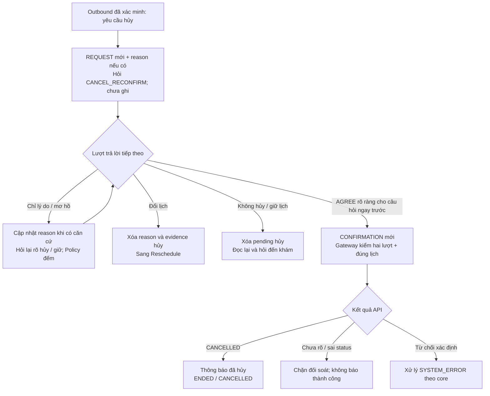
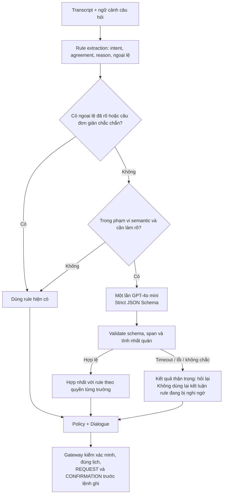

# Plan T-05 — Hội thoại Cancel

**Owner:** A (Hoàn) · **Ngày:** 22-09-2026 · **Baseline khảo sát:** `main`, `7f6c4a1`.

**Trạng thái:** đã triển khai ngày 22-09-2026. §1–§7 (hội thoại Cancel) xong toàn bộ. §8 (tầng ngữ nghĩa GPT-4o mini, bổ sung sau review) xong bước 1–6 và 8; **bước 7 — đánh giá model thật — chưa chạy**; tầng ngữ nghĩa bật mặc định theo quyết định owner 22-09-2026, **trước** khi chạy bước 7 (máy thiếu `OPENAI_API_KEY` tự về chỉ-luật). Kết quả thực chạy: [evidence T-05](../evidence/t05-cancel-dialogue.md).

## 1. Mục tiêu và căn cứ

Hoàn thiện hội thoại hủy lịch outbound: ghi nhận yêu cầu và lý do, hỏi xác nhận hủy lần hai, xử lý đổi ý / mơ hồ; chỉ báo `CANCELLED` khi Gateway trả kết quả hủy thành công. Yêu cầu hủy và xác nhận phải ở **hai lượt người gọi khác nhau**.

Nguồn đã đối chiếu với code hiện tại:

| Nguồn | Áp dụng cho T-05 |
| --- | --- |
| [Task breakdown](../task-breakdown.md), T-05 và §7 | Owner A; xác nhận lần hai rõ ràng; không dùng đồng ý mơ hồ để mở khóa hủy; không báo thành công trước API |
| [Kiến trúc](../reference/ai-callbot-architecture.md), §3.2–§4.3 | Outbound hủy đúng lịch sau xác minh; inbound yêu cầu hủy → `OUT_OF_SCOPE`; reason hợp lệ; lỗi ghi phải được phân biệt |
| [Thiết kế IE](../reference/information-extraction-design.md), §5.6, §5.8, §6.1 | Cần động từ hủy tường minh; không suy diễn reason; **không bắt buộc hỏi lý do**; nếu hỏi chỉ một lần sau xác nhận lần hai; ngưỡng mơ hồ / không hiểu khác nhau |
| [F-04](../evidence/f04-information-extraction-http.md) | Đã có Cancel cơ bản qua Orchestrator và HTTP; evidence cũ phải đọc cùng cập nhật T-04/T-08 |
| [T-03](../evidence/t03-gateway-confirm-cancel-transfer.md) | Gateway đã kiểm SF-01/SF-05, reason, `confirmed=true`, idempotency và version; do B sở hữu |
| [T-04](../evidence/t04-confirm-dialogue.md) | Mẫu kiểm status API trước báo thành công; 2xx sai status phải chặn đối soát; ngưỡng Confirm không được áp sang Cancel |
| [T-08](../evidence/t08-silence-line-signal.md) | Xác nhận phải trả lời câu hỏi ở lượt ngay trước; nhắc im lặng / xin nhắc lại phải phát lại đúng câu đang chờ |
| [F-03](../evidence/f03-session-store.md) | Journal và tombstone; kết quả ghi chưa rõ → đối soát; không phát thêm lệnh ghi; xóa nội dung sau ghi Clinic |
| [T-02](../evidence/t02-identity-dialogue.md) | Xác minh trước tiết lộ lịch; ý định nói ở bước danh tính không thay thế yêu cầu / xác nhận sau xác minh |

Phụ thuộc nền đã có: F-03/F-04, T-02, T-03 và hành vi T-08. T-12 phụ trách phục hồi lỗi ghi mở rộng; không chờ T-12 để làm hội thoại với Gateway/fake hiện có.

## 2. Hiện trạng và khoảng trống

Đã có: `DialogueManager._start(CANCEL)`, `_cancel_reconfirm`, `_abandon`; `cancel_reason` và `ActionEvidence` trong `CallContext`; IE ánh xạ năm reason; guardrail đòi REQUEST trước CONFIRMATION và đúng câu hỏi/lượt. Test nền nằm ở `test_orchestrator.py`, `test_agreement.py`, `test_extractor.py`, `test_context_fsm.py`, `test_clinic_gateway.py` và HTTP.

Ngày 22-09 đã chạy các chuỗi dưới đây bằng **Orchestrator thật + FakeClinicAPI + RedisSessionStore trên fakeredis**, sau xác minh bằng dữ liệu fixture. Đây là khảo sát baseline, không phải kết quả test T-05 hay kiểm chứng Mock thật.

| ID | Khoảng trống | Bằng chứng hiện tại | Đích xử lý |
| --- | --- | --- | --- |
| G-1 | Bỏ lý do ở lượt trung gian | `muốn hủy` → `hôm đó tôi đi công tác` → `hủy giúp tôi` → `hủy giúp tôi`: cuối cùng ghi `UNSPECIFIED`; phải xác nhận thêm vì lượt nêu lý do chỉ được trả câu nhắc chung | Lưu lý do ngay khi hiểu; hỏi lại xác nhận hủy trong chính lượt đó, không ghi chỉ vì nhận reason |
| G-2 | Không cập nhật lý do mới | `muốn hủy vì bận` → `hủy giúp tôi vì chi phí cao`: vẫn ghi `PATIENT_UNAVAILABLE` | Lý do mới rõ ràng trong cùng nhánh hủy thay lý do cũ: ghi `COST` |
| G-3 | Lý do cũ tồn tại qua hành động khác | Cancel vì bận → Reschedule → Cancel không nêu lý do: vẫn ghi reason bận. `set_pending` xóa evidence nhưng không xóa `cancel_reason` | Rời nhánh hủy phải xóa reason; quay lại tạo yêu cầu mới, mặc định `UNSPECIFIED` nếu không nêu lý do |
| G-4 | Từ chối hủy kèm đổi lịch bị xử lý thành giữ lịch | `không hủy nữa, tôi muốn đổi lịch`: về `CONFIRM_READBACK`; `_cancel_reconfirm` xét REFUSE trước RESCHEDULE | Nhận ý định đổi lịch hợp lệ, bỏ dữ liệu hủy và đi nhánh Reschedule |
| G-5 | Không kiểm kết quả cancel trước báo thành công | Đọc code: `_gateway.cancel(...)` bị bỏ qua kết quả; ngay sau đó `_finish("CANCELLED", ...)` | Kiểm kết quả trả về, tương tự T-04; status sai → đối soát, không thông báo đã hủy |
| G-6 | Reason có từ phủ định làm câu xác nhận thành mơ hồ | `hủy giúp tôi vì không cần khám nữa`: không ghi, nhưng cũng không lưu reason | Giữ cách hiểu thận trọng; lưu `NO_LONGER_NEEDED`, hỏi lại rõ ràng, câu sau `hủy giúp tôi` mới ghi. Không bỏ phủ định toàn câu để ép AGREE |
| G-7 | Chưa có bộ nghiệm thu Cancel riêng | Test hiện có chứng minh một số đường chính, chưa gom reason sửa lại, chuyển hành động, sai status, timeout và HTTP | Thêm `test_cancel_dialogue.py` và các ca HTTP / regression liên quan |

## 3. Quyết định thiết kế đề xuất

### 3.1. Xác nhận và phạm vi

- Cancel chỉ xử lý nghiệp vụ outbound, sau xác minh; appointment đích lấy từ cuộc gọi. Inbound xin hủy vẫn chuyển `OUT_OF_SCOPE`, không ghi Mock.
- Giữ ngưỡng IE hiện có: `hủy đi`, `hủy giúp tôi`, `đúng, hủy` có thể là AGREE tại `CANCEL_RECONFIRM`; `vâng`, `dạ`, `ừ`, `có`, `được`, `đúng`, `ok` đứng riêng không mở khóa hủy.
- Câu hỏi, ngập ngừng, mâu thuẫn và từ không dấu mơ hồ tiếp tục phải được làm rõ. LLM fallback không được nâng câu thiếu động từ hủy thành AGREE.
- Một câu `tôi muốn hủy, xác nhận hủy luôn` ở lần yêu cầu đầu vẫn chỉ tạo REQUEST và câu hỏi xác nhận; không đủ hai lượt.
- Không thêm bước hỏi reason trong T-05. Thiếu / không xác định được dùng `UNSPECIFIED`, đúng IE §5.8. `ASK_CANCEL_REASON` chưa cần bật; tránh phát sinh xác nhận cách xa lượt ghi, trái guardrail T-08.

### 3.2. Vòng đời lý do hủy

1. Khi bắt đầu một yêu cầu hủy mới, xóa dữ liệu của hành động cũ; tạo REQUEST mới; nhận reason từ câu yêu cầu nếu có.
2. Trong lúc chờ xác nhận, nhận reason ở mọi lượt có nội dung lý do, không chỉ lượt AGREE. Nhận reason **không đồng nghĩa** xác nhận hủy.
3. Lý do mới ánh xạ rõ về một mã thì cập nhật. Lượt không nói lý do giữ giá trị hiện tại. Nhiều lý do không chọn được trong cùng câu → `UNSPECIFIED`, không giữ ngầm reason cũ.
4. Hiện `extract_cancel_reason` trả `Field.nothing(UNSPECIFIED)` cho cả không có tín hiệu và nhiều reason. Cần phân biệt hai trường hợp này trong IE để bước 3 thực hiện được; ưu tiên dùng `Field`/provenance/span hiện có cho trường hợp nhận được nhiều reason, kèm unit test. Không suy reason từ hồ sơ hay intent.
5. Khi bỏ hủy / chuyển hành động, xóa reason và evidence hủy. Sửa lifecycle trong `CallContext` hoặc helper chuyển hành động dùng chung thuộc A, có test Cancel → Reschedule → Cancel; không chỉ vá một đường vào `_start`.
6. Khi hiểu được reason nhưng chưa có AGREE: trả câu xác nhận hủy mới bằng `_ask`, cập nhật `question.turn`. Chỉ lần có tiến triển reason mới tính UNDERSTOOD; lặp cùng reason nhưng vẫn né xác nhận tính UNCLEAR để tránh lặp vô hạn. Câu có lý do nhưng còn ngập ngừng/mâu thuẫn vẫn tính UNCLEAR.

Không dự kiến thêm trường persist hoặc đổi schema session; nếu giải pháp thực tế cần thêm trường, phải bổ sung round-trip test và đánh giá `SCHEMA_VERSION` trước khi triển khai.

### 3.3. Đổi ý, mơ hồ và câu thoại

- Ngoại lệ Policy (lâm sàng, xin nhân viên, sai danh tính, ngoài phạm vi, tín hiệu đường dây) tiếp tục chạy trước Dialogue.
- Trong `_cancel_reconfirm`, ý định RESCHEDULE hợp lệ được xét trước nhánh REFUSE chung: `không hủy nữa, tôi muốn đổi lịch` đi đổi lịch; không tạo xác nhận hủy từ câu này.
- REFUSE còn lại → `_abandon`: xóa pending, reason, evidence; đọc lại lịch và hỏi đến khám theo hành vi hiện có. Không tự ghi `CONFIRMED` hay kết thúc `SCHEDULED` chỉ vì người gọi bỏ hủy.
- Nếu người gọi trở lại yêu cầu hủy, phải có REQUEST mới và xác nhận mới; không dùng lại evidence trước khi đổi ý.
- UNCLEAR → giữ `CANCEL_RECONFIRM`, hỏi lựa chọn hủy / giữ bằng câu rõ hành động. Đề xuất lời thoại: “Dạ, anh chị muốn hủy hay giữ lịch khám ạ? Nếu muốn hủy, anh chị xác nhận ‘hủy lịch’ giúp em ạ.”
- Nhận reason mà chưa đồng ý → “Dạ, em đã ghi nhận lý do. Anh chị xác nhận hủy lịch khám này chứ ạ? Nếu muốn hủy, anh chị nói ‘hủy lịch’ giúp em ạ.” Chỉ dùng tiền tố ghi nhận khi thực sự có reason xác định; không đọc phỏng đoán.
- Không sửa ngưỡng Policy: cấu hình mặc định, UNCLEAR liên tục lần đầu chưa tính thất bại; lần 2 và 3 tính, lần 3 chuyển `NOT_UNDERSTOOD`. Hai lượt NOT_UNDERSTOOD liên tiếp chuyển máy. Silence có bộ đếm riêng.
- Xin nhắc lại / im lặng giữ hành vi T-08: đọc lại câu xác nhận, cập nhật lượt hỏi; không dùng đồng ý trả lời câu nhắc chung để ghi.

### 3.4. Ghi và kiểm tra kết quả

Sau AGREE hợp lệ: ghi CONFIRMATION đúng lượt → `Gateway.cancel(ctx, reason)`; Gateway vẫn kiểm SF-01/SF-05 và gửi `confirmed=true`, version/idempotency theo T-03.

| Kết quả | Hành vi |
| --- | --- |
| Bản ghi trả về có `status=CANCELLED` | Mới kết thúc `ended=true, outcome=CANCELLED` và nói đã hủy; test phải kiểm reason trên bản ghi FakeClinicAPI, không chỉ kiểm câu nói |
| 2xx nhưng status khác / thiếu status | Ném `WriteOutcomeUnknown` theo mẫu T-04 → HTTP `409 CALL_RECONCILIATION_REQUIRED`; không ghi `/transfer` tiếp vì journal có thể đã SUCCEEDED |
| `ClinicWriteRejected` | Theo đường lỗi có sẵn → `SYSTEM_ERROR`; chỉ kỳ vọng `TRANSFERRED` khi thao tác transfer thực sự thành công trong kịch bản test |
| Timeout / kết quả chưa rõ | Chặn đối soát, không báo đã hủy; không tự gửi thêm lệnh cancel hoặc transfer |
| `VERSION_CONFLICT` | Tái sử dụng Gateway: đọc lại và retry giới hạn với cùng key; test chứng minh không ghi hai lần |
| Gửi lại lượt đã hủy | Theo F-03: `CallEnded` sau purge, không ghi lần hai; lượt trước ghi vẫn tuân cơ chế replay hiện hành |

Không đổi interface Gateway/client hay thuật toán retry của B. Quy tắc hỏi lại khi nội dung appointment thay đổi và phục hồi 429/503 thuộc T-12; không đưa vào T-05 bằng cách tự thêm retry trong Dialogue.

## 4. Luồng đích



Mọi lượt trong sơ đồ vẫn chịu Policy; sơ đồ chỉ chi tiết nhánh Cancel, không thay thế luồng ngoại lệ chung.

## 5. Thứ tự triển khai

| Bước | Việc và đầu ra | File chính |
| --- | --- | --- |
| 1 | Chạy test nền liên quan; thêm regression tái hiện G-1..G-5 trước sửa, khóa hành vi an toàn G-6 | `tests/engine/test_cancel_dialogue.py` mới; test IE/session |
| 2 | Phân biệt reason vắng / một / nhiều; cập nhật reason theo lượt; làm rõ lifecycle khi rời nhánh hủy | `extraction/cancel_reason.py`, `session/context.py`, test reason và context |
| 3 | Hoàn thiện `_start`, `_cancel_reconfirm`: reason, thứ tự đổi ý, câu hỏi mới và bộ đếm; giữ ngưỡng agreement | `dialogue/manager.py`, `dialogue/templates.py`; chỉ chỉnh `extraction/agreement.py`/`extractor.py` nếu regression chứng minh cần |
| 4 | Kiểm status cancel; lỗi chưa rõ đi đường đối soát; test FakeClinicAPI và capture evidence trước purge | `dialogue/manager.py`, `tests/engine/test_cancel_dialogue.py` |
| 5 | Kiểm chứng qua HTTP; chạy lại các nhóm liên quan, sau đó kiểm tra toàn repo | `tests/transports/http/test_calls.py`, test Confirm / Silence / SF-03 / Gateway |
| 6 | Cập nhật thiết kế và viết evidence mới có AC → code → test → kết quả thực chạy | IE §5.8, kiến trúc §5, `docs/evidence/t05-cancel-dialogue.md` theo [template](../evidence/TEMPLATE.md) |

Ước lượng: **1,5–2 ngày làm việc** cho A, với baseline chạy được và không mở rộng interface Gateway. Chủ yếu dành cho lifecycle reason, regression hội thoại và HTTP. Nếu phát hiện lỗi Gateway, tách giao B và ghi rõ ảnh hưởng đến nghiệm thu.

## 6. Ma trận nghiệm thu

| AC | Kịch bản | Kỳ vọng |
| --- | --- | --- |
| AC-1 | Yêu cầu hủy ở lượt n, câu xác nhận hủy ở n+1; yêu cầu và xác nhận gộp trong một câu | Lượt n không ghi; chỉ n+1 đủ bằng chứng mới cancel; REQUEST.turn < CONFIRMATION.turn |
| AC-2 | `vâng/dạ/ừ/có/được/đúng/ok`; hỏi phí hủy; `chắc là hủy`; `không, hủy đi`; `dung huy` | Không CANCELLED; hỏi lại hoặc từ chối phù hợp; fallback không được mở khóa |
| AC-3 | Năm reason hợp lệ; reason ở yêu cầu / lượt giữa / lượt xác nhận; không nêu; không nhận diện; phủ định; nhiều lý do | Payload đúng enum, không suy đoán; giữ reason khi lượt sau không nêu; reason mâu thuẫn → UNSPECIFIED |
| AC-4 | Bận → nói rõ chi phí cao; reason có `không cần khám nữa` rồi xác nhận riêng | Cập nhật COST; trường hợp thứ hai lưu NO_LONGER_NEEDED nhưng không ép AGREE từ câu mơ hồ |
| AC-5 | `không hủy`, `giữ lịch`, `không hủy nữa, tôi muốn đổi lịch`; Cancel → Reschedule → Cancel | Không ghi hủy khi đổi ý; đi đúng nhánh; xóa reason/evidence cũ; muốn hủy lại phải có hai lượt mới |
| AC-6 | Lặp mơ hồ; lặp chỉ reason; hai câu không hiểu; xin nhắc lại; silence rồi đồng ý | Không lặp vô hạn; ngưỡng Policy đúng; xác nhận gắn đúng câu hỏi ở lượt ngay trước; không dùng evidence cũ |
| AC-7 | Gateway thành công, từ chối, 2xx sai status, timeout cả trước/sau khi áp ghi, VERSION_CONFLICT | Chỉ báo CANCELLED với status đúng; unknown → đối soát, không ghi thêm; cùng thao tác giữ key; API apply rồi timeout vẫn không báo thành công thiếu bằng chứng |
| AC-8 | Gửi lại lượt yêu cầu / mơ hồ; gửi lại lượt đã hủy; hai cuộc gọi độc lập | Replay không tạo evidence/ghi trùng; sau purge CallEnded; reason không lẫn phiên |
| AC-9 | Lâm sàng, xin người thật, ngoài phạm vi, sai danh tính, voicemail trong lúc chờ hủy; ba silence | Theo Policy; không cancel; không dùng câu có tín hiệu ngoại lệ làm bằng chứng |
| AC-10 | Yêu cầu hủy trước VERIFIED; inbound xin hủy sau VERIFIED | Không lộ lịch / hủy trước xác minh; inbound OUT_OF_SCOPE và không ghi Mock |
| AC-11 | HTTP text: thành công, mơ hồ rồi rõ, đổi ý, từ chối ghi, timeout, sai status, gửi lại | `state/ended/outcome` đúng; 409 đối soát khi cần; số lệnh cancel và reason chính xác |
| AC-12 | Hồi quy Confirm, Slot readback, T-08, Gateway SF-01/SF-05 | Giữ ngưỡng và contract hiện có; không nới AGREE cho Cancel khi sửa luồng khác |

Test tích hợp dùng Orchestrator thật, FakeClinicAPI và fixture fakeredis hiện có; không cần gọi LLM hay API ngoài. Capture evidence tại thời điểm gọi Gateway vì F-03 xóa context sau ghi thành công. Bổ sung test có dấu / không dấu cho các rule IE thay đổi.

Lệnh kiểm chứng khi triển khai:

```powershell
# Nếu Python chưa cài package editable: thiết lập đường dẫn import cho phiên hiện tại.
$env:PYTHONPATH = 'src'
python -m pytest -q tests/engine/test_cancel_dialogue.py tests/engine/extraction tests/engine/session/test_context_fsm.py
python -m pytest -q tests/engine/test_confirm_dialogue.py tests/engine/test_silence_line_signal.py tests/engine/test_sf03_appointment_disclosure.py tests/engine/tools/test_clinic_gateway.py tests/transports/http/test_calls.py
make check
```

`make check` gồm Ruff lint, Ruff format check và toàn bộ pytest. Evidence phải ghi kết quả thực chạy và skip/failure còn lại. Mock live chỉ cần thêm nếu đổi Gateway/interface hoặc có yêu cầu nghiệm thu tích hợp; fake không chứng minh đã chạy Mock thật.

## 7. Ranh giới và rủi ro còn lại

- Không mở rộng T-05 thành T-06/T-10/T-12: chỉ chuyển đúng sang nhánh Reschedule hiện có, không hoàn thiện toàn bộ hội thoại đổi lịch hay cơ chế phục hồi ghi.
- Lỗi đã nêu trong evidence T-04: `transfer()` có thể trả TRANSFERRED dù `/transfer` bị từ chối. Thuộc T-06/T-12; khi gặp phải ghi rõ giới hạn, không dùng ca đó chứng minh Mock đã chuyển trạng thái.
- Không thêm Output Guard tập trung (R-01), hệ thống tracing mới (R-02), audio hay Phone Adapter. Dùng đường core chung và cơ chế evidence/trace hiện có.
- `UNSPECIFIED` đang gộp không có / nhiều reason trong IE: đây là thay đổi cần unit test rõ trước khi đổi logic Dialogue. Không xóa reason cũ ở mọi lượt chỉ vì giá trị mặc định là UNSPECIFIED.
- Đổi cách tính tiến triển reason có thể ảnh hưởng vòng lặp Policy: phải có test lặp cùng reason, đổi reason và xen kẽ câu mơ hồ, tránh reset bộ đếm chỉ vì thấy một từ khóa.
- Không sửa evidence lịch sử thành “đã pass T-05”. Chỉ viết evidence T-05 sau triển khai và chạy kiểm chứng.

## 8. Tầng ngữ nghĩa GPT-4o mini — bổ sung sau review

**Model theo yêu cầu:** `gpt-4o-mini`. Sửa cách hiểu câu người gọi trong ngữ cảnh câu hỏi đang chờ, nhất là lý do có phủ định, đổi ý và nhiều ý định — hai lỗi phát hiện khi review §1–§7. Thuộc phạm vi A, không thay interface Clinic Gateway của B. Căn cứ bổ sung: thiết kế [IE](../reference/information-extraction-design.md).

Đánh số bên dưới là §8.x; trong code và test, tham chiếu "T-05 §8.3.4" là mục 8.3.4 của plan này.

### 8.1. Hiện trạng và vấn đề cần sửa

| Thành phần | Hiện trạng đã đọc trong repo | Thay đổi cần thiết |
| --- | --- | --- |
| `extraction/intent.py` | Chọn nhãn theo cụm từ, phủ định và thứ tự ưu tiên; bỏ dấu câu trước khi so khớp | Giữ luật cho câu đơn giản; câu nhiều mệnh đề / mâu thuẫn phải được xét ngữ cảnh |
| `extractor._intent/_agreement` | Chỉ gọi fallback khi `result.found == False` | Cho phép gọi tầng ngữ nghĩa khi rule đã khớp nhưng có nguy cơ hiểu sai; không dùng `found` như điểm tin cậy |
| `FallbackExtractor`, `NameNER` | Có interface intent/agreement, nhưng adapter `NameNER` trả `None` cho cả hai | Thêm adapter ngữ nghĩa riêng; một lần gọi trả các trường liên quan, không gọi model lần lượt cho từng trường |
| `TurnContext` | Có `question_id`, hướng gọi, thời gian, slot; chưa có pending action / lượt hỏi | Bổ sung context tối thiểu cho ngữ nghĩa; giữ ranh giới IE không nhận hồ sơ chuẩn |
| `inference/llm` | Có OpenAI Chat Completions + strict JSON Schema, `store=False`, kết quả có status và token usage | Tái sử dụng gateway/provider và validate output tại adapter |
| `ProviderConfig` | `model`, timeout và token limit đang đọc từ `NAME_FALLBACK_*` | Cấu hình riêng cho semantic; không để đổi cấu hình này làm đổi NER |
| `DialogueManager._cancel_reconfirm` | `REFUSE` được xử lý trước reason | Cần phân biệt “không đủ tiền” với “không hủy”; sửa kết quả extraction trước khi Dialogue quyết định |

Hai case từ review phải có regression:

1. Yêu cầu hủy → “tôi không cần khám nữa” / “tôi không đủ tiền”: hiện IE trích được reason nhưng agreement là REFUSE, dẫn đến bỏ hủy và mất reason. Đích: nhận reason, hỏi xác nhận hủy lại, chưa ghi.
2. Yêu cầu hủy → “không, hủy đi”: hiện dấu phẩy bị bỏ, thành cụm “không hủy” và chọn giữ lịch. Đích: câu mâu thuẫn được hỏi lại. Dấu câu của ASR chỉ là một tín hiệu; không xây thiết kế phụ thuộc riêng dấu phẩy.

Test §6 AC-2 hiện có đang chấp nhận hành vi thứ hai, nên phải đổi kỳ vọng và ghi rõ lý do trong evidence. Không lấy việc test hiện tại xanh làm bằng chứng đã xử lý đủ ngữ nghĩa.

### 8.2. Lựa chọn model và phạm vi

Sử dụng **OpenAI `gpt-4o-mini`**, text input, Structured Outputs, qua `LLMGateway.generate_structured()` và provider OpenAI hiện có. Model hỗ trợ Structured Outputs theo [tài liệu model chính thức](https://developers.openai.com/api/docs/models/gpt-4o-mini). Không đổi model hoặc chuyển API trong đợt này. Khi đánh giá, lưu model trả về/cấu hình và phiên bản prompt để truy nguyên kết quả.

Structured Outputs kiểm soát cấu trúc JSON, không thay kiểm tra đúng nghĩa câu nói. Phải xử lý refusal, phản hồi bị cắt, output sai và kết quả không có căn cứ theo [hướng dẫn Structured Outputs](https://developers.openai.com/api/docs/guides/structured-outputs). Tài liệu được kiểm tra ngày lập plan; khả năng gọi bằng tài khoản hiện tại và chất lượng tiếng Việt phải được đo thực tế.

Phạm vi đợt này:

- Hoàn thiện Cancel outbound tại `CANCEL_RECONFIRM`.
- Nhận ý định chưa rõ hoặc mâu thuẫn tại `ASK_INTENT`, `CONFIRM_READBACK` sau bước danh tính, để vào đúng nhánh Cancel / Confirm / Reschedule; inbound giữ phạm vi booking và chuyển hỗ trợ khi xin xử lý lịch cũ.
- Ngữ nghĩa được dùng để phân loại câu, trích reason và đề xuất hỏi lại. Model không sinh lời thoại tự do, không gọi Clinic, không tạo slot hay đọc trạng thái lịch hẹn.
- Giữ nguyên NER tên, DOB, chọn slot, các ngưỡng ghi Confirm/Booking/Reschedule. Chưa mở semantic ở `OFFER_SLOTS`, `SLOT_READBACK`, bước danh tính hoặc toàn bộ hội thoại T-10/T-11.

### 8.3. Luồng xử lý đích



Phải chạy rule cho các trường liên quan trước khi quyết định gọi semantic, để thấy xung đột giữa agreement và reason. Không gọi `_fallback.intent()` rồi `_fallback.agreement()` riêng cho cùng lượt. NER tên là nhánh độc lập, không được thay bằng adapter ngữ nghĩa.

#### 8.3.1. Khi nào gọi model?

Router là code có test, trả `skip` hoặc một mã lý do gọi model; không dùng điểm confidence do rule/model tự khai báo làm điều kiện duy nhất.

| Tình huống | Quyết định |
| --- | --- |
| Silence, transcript rỗng, bước tên/DOB | Không gọi semantic |
| Rule đã thấy tín hiệu buộc chuyển hỗ trợ: lâm sàng, xin người thật, sai danh tính, ngoài phạm vi; line signal hợp lệ | Không để model trì hoãn hoặc xóa quyết định Policy; đi đường có sẵn |
| Câu Cancel đơn giản khớp toàn câu, ví dụ “hủy giúp tôi”, “không hủy nữa”, “giữ lịch” | Rule xử lý; bộ nhận diện phải xét toàn câu, không chỉ thấy từ khóa bên trong câu dài |
| Đáp lễ đơn giản “vâng”, “dạ”, “được” tại `CANCEL_RECONFIRM` | Rule UNCLEAR, hỏi rõ hủy/giữ; không gọi model chỉ để đoán đồng ý |
| `REFUSE` đi cùng reason, nhiều tín hiệu hành động, câu đính chính, câu hỏi / điều kiện hoặc nhiều mệnh đề | Gọi semantic, kể cả `found=True`; mã ví dụ `RULE_CONFLICT` hoặc `COMPLEX_REPLY` |
| Các câu Cancel còn lại ngoài tập toàn câu rõ ràng | Gọi semantic để tránh bỏ sót câu rule hiểu sai nhưng vẫn có nhãn |
| `ASK_INTENT` / `CONFIRM_READBACK`: thiếu intent có ích, hoặc intent/agreement mâu thuẫn | Gọi semantic; chỉ thay ý định và làm rõ phản hồi, không mở khóa lệnh ghi mới |

Đường chỉ dùng rule vẫn phải giữ phản hồi an toàn cho xung đột đã phát hiện. Khi tắt semantic hoặc model lỗi, “không đủ tiền” ở bước hủy không được quay lại REFUSE và bỏ hủy; hạ kết luận đang nghi ngờ xuống UNCLEAR, giữ reason rule có căn cứ và hỏi lại.

#### 8.3.2. Context đưa vào prompt

Tạo `SemanticContext` riêng, lấy từ các trường cho phép; không serialize cả `CallContext` hoặc `TurnContext` vào prompt.

| Dữ liệu | Cách cung cấp |
| --- | --- |
| Transcript hiện tại | Giữ dấu câu; giới hạn độ dài, quá dài thì hỏi lại thay vì cắt phần có thể chứa phủ định |
| `question_id`, `direction` | Enum từ context |
| `pending_action`, `question_turn`, `turn` | Bổ sung vào `TurnContext` dưới dạng trường tùy chọn, tương thích các test cũ; lấy từ `build_turn_context` |
| Mục đích câu bot vừa hỏi | Mô tả chuẩn từ `question_id`, ví dụ “xác nhận hủy lần hai” hoặc “chọn nhu cầu”; không gửi nguyên câu đọc lịch |
| Câu hỏi có thực sự ở lượt ngay trước không | Tính từ `question_turn`; dùng để giải thích câu đáp, guardrail vẫn kiểm riêng |
| Rule candidates và mã xung đột | Chỉ các nhãn/span thuộc lượt hiện tại; là gợi ý có thể sai, không phải đáp án bắt buộc |

Không gửi tên/DOB chuẩn, `identity_reference`, patient/appointment object, slot object hoặc toàn bộ lịch sử cuộc gọi. Câu bot đọc lịch có dữ liệu Clinic nên không gửi nguyên văn dù người gọi đã xác minh. Câu chỉ trỏ vào lịch sử không có trong context → UNCLEAR, không tự suy ra.

Prompt có version, dùng tiếng Việt và ví dụ đối lập; transcript là dữ liệu cần phân loại. Các câu “bỏ qua quy tắc”, JSON giả, lời đóng vai hệ thống trong transcript không được đổi nhiệm vụ hoặc trả quyền ghi.

#### 8.3.3. Kết quả có cấu trúc

Thêm model Pydantic strict `SemanticReading` trong module thuộc extraction, dùng schema đóng (`additionalProperties: false`); mọi key bắt buộc, giá trị không có thông tin dùng null. Đề xuất:

| Trường | Giá trị |
| --- | --- |
| `intent` | Intent enum hiện có trong tập nhãn cho ngữ cảnh, hoặc null |
| `intent_span` | Đoạn nguyên văn làm căn cứ, hoặc null |
| `reply_kind` | `CONFIRM_ACTION`, `DECLINE_ACTION`, `INFORM_REASON`, `CHANGE_INTENT`, `QUESTION`, `AMBIGUOUS` |
| `reply_span` | Đoạn nguyên văn cho cách hiểu phản hồi; bắt buộc với kết luận xác định |
| `cancel_reason` | Năm mã hiện có, hoặc null |
| `reason_span` | Đoạn nguyên văn làm căn cứ reason, hoặc null |

Không trả `outcome`, `appointment_id`, `slot_id`, API payload, câu thoại hoặc trường “được phép ghi”. Không cần chuỗi giải thích dài hay điểm confidence.

Ví dụ sau câu xác nhận hủy, “tôi không đủ tiền”: `reply_kind=INFORM_REASON`, `cancel_reason=COST`, `reason_span="không đủ tiền"`; intent có thể null. Không đổi một câu nêu reason thành lời đồng ý hủy.

Kiểm tra sau model:

1. Validate enum, cặp nhãn/span, độ dài và key lạ. Có span thật không đồng nghĩa nhãn đúng; còn phải kiểm quyền hợp nhất dưới đây.
2. Span phải xuất hiện trong transcript hiện tại. So khớp giữ ranh giới mệnh đề bằng `normalize`; không bỏ dấu câu trước khi xác minh lời phủ định/đính chính. Không nhận span model viết lại hoặc nối hai đoạn bằng “+”.
3. `INFORM_REASON` đòi có reason có căn cứ; `CHANGE_INTENT` đòi intent hợp lệ; nhãn tự mâu thuẫn → không chấp nhận kết luận chắc chắn.
4. Dùng tập intent theo ngữ cảnh, kể cả nhãn xin xử lý lịch cũ ở inbound để Dialogue chuyển `OUT_OF_SCOPE`; không lấy nguyên bộ lọc outbound/inbound cũ làm mất nhánh này.
5. `cancel_reason=null` nghĩa là chưa nêu reason, giữ reason trước. `UNSPECIFIED` kèm span nghĩa là có nội dung lý do nhưng không ánh xạ được hoặc không chọn được một mã. Không tự chọn hộ giữa nhiều lý do; lý do rõ ràng mới được cập nhật.

#### 8.3.4. Quyền hợp nhất model và rule

| Kết quả semantic | Xử lý trong core |
| --- | --- |
| `INFORM_REASON` tại Cancel, chưa có từ chối hủy tường minh | Cập nhật reason hợp lệ; agreement ở trạng thái chưa xác nhận, tiếp tục hỏi hủy/giữ; không `_abandon` chỉ vì reason có chữ “không” |
| `DECLINE_ACTION` có căn cứ | REFUSE cho hành động đang chờ; hủy pending/evidence theo Dialogue hiện có |
| `CHANGE_INTENT` | Chuyển sang intent đã hiểu, xóa reason/evidence cũ theo lifecycle; ý định mới cần xác nhận riêng |
| `QUESTION` / `AMBIGUOUS` | UNCLEAR; cập nhật reason chỉ khi có căn cứ chắc chắn; hỏi lại và tính bộ đếm hiện hành |
| `CONFIRM_ACTION` | Chỉ giữ AGREE nếu tầng rule độc lập cũng đủ điều kiện cho chính hành động/câu hỏi đó và không có xung đột; model không nâng NONE/UNCLEAR/REFUSE thành AGREE để ghi |
| Model không có kết quả đáng dùng | Giữ rule rõ ràng; với trường đang bị nghi ngờ thì UNCLEAR và hỏi lại, không khôi phục AGREE/REFUSE gây lỗi |

Đối với các câu đã được router đánh dấu mâu thuẫn/ngập ngừng, kết quả model không được mở khóa hủy trong cùng lượt. Model có thể làm rõ reason hoặc chuyển nhu cầu; muốn hủy vẫn hỏi lại và nhận xác nhận mới.

Các câu “hủy giúp tôi vì không cần khám nữa” có thể cần thêm một lượt xác nhận theo chính sách này. Đợt đầu ưu tiên hiểu đúng reason và đổi ý, giữ ngưỡng SF-05; mở rộng xác nhận gián tiếp là thay đổi chính sách riêng.

Các giá trị model được chấp nhận mang `Provenance.FALLBACK` và span thật. `reply_kind` là kết quả nội bộ, map sang `ExtractionResult` hiện có: với reason-only dùng `agreement=Field.nothing(UNCLEAR)` để Dialogue nhận reason và hỏi lại; với câu mơ hồ dùng UNCLEAR có tín hiệu. Không gán nhãn EXACT cho suy luận model.

SF-01/SF-03/SF-05 tiếp tục do core/Gateway kiểm: đã xác minh, đúng appointment, REQUEST trước CONFIRMATION, trả lời câu hỏi ở lượt ngay trước và chỉ báo thành công khi API ghi đúng status. Không đưa việc kiểm này vào prompt làm lớp bảo vệ duy nhất.

### 8.4. Cấu hình, lỗi và độ trễ

| Biến đề xuất | Giá trị mặc định / ý nghĩa |
| --- | --- |
| `SEMANTIC_FALLBACK_ENABLED` | Đề xuất ban đầu `false`. **Đã đổi thành `true`** theo quyết định owner 22-09-2026; thiếu khóa thì tự về chỉ-luật |
| `SEMANTIC_FALLBACK_MODEL` | `gpt-4o-mini`; provider cố định OpenAI trong đợt này |
| `SEMANTIC_FALLBACK_TIMEOUT_S` | `2.0`, timeout I/O ban đầu để đo; connect tối đa 1 giây theo provider hiện có |
| `SEMANTIC_FALLBACK_MAX_TOKENS` | `400`, điều chỉnh sau khi đo schema thực tế; không dùng mặc định 200 của NER một cách ngầm định |
| `SEMANTIC_FALLBACK_MAX_INPUT_CHARS` | `1500`; vượt giới hạn → hỏi ngắn lại, không âm thầm truncate |
| `OPENAI_API_KEY` | Đọc từ cấu hình hiện có; chỉ kiểm khi bật semantic; không sửa `.env` đang dùng |

`EngineSettings` nhận cấu hình semantic; factory dựng `OpenAIConfig` với `model`, `timeout_s`, `max_completion_tokens` truyền tường minh. Nếu Pydantic alias đang ưu tiên `NAME_FALLBACK_*` hơn giá trị explicit thì tách config cho semantic hoặc sửa cơ chế truyền giá trị kèm test. Kiểm chứng NER có thể dùng provider/model khác mà không ảnh hưởng semantic và ngược lại.

- Tối đa một request semantic trong một lần xử lý lượt; không retry hoặc tự chuyển model. Turn đã commit và replay không gọi model lại. Worker crash trước commit có thể xử lý lại lượt theo F-03, nên không hứa “đúng một API request suốt đời turn”.
- Timeout, 429/5xx, mất mạng, refusal, JSON thiếu, sai schema, response bị cắt → nhánh hỏi lại. Không biến lỗi mô hình thành lỗi Clinic, không để exception kéo theo `/transfer SYSTEM_ERROR` ngoài chủ đích.
- Timeout HTTPX hiện là timeout từng pha, **không phải deadline tổng**. Không tuyên bố 2 giây là trần wall-clock. Đo thời gian model và toàn lượt; nếu không đạt ngân sách HTTP 8 giây phải bổ sung deadline có hủy I/O hoặc giữ tính năng tắt. Không dùng thread bị bỏ chờ rồi để kết quả muộn sửa context.
- Không chạy semantic sau tín hiệu Policy đã đủ để kết thúc. Model chỉ trả dữ liệu; không có side effect ghi Clinic dù response đến muộn.
- Trace kỹ thuật: route reason, model, prompt version, status, elapsed, usage, accept/reject và trường nào được thay. Giữ lifecycle xóa dữ liệu F-03. Không log key/prompt/transcript trong logger kỹ thuật mới.
- Không thêm key vào response HTTP chuẩn chỉ để debug semantic. Dùng trace/session hiện có; kiểm thử nếu thêm metadata vào `to_trace()` để consumer `extraction_debug` không hiểu nhầm metadata là một Field.

### 8.5. Cách triển khai theo thứ tự

| Bước | Nội dung | File dự kiến |
| --- | --- | --- |
| 1 | Chốt fixture ngữ nghĩa và regression hai lỗi review, gồm bản có dấu/không dấu/ASR; ghi baseline | `tests/engine/test_cancel_dialogue.py`, `tests/engine/extraction/test_semantic.py` mới; dữ liệu eval riêng |
| 2 | Tạo schema, context, prompt tiếng Việt và adapter dùng gateway; test schema/span/lỗi bằng fake provider | `extraction/semantic.py`, `inference/llm/prompt/semantic.py` mới |
| 3 | Router và merge thuần, có test bảng quyền; rule thu đủ các trường trước một lần gọi model | `extraction/semantic_router.py` mới, `extractor.py`; điều chỉnh nhận diện xung đột trong `agreement.py`/`intent.py` nếu cần |
| 4 | Nối context và factory; tách cấu hình model khỏi NER; sửa fallback an toàn khi model tắt/lỗi | `schema.py::TurnContext`, `orchestrator.py::build_turn_context`, `settings.py`, `engine/__init__.py`, config provider nếu cần |
| 5 | Nối reason-only / đổi ý vào Dialogue, kiểm bộ đếm và bằng chứng; không tự reset bộ đếm ở mọi kết quả model | `dialogue/manager.py`, `templates.py` nếu cần câu hỏi làm rõ |
| 6 | Kiểm HTTP, regression NER/Confirm/slot/Silence/Session; kiểm privacy prompt và không gọi API trong unit test | `tests/transports/http/test_calls.py`, `tests/conftest.py`, `tests/llm/` |
| 7 | Đánh giá model thật bằng dữ liệu tổng hợp khi triển khai: baseline vs semantic, chất lượng, lỗi ghi, latency, tokens | Script eval độc lập, dữ liệu và báo cáo theo phiên bản prompt/model |
| 8 | Cập nhật tài liệu và evidence bằng kết quả thực; chỉ bật trong cấu hình môi trường đã kiểm chứng | IE §4/§5/§6, `llm-gateway.md`, kiến trúc §5, evidence T-05 |

Không sửa `FallbackExtractor` của tên để nhồi thêm session context vào NER. Đề xuất interface riêng `SemanticExtractor.analyze(context, transcript, rule_result)`; inject fake trong test. Phần API schema của model thuộc inference/extraction, FSM không phụ thuộc tên provider.

Không dự kiến thêm trường persist vào `CallContext`; bổ sung `TurnContext` là dữ liệu dựng cho mỗi lượt. Nếu triển khai cần persist thêm dữ liệu ngữ nghĩa, phải xem lại `SCHEMA_VERSION`, round-trip test, replay và purge trước khi thêm.

Ước lượng: **3–4 ngày làm việc** cho tích hợp, regression và một vòng đánh giá model thật; chưa tính thời gian chờ tài khoản/API hoặc mở rộng phạm vi T-10/T-11.

### 8.6. Tiêu chí nghiệm thu

#### 8.6.1. Hành vi hội thoại

Các câu dưới đây ở `CANCEL_RECONFIRM`, sau một REQUEST hợp lệ, trừ khi ghi khác.

| Câu / chuỗi | Kết quả cần chứng minh |
| --- | --- |
| “tôi không đủ tiền” | Reason COST, vẫn chờ hủy; không REFUSE nhầm, không ghi |
| “tôi không cần khám nữa” | Reason NO_LONGER_NEEDED, hỏi xác nhận lại |
| “không hủy nữa, dù tôi không đủ tiền” | Bỏ hủy, xóa pending/reason/evidence; không ưu tiên reason hơn lời đổi ý |
| “không, hủy đi”; “hủy đi nhưng để tôi nghĩ lại” | UNCLEAR, hỏi lại; không viết CANCELLED, không tự chọn giữ lịch |
| “vâng”, “dạ”, “được” | Không mở khóa hủy; không cần gọi model cho câu đơn giản này |
| “hủy giúp tôi” | Rule đủ bằng chứng → ghi đúng một lần; không làm chậm đường rõ ràng bằng model |
| “hủy giúp tôi vì không cần khám nữa” | Giữ reason; nếu rule/model mâu thuẫn thì hỏi lại, không nới ngưỡng ghi |
| “ngày đó tôi phải có mặt ở cơ quan” | Model có thể nhận PATIENT_UNAVAILABLE từ lời nói; không tự suy đồng ý hủy |
| “không hủy nữa, chuyển sang tuần sau nhé” | Hiểu ý đổi lịch → nhánh Reschedule hiện có; xóa dữ liệu hủy |
| Bận → reason mới chi phí → xác nhận | Ghi reason mới; không lấy reason từ lịch sử do model tự dựng |
| Chỉ reason lặp / mơ hồ xen kẽ | Tuân Policy, không reset bộ đếm chỉ vì API trả JSON hợp lệ; có case đổi reason luân phiên để đánh giá vòng lặp |
| Đầu cuộc gọi gộp “tôi muốn hủy, xác nhận luôn” | Chỉ tạo REQUEST; model không tạo hai lượt từ một câu |
| “xin gặp nhân viên”, câu hỏi lâm sàng | Policy được ưu tiên; model không biến thành xác nhận hoặc trì hoãn chuyển hỗ trợ |
| Inbound xin hủy lịch cũ | OUT_OF_SCOPE, không ghi Mock |
| Model timeout trên “không đủ tiền” | Giữ reason rule có căn cứ, hỏi lại; không bỏ hủy vì REFUSE lỗi |

#### 8.6.2. Kiểm chứng tích hợp và chất lượng

- Unit tests không mạng: router gọi đúng các câu `found=True` nhưng xung đột, bỏ qua câu rõ, identity/silence; một request cho nhiều trường; lỗi model đi đúng nhánh.
- Validator: enum/key/span sai, span lấy từ câu bot, câu prompt injection, output bị cắt, refusal, null không nhất quán, model tự khẳng định quyền ghi đều bị từ chối hoặc hạ UNCLEAR.
- Merge tests: model trả AGREE cho “vâng”, reason-only hoặc câu mâu thuẫn → không thể ghi; model không xóa ngoại lệ, đổi patient/appointment hoặc tự chọn slot.
- Context tests: prompt không có tên/DOB chuẩn, dữ liệu Clinic, lịch sử phiên; không gửi nguyên câu bot đọc lịch. Test stale question vẫn bị guardrail chặn.
- Orchestrator + fake Clinic + HTTP: mọi AC T-05, lý do/evidence đúng lượt, đổi ý quay lại phải xác nhận mới, kết quả API sai status / timeout không báo thành công, replay không ghi trùng.
- Cấu hình bật/tắt độc lập NER; fixture autouse tắt semantic mặc định để `.env` cá nhân không làm pytest gọi API trả phí. Test riêng bật bằng fake gateway.
- So sánh tối thiểu **100 câu tổng hợp**, chia nhóm câu rõ, nói vòng, phủ định, đính chính, câu hỏi, nhiều ý định và không dấu. Tách tập viết prompt và tập giữ lại để đánh giá; lưu nhãn do người review xác định.
- Mục tiêu đề xuất: ≥95% hành vi đúng trên tập giữ lại, không giảm nhóm câu rõ; **0 ca ghi hủy thiếu xác nhận hợp lệ trong tập test**. Đây là tiêu chí trên tập đánh giá, không tuyên bố tỷ lệ lỗi thực tế bằng 0.
- Ca an toàn chạy lặp để quan sát biến thiên. Báo cáo tỷ lệ router bỏ sót câu cần model riêng với độ chính xác model trên câu đã được gọi; không chỉ báo accuracy của adapter.
- Đo p50/p95 model và toàn lượt, tỷ lệ gọi model, tỷ lệ hỏi lại, lỗi provider, tokens và chi phí suy ra từ usage. P95 toàn lượt HTTP phải đáp ứng 8 giây trong môi trường đo; unit test dùng provider giả không chứng minh latency model thật.
- Chạy Ruff và full pytest. Baseline review hiện có lỗi schema `extraction_debug` và format `calls.py`; xác nhận lại khi triển khai, ghi rõ lỗi còn lại, không bỏ assert để làm CI xanh.

### 8.7. Bàn giao và bật tính năng

Đầu ra gồm code tích hợp, tests không mạng, bộ câu eval có nhãn, báo cáo model thật và phần tầng ngữ nghĩa trong [evidence T-05](../evidence/t05-cancel-dialogue.md) liên kết AC → code → test. Không ghi số liệu semantic chưa chạy như đã có.

Đề xuất ban đầu là giữ mặc định tắt cho đến khi có kết quả nghiệm thu. **Owner quyết định bật mặc định ngày 22-09-2026, trước bước 7**; rủi ro chất lượng và độ trễ model thật vì vậy chưa được đo khi bật. Rollback bằng `SEMANTIC_FALLBACK_ENABLED=false`; đường hỏi lại thận trọng cho xung đột phải còn hoạt động khi tắt. Không tự triển khai production trong bước lập plan.
