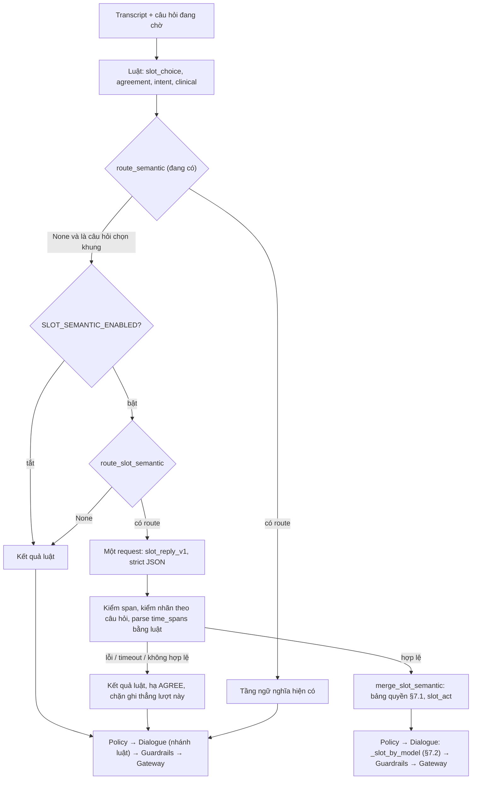

# T-10 — Tầng LLM cho câu trả lời chọn khung

**Trạng thái:** thiết kế (07/10/2026), chưa làm. Bản chi tiết của bước 9 trong [plan T-10 §3.8.2](t10-reschedule-dialogue.md),
viết lại sau hai vòng review PR đổi lịch ([evidence §10–§12](../evidence/reschedule-mentor-eval-2026-10-06.md)).

**Sửa 07/10 sau review plan (§13):** 5 điểm phải sửa trước khi code — Dialogue theo kết quả model thay vì thứ tự nhánh
của luật (§7.2), lỗi model ở route chọn khung không đi đường "model lỗi" chung (§8), `pick` chỉ cho cách gọi theo thứ
tự (§6), tối đa 2 đoạn giờ (§6), cờ tắt thì router không chạy (§8). Kèm theo: điều kiện nhận `KEEP_OLD` (§7.1), chốt ở
guardrail (§7.3), eval đo cả hại không phải lệnh ghi (§10).

**Nguồn:** contract rev 1.1 (SF-01..05, §1.1.5); PRD v2.1 (R-19, R-23, R-29, R-30, R-41, R-44); plan T-05 §8 (tầng ngữ
nghĩa đang chạy ở câu đọc lịch / đổi hay hủy / xác nhận hủy); plan T-10 §3.8.

## 0. Đọc nhanh

- Áp dụng cho 4 câu hỏi chọn khung: `OFFER_SLOTS`, `SLOT_READBACK`, `SLOT_REFUSE_CHOICE`, `ASK_SLOT_PREFERENCE`.
  Dùng chung cho đổi lịch và đặt lịch.
- **Luật chạy trước.** Chỉ gọi model khi router (hàm thuần, có test) thấy câu thuộc loại luật hay hiểu sai. Mỗi lượt
  tối đa 1 request, dùng chung ngân sách với tầng ngữ nghĩa hiện có.
- **Model đọc vai trò, luật tính giá trị.** Model chỉ nói câu làm gì và đoạn nào là giờ muốn, đoạn nào là lịch cũ.
  Chuyển đoạn đó thành tiêu chí và lọc trên `GET /slots` vẫn do parser luật làm. Model không thấy khung giờ, lịch hẹn
  hay hồ sơ, và không trả `slot_id`. Vì không thấy giờ khung, model chỉ trả số khung khi khách gọi theo thứ tự ("khung
  2", "cái sau"); khách nhắc theo giờ thì model trả đoạn giờ, luật dò khung.
- **Model đã đọc lượt thì Dialogue theo model.** Kết quả model không bị các nhánh luật đọc lại transcript đè lên
  (§7.2).
- **Model không mở khóa lệnh ghi.** Khung có tham gia của model luôn đi qua câu chốt. Model thấy "đồng ý" ở câu chốt
  thì bot chỉ hỏi lại.
- **Cờ tắt:** router không chạy, hành vi đúng như chỉ có luật (rollback chính xác).
- **Cờ bật mà model lỗi, timeout hoặc span bị loại:** dùng kết quả luật (đã sửa theo evidence §12.3), lượt đó không
  ghi thẳng. Không đi đường "model lỗi" chung của câu xác nhận (§8).
- Bật bằng cờ riêng `SLOT_SEMANTIC_ENABLED`, mặc định tắt cho đến khi eval đạt (§10).
- Theo đúng khuôn tầng ngữ nghĩa Confirm / Cancel đang chạy (§1.1). Chỉ khác ở prompt / schema riêng và span thời gian.

## 1. Vì sao cần

Luật bắt được câu theo từ khóa và thứ tự cụm. Bốn lớp câu dưới đây luật không phủ hết được: sửa chỗ này lại hở chỗ khác.
Hai vòng review vừa rồi đều rơi vào các lớp này.

| Lớp câu | Ví dụ | Vì sao luật khó |
| --- | --- | --- |
| Nhiều vế, mỗi vế một vai | "thôi để nguyên lịch 3 rưỡi chiều thứ Tư đi"; "9 giờ thì thôi, cho tôi ngày 16" | Cùng một cụm thời gian có thể là lịch cũ, giờ bị bỏ hay giờ muốn. Vai do cấu trúc cả câu quyết định, không do từ khóa |
| Tự sửa, loại trừ | "3 giờ chiều à không phải 10 giờ 30"; "không lấy ngày 14, ngày 15 đi" | "không phải" vừa là lời sửa vừa là lời loại; ASR thường mất dấu câu |
| Không dấu, dấu lẫn | "cho toi 9 gio sang mai duoc khong" | Mỗi bộ cụm cần hai dạng; khôi phục dấu một phần tạo ra câu nửa có dấu nửa không |
| Nói vòng, không từ khóa | "lúc nào thuận tiện cũng được", "không biết nữa", "tôi đổi ý", "tôi đang lái xe", "tôi có câu hỏi về bệnh" | Không có từ khóa nào để bắt |

Eval chỉ luật hiện tại: holdout 113/121. 7/8 ca còn fail thuộc lớp cuối: R056, R060, R075, R112, R113, R118, R120.
Trong đó:
- R112 "tôi có câu hỏi về bệnh": luật lâm sàng ra MENTION nên đã vào route `CLINICAL_UNRESOLVED` của tầng hiện có khi
  bật model; `--baseline` không gọi model nên vẫn fail.
- R118 "tôi cần tư vấn bác sĩ" (`needs_inference=no`): luật lâm sàng ra NONE. Sửa ở `clinical.py`, không chờ tầng này:
  SF-04 không được phụ thuộc một cờ mặc định tắt.
- R075 "tôi đổi ý": theo §7.1 tầng này ra câu A/B (không có cụm giữ / bỏ của luật). Đổi kỳ vọng sang `REFUSE_CHOICE`
  (đúng §1.1.5 hơn: "đổi ý" chưa nói đổi ý về việc gì).

Lợi ích đo được trên holdout hiện tại vì vậy nhỏ (vài câu). Lợi ích chính nằm ở 4 lớp câu trên, nên phải đo bằng bộ
held-out mới viết riêng cho 4 lớp này (§10).

### 1.1 Confirm và Cancel đang dùng LLM thế nào

Hai flow dùng chung **một** tầng ngữ nghĩa: `extraction/semantic.py`, `semantic_router.py`, prompt `semantic_v9_luna`,
model `gpt-6-luna`. Tầng này bật mặc định từ 22/09 (`SEMANTIC_FALLBACK_ENABLED`).

| Bước | Confirm (T-04) | Cancel (T-05) |
| --- | --- | --- |
| Câu hỏi có model | `CONFIRM_READBACK`, `ASK_INTENT` | `CANCEL_RECONFIRM` |
| Khi nào gọi (route) | `INTENT_UNCLEAR`: luật không ra ý định, không có có/không dứt khoát. `ATTENDANCE_UNCLEAR`: từ khóa xác nhận khớp vào câu kể. `NEED_CONFLICT`: vừa đồng ý vừa không đến được, có đổi / hủy. `INTENT_HEDGED`: đổi / hủy trong câu chưa quyết | `CANCEL_CONTRADICTION`, `CANCEL_REFUSAL_WITH_REASON`, `CANCEL_UNRESOLVED`, `CANCEL_LEFTOVER` |
| Không gọi | Câu khớp **toàn câu** tập đã rõ (`_SETTLED`: "vâng", "hủy đi", "giữ lịch"…); tín hiệu Policy; im lặng; lâm sàng cần chuyển máy | Như Confirm |
| Model trả | `reply_kind` (6 nhãn), kèm `intent`, `cancel_reason`, `clinical`. Mỗi nhãn có span neo vào transcript | Cùng schema |
| Model được làm | Đổi ý định (`CHANGE_INTENT`). Nêu lý do không đến → hỏi "đổi hay hủy". Báo ngoài phạm vi / lâm sàng → chuyển máy | Làm rõ lý do; bỏ hủy (`DECLINE_ACTION`); chuyển sang đổi lịch |
| Model không được làm | Nâng thành đồng ý để ghi `CONFIRMED`. Model thấy đồng ý thì bot chỉ đọc lại lịch | Nâng thành đồng ý để hủy. Ngoại lệ duy nhất là `CANCEL_LEFTOVER` khi bật `CANCEL_SEMANTIC_CONFIRM_ENABLED`: model chỉ đề xuất, chốt `_keep_cancel_threshold` tự tính lại 5 điều kiện từ transcript, không tin nhãn route hay kết quả merge |
| Model thấy ý mà luật không xác nhận | – | Không ghi; hỏi đúng câu `CANCEL_CONFLICT` ("nếu đồng ý, anh chị nói 'hủy lịch' giúp em") thay vì câu hủy-hay-giữ chung |
| Model tắt / lỗi | Route vẫn là cờ nghi ngờ: `_without_model` bỏ nhãn đổi / hủy chưa quyết, hạ đồng ý trong câu mâu thuẫn. Lượt model lỗi bị chặn ghi và hỏi lại | Như Confirm |
| Eval | `confirm_eval --baseline`, `--route-only`, `--semantic --repeats 3` | Thêm `--fake` (nhãn lý tưởng), `--adversarial` (mọi span chứa "hủy" làm `CONFIRM_ACTION`: 0/601 lần ghi sai). CI exit 1 khi có ghi sai. So từng câu với snapshot khi tắt cờ. Test prompt cũ giống từng byte |
| Kết quả đo | Model thật: 154–158/181 holdout, 0 ghi sai. Model được gọi ở khoảng 55% câu holdout (bộ thiên về câu khó). p50 / p95 lượt 1,4–1,5 / 1,8–3,2 s | 94,5% hành vi, 0 ghi sai (06/10). Trước đó 96,26%, 0/600 lượt ghi sai; p50 / p95 1 438 / 1 807 ms |

**Thiết kế này lấy lại nguyên:**
- Router thuần, tập câu đã rõ khớp toàn câu; một request mỗi lượt.
- Schema đóng, span neo vào transcript (`_grounded`).
- Bảng quyền "model chỉ kéo về hướng không ghi".
- Model thấy ý mà luật không xác nhận thì hỏi câu đúng trọng tâm.
- Route là cờ nghi ngờ khi model lỗi (khi cờ bật).
- Một chốt cuối tự tính lại từ đầu.
- Cờ riêng cho phần rủi ro.
- `--fake`, `--adversarial`, snapshot khi tắt cờ, CI chặn ghi sai.
- Nguyên tắc "đọc theo quyết định sau cùng" của `semantic_v9_luna`.

**Khác ở chỗ:**
- **Prompt và schema riêng** (`slot_reply_v1`, `SlotReading`), không thêm nhãn vào `SemanticReading`. Câu chọn khung
  cần `pick`, `time_spans`, `old_time_span` mà schema hiện có không có. Nếu sửa `semantic_v9_luna` thì phải chạy lại
  eval Confirm / Cancel bằng model thật. Adapter, gateway, cấu hình, ngân sách và trace dùng chung. Mô tả mục đích 4
  câu hỏi cũng đặt trong prompt riêng (`QUESTION_PURPOSE` dùng chung mới có `OFFER_SLOTS`, `SLOT_READBACK`).
- **Model trả thêm span thời gian**, để luật parse; Confirm / Cancel không cần.
- **Dialogue có hàm điều phối riêng cho kết quả model** (`_slot_by_model`, §7.2), vì thứ tự nhánh của 4 handler chọn
  khung được viết cho kết quả luật. Confirm / Cancel không cần vì ở đó model chỉ đổi `intent` / `agreement`.
- **Cờ tắt thì router không chạy** (§8), khác tầng chung vẫn hạ trường nghi ngờ khi tắt model.
- **Mặc định tắt** (`SLOT_SEMANTIC_ENABLED`), khác tầng chung đang bật.

## 2. Nguyên tắc

Giữ 7 nguyên tắc ở plan T-10 §3.8; bổ sung các điểm in đậm.

1. Luật chạy trước. Model chỉ được gọi khi `route_slot_semantic` trả một lý do (§4).
2. Mỗi lượt tối đa 1 request (`model_budget.ModelBudget`). Lượt đã gọi model cho việc khác (vd. lâm sàng) thì không
   gọi nữa.
3. Prompt chỉ có transcript (giữ dấu câu), mục đích câu hỏi đang chờ, hành động đang chờ, số khung của trang đang đọc,
   mã route và gợi ý luật của **chính lượt này**. Không khung giờ, lịch hẹn, hồ sơ hay câu bot vừa đọc (R-19; T-05
   §8.3.2).
4. Model trả nhãn trong tập đóng, kèm span là một đoạn liền, nguyên văn của transcript (`semantic._grounded`).
5. **Model không trả ngày giờ đã chuẩn hóa và không trả `slot_id`.** Nó chỉ trả span; `parse_slot_criteria` đọc span,
   `filter_slots` lọc trên `ctx.slots`, tức dữ liệu `GET /slots` (SF-02). **Số khung (`pick`) chỉ khi khách gọi theo
   thứ tự / chỉ trỏ**; model không thấy giờ khung nên không thể đổi "cái 10 rưỡi" thành khung 1 hay 2.
6. **Không mở khóa lệnh ghi:**
   - Khung chọn từ kết quả có model luôn đọc câu chốt; không ghi thẳng theo R-29, dù câu trông như chọn rõ.
   - "Đồng ý" của model ở câu chốt chỉ dẫn tới hỏi lại có/không.
   - Guardrail chặn thêm bằng chứng có nguồn model cho RESCHEDULE / BOOK (§7.3).
7. **Cờ tắt:** `route_slot_semantic` không chạy, không có cờ nghi ngờ nào; hành vi đúng như chỉ có luật.
8. **Cờ bật mà model lỗi, timeout hoặc span không qua bước kiểm:** dùng kết quả luật, lượt đó không ghi thẳng. Không
   xóa `intent` / `agreement` như lỗi model chung, không đi nhánh hỏi lại chung `_reask_confirmation(failed=True)`.
9. **Model đã đọc lượt thì Dialogue theo model.** Không có nhánh luật nào (bỏ đổi lịch, bận, hỏi lại, cắt vế sau lời
   bỏ) đọc lại transcript để đè lên kết quả model.

## 3. Vị trí trong pipeline

## 4. Khi nào gọi model: `route_slot_semantic`

Router chỉ chạy khi bật `SLOT_SEMANTIC_ENABLED` và tầng ngữ nghĩa có adapter (có khóa). Cờ tắt thì không tính route,
nên không có cờ nghi ngờ nào ảnh hưởng tới hành vi luật (§8).

**Không gọi khi:**
- Im lặng hoặc transcript rỗng.
- Đã có tín hiệu Policy: xin nhân viên, lâm sàng cần chuyển máy, không phải bệnh nhân.
- Câu khớp **toàn câu** tập đã rõ: "vâng", "không", "khung 1", "khung khác", "thôi không đổi nữa", ...
- Luật ra chọn rõ sạch: `explicit_slot_pick` đúng và không có dấu hiệu nghi ngờ nào bên dưới.
- Ở `SLOT_READBACK`, luật ra AGREE (đã qua veto R-41): đó là đường đi chắc, kể cả khi câu không dấu.

| Route | Điều kiện (tính bằng luật) | Ví dụ | Không có model thì |
| --- | --- | --- | --- |
| `SLOT_GIVE_UP_WITH_TIME` | Có cụm giữ lịch / bỏ điều kiện **và** có tiêu chí thời gian | Ý 1, ý 3 review lần 2 | Luật evidence §12.3 |
| `SLOT_CORRECTION` | Có lời tự sửa hoặc loại trừ ("à không", "không phải", "chứ không phải", "trừ", "không lấy"), và tiêu chí ở cả hai vế | §11 M3, §11.5 | Luật hiện tại |
| `SLOT_ASKS_BACK` | Luật thấy khung / tiêu chí nhưng câu là hỏi lại ("sao lại…", "…à", "?") | "sao lại là thứ Sáu" | Hỏi lại câu đang chờ |
| `SLOT_UNACCENTED` | Câu gốc không dấu và luật không có đường đi chắc (không chọn rõ, không đồng ý ở câu chốt, không bỏ, không MORE / ANY) | "de sang thu nam duoc khong em" | Luật evidence §12.3 |
| `SLOT_UNRESOLVED` | Luật không ra khung, tiêu chí, MORE, ANY, bỏ đổi lịch, đồng ý hay từ chối dứt khoát; câu còn nội dung ngoài từ đệm | R056, R060, R075, R112, R113, R118, R120 | "Em chưa hiểu" (§1.1.5) |

`SLOT_ASKS_BACK` có ít lợi: model không trả lời được câu hỏi (không có dữ liệu khung), phần lớn ra `QUESTION` như luật.
Chỉ giữ route này nếu `--semantic` cho thấy nó sửa được câu mà luật sai (đo theo từng route, §10).

Câu xin giờ khác ở câu đọc lịch (`CONFIRM_READBACK`) **không** thuộc tầng này và cũng không được tầng hiện có cứu:
prompt `semantic_v9_luna` chỉ cho `CHANGE_INTENT` khi khách nói rõ muốn đổi (evidence §2.2, qc-rs-03). Câu nêu giờ
không có chữ "đổi" ở đó là chỉ-luật theo thiết kế (`requests_time`, evidence §12.3 ý 2). Không thêm route ở đó để
không phải sửa prompt `semantic_v*`.

Mục tiêu: không quá **30%** lượt ở câu hỏi chọn khung gọi model, đo bằng `reschedule_eval.py --route-only`.

## 5. Ngữ cảnh gửi model: `SlotSemanticContext`

| Trường | Giá trị |
| --- | --- |
| `transcript` | Nguyên văn, giữ dấu câu; dài hơn `semantic_fallback_max_input_chars` thì không gọi |
| `question_id` | Một trong 4 câu hỏi chọn khung; prompt dùng mô tả mục đích, không dùng câu bot đã đọc. Mô tả của cả 4 câu hỏi đặt trong `slot_reply.py`, không thêm vào `QUESTION_PURPOSE` dùng chung (dict đó chưa có `SLOT_REFUSE_CHOICE`, `ASK_SLOT_PREFERENCE`; thêm vào sẽ đổi prompt `semantic_v*` ở route lâm sàng) |
| `pending_action` | `RESCHEDULE` / `BOOK` |
| `page_size` | 0, 1 hoặc 2: số khung trên trang vừa đọc. Không gửi giờ của khung |
| `route_reason` | Mã route ở §4 |
| `rule_hints` | Kết luận luật của chính lượt: loại chọn (thứ tự khung / MORE / ANY / có cụm giờ), span thời gian luật thấy, span cụm bỏ / giữ / sửa. Chỉ là gợi ý, có thể sai. **Không gửi** kết quả khớp khung (MATCH / NO_MATCH): kết quả đó suy ra từ `GET /slots` |

Không gửi tên, ngày sinh, `appointment_id`, số điện thoại, giờ lịch hẹn, giờ các khung hay lịch sử cuộc gọi.

## 6. Kết quả có cấu trúc: `SlotReading`

Pydantic strict, `extra="forbid"`. Mọi khóa bắt buộc; không có thông tin thì để `null`.

| Trường | Giá trị |
| --- | --- |
| `act` | `PICK`, `TIME`, `MORE`, `ANY`, `REFUSE`, `KEEP_OLD`, `CONFIRM`, `CANCEL`, `OUT_OF_SCOPE`, `QUESTION`, `AMBIGUOUS` |
| `act_span` | Đoạn làm căn cứ. Bắt buộc, trừ `QUESTION` / `AMBIGUOUS` |
| `pick` | 1 / 2, **chỉ** cho `PICK`: khách gọi theo thứ tự hoặc chỉ trỏ ("khung 2", "cái sau", "cái đầu"). Ngược lại `null` |
| `time_spans` | 1–2 đoạn nói thời gian người gọi **muốn**, theo thứ tự trong câu. Bắt buộc cho `TIME`, ngược lại `[]` |
| `old_time_span` | Đoạn nhắc lịch cũ hoặc giờ bị bỏ. Chỉ dùng để kiểm chéo (§7.1), không bao giờ dùng để chọn |
| `clinical`, `clinical_span` | Như schema tầng ngữ nghĩa hiện có |

**`PICK` và `TIME`.** Model không thấy giờ khung (§5), nên không biết "cái 10 rưỡi" là khung 1 hay 2. Mọi cách nhắc
khung theo giờ / ngày / buổi ("cái 10 rưỡi", "cái buổi chiều", "3 giờ chiều ngày 14") là `TIME`. Luật dò đoạn giờ trên
các khung vừa đọc rồi quyết: khớp đúng một khung trên trang thì là chọn khung đó (đọc câu chốt), không khớp thì là
yêu cầu mới — đúng cách `_picked` / `_new_request` đang làm. Nhờ vậy không cần gửi buổi của khung vào prompt (§12).

**Vì sao tối đa 2 đoạn giờ.** Một đoạn liền không chứa được giờ muốn bị lời sửa chen giữa:
- "thứ Năm 9 giờ, à không, 10 giờ": giờ muốn là thứ Năm + 10 giờ. Đoạn "10 giờ" mất thứ Năm, trong khi luật (R-44)
  hiện đọc đúng. Model trả `["thứ Năm", "10 giờ"]`.
- "ngày 15 ấy, à không phải 10 giờ đâu, 3 giờ chiều": luật hiện đọc ngày 15 lúc 22h (sai). Giờ muốn là hai đoạn rời
  `["ngày 15", "3 giờ chiều"]`.

**Kiểm sau model** (`ground_slot_reading`). Không đạt điều nào thì coi như model không trả gì (§8).

1. Mọi span phải là đoạn liền trong transcript (`_grounded`). Không nhận span nối hai đoạn; muốn hai đoạn thì là hai
   phần tử của `time_spans`.
2. `act` phải được phép ở câu hỏi đang chờ (bảng dưới).
3. `pick` chỉ có ở `PICK`, và phải ≤ `page_size`.
4. Từng phần tử `time_spans` qua `parse_slot_criteria` phải ra tiêu chí không rỗng. Các tiêu chí gộp theo trường; một
   trường có ở hai đoạn với giá trị khác nhau thì `TIME` hạ thành `AMBIGUOUS`.
5. `old_time_span` không được **bằng** một phần tử của `time_spans`. Được phép nằm trong vùng câu có lời sửa.

| `act` | `OFFER_SLOTS` | `SLOT_READBACK` | `SLOT_REFUSE_CHOICE` | `ASK_SLOT_PREFERENCE` |
| --- | --- | --- | --- | --- |
| `PICK` | ✓ | ✓ | ✓ | – |
| `TIME`, `KEEP_OLD`, `CANCEL`, `OUT_OF_SCOPE`, `QUESTION`, `AMBIGUOUS` | ✓ | ✓ | ✓ | ✓ |
| `MORE` | ✓ | ✓ | ✓ | – |
| `ANY` | ✓ | – | ✓ | ✓ |
| `REFUSE` | ✓ | ✓ | – | – |
| `CONFIRM` | – | ✓ | – | – |

`ANY` ở `OFFER_SLOTS` theo đúng luật hiện có ("khung nào cũng được" → đọc câu chốt khung đầu trang). `CANCEL` chỉ
nhận ở cuộc gọi đi. Ở cuộc gọi đến, nó thành `OUT_OF_SCOPE` theo luật hiện có.

## 7. Bảng quyền và cách Dialogue dùng kết quả model

### 7.1 `merge_slot_semantic`: trạng thái đầy đủ sau merge

Merge **thay cả bộ** trường chọn khung của lượt, không chỉ ghi thêm. Trường không nêu trong bảng đặt về "không có"
(`Field.nothing`), không giữ giá trị luật: nếu giữ, nhánh luật sẽ đọc lại chính kết quả sai mà model được gọi để sửa.
Mọi giá trị từ model mang `Provenance.FALLBACK`. `slot_act` luôn có giá trị khi kết quả model được nhận.

| `act` | Nhận khi | `slot_act` | `slot_choice` | `slot_request` | `agreement` | `intent` |
| --- | --- | --- | --- | --- | --- | --- |
| `PICK n` | Khung thứ n của trang chưa bị từ chối | `PICK` | `MATCH` khung n | – | – | – |
| `TIME` | Mọi đoạn ra tiêu chí, không xung đột | `TIME` | Luật tính lại trên `time_spans` | `time_spans` | – | – |
| `MORE` / `ANY` | – | `MORE` / `ANY` | `MORE` / `ANY` | – | – | – |
| `REFUSE` | – | `REFUSE` | – | – | `REFUSE` | – |
| `KEEP_OLD` | Đủ 3 điều kiện dưới | `KEEP_OLD` | – | – | – | – |
| `KEEP_OLD` | Thiếu một điều kiện | `KEEP_OLD_UNSURE` | – | – | – | – |
| `CONFIRM` | Chỉ ở câu chốt | `CONFIRM` | – | – | `UNCLEAR` | – |
| `CANCEL` | Cuộc gọi đi | `CANCEL` | – | – | – | `CANCEL` |
| `OUT_OF_SCOPE` / lâm sàng | – | `OUT_OF_SCOPE` | – | – | – | `OUT_OF_SCOPE` / `clinical` |
| `QUESTION` / `AMBIGUOUS` | – | `UNCLEAR` | – | – | `UNCLEAR` | – |

Lượt có kết quả model **không bao giờ còn AGREE** sau merge (kể cả khi luật ra AGREE): lượt có route không ghi thẳng.

**Nhận `KEEP_OLD` thẳng** (kết thúc việc đổi lịch, chuyển `PATIENT_REQUEST`) chỉ khi đủ cả ba:
1. `act_span` chứa một cụm giữ lịch / bỏ đổi lịch của luật (`_KEEP_OLD` / `_DROP_CONDITION`, evidence §12.3). Có cụm ở
   chỗ khác trong câu chưa đủ: "3 giờ chiều thì thôi, lấy khung 2" có "thì thôi" nhưng câu là chọn khung 2.
2. Không có `pick`, không có `time_spans`.
3. Có `old_time_span` thì tiêu chí của nó phải khớp `starts_at` của lịch đang đổi (Dialogue đọc qua
   `get_actionable_appointment`, một lần mỗi lượt). Không khớp thì đó không phải lịch cũ.

Thiếu một điều kiện thì hỏi câu A/B "nghe khung khác hay giữ lịch cũ". `TIME` mà tiêu chí chỉ khớp lịch hẹn hiện tại
cũng hỏi câu A/B.

### 7.2 Dialogue: `_slot_by_model`

Thứ tự nhánh của 4 handler chọn khung được viết cho kết quả luật: bỏ đổi lịch → bận → khớp khung / cụm giờ → … → từ
chối → hủy. Nếu kết quả model đi qua thứ tự này, cụm giờ luật đọc được sẽ chạy trước `REFUSE` / `CANCEL` / `KEEP_OLD`
của model, và các hàm đọc lại transcript (`_gives_up`, `_busy`, `asks_back`, `gives_up_slot_change`, `is_bare_da`,
`slot_answer`) sẽ đè lên model. Ví dụ "thôi để nguyên lịch 3 rưỡi chiều thứ Tư đi": model ra `KEEP_OLD` nhưng bot vẫn
nói "thứ Tư ngày 7 đã kín" như khi chỉ có luật.

Vì vậy, ở cả 4 handler, `slot_act` khác `None` thì đi **`_slot_by_model`** đầu tiên. Hàm này chỉ điều phối theo
`slot_act`, dùng lại helper sẵn có, không đọc lại transcript:

| `slot_act` | Dialogue |
| --- | --- |
| `PICK` | `_read_back` khung đó |
| `TIME` | Khớp đúng một khung trên trang → `_read_back`; còn lại → `_new_request(ex.slot_request)` (vòng R-29, quy thứ R-30, bỏ khung đã từ chối V-9) |
| `MORE` / `ANY` | Như nhánh luật cùng tên ở câu hỏi đang chờ |
| `REFUSE` | `_refuse_slots` (câu A/B) |
| `KEEP_OLD` | Đổi lịch: `_give_up`. Đặt lịch: hỏi lại nhu cầu |
| `KEEP_OLD_UNSURE` | Câu A/B (`SLOT_REFUSE_CHOICE`) |
| `CONFIRM` | `_reask_readback` với `slot_readback_da` (nhắc nói "đồng ý"), như `CANCEL_CONFLICT` của Cancel |
| `CANCEL` | `_start(CANCEL)`: lượt yêu cầu, vẫn cần xác nhận lần hai (SF-05) |
| `OUT_OF_SCOPE` | Policy chuyển máy trước khi tới Dialogue |
| `UNCLEAR` | Hỏi lại câu đang chờ, tính §1.1.5 như luật |

Không gọi lệnh ghi trong `_slot_by_model`.

### 7.3 Chốt ghi

**Chốt cuối `_keep_slot_write_threshold`** (như `_keep_cancel_threshold` của Cancel), ở Dialogue. Đây là chỗ quyết
lượt này có được ghi thẳng ở câu mời khung hay ghi ở câu chốt. Chốt tự tính lại từ transcript và `TurnContext`, không
tin nhãn route hay kết quả merge. Chỉ ghi khi đủ cả ba điều kiện:
- Luật tự nhận ra chọn rõ / đồng ý trên **nguyên câu** (`explicit_slot_pick`, `extract_agreement`).
- Lượt không có route chọn khung (`ExtractionResult.model_route`).
- `slot_choice.provenance` và `agreement.provenance` không phải `FALLBACK`.

Không đạt thì đọc câu chốt (câu mời khung) hoặc hỏi lại (câu chốt), **không** gọi lệnh ghi để guardrail chặn thành
SYSTEM_ERROR.

**Lưới cuối ở guardrail.** `assert_action_confirmed` từ chối bằng chứng CONFIRMATION có `provenance == FALLBACK` khi
hành động là RESCHEDULE / BOOK. Chốt ở Dialogue tránh SYSTEM_ERROR; chốt ở guardrail giữ bất biến "model không gây lệnh
ghi" kể cả khi Dialogue đổi sau này. **Không áp cho CANCEL**: `cancel_semantic_confirm_enabled: true` đang dùng bằng
chứng `FALLBACK` đã kiểm chứng cho hủy (`_keep_cancel_threshold`).

## 8. Khi model lỗi hoặc tắt

**Cờ tắt (`SLOT_SEMANTIC_ENABLED=false`) hoặc không có khóa:** `route_slot_semantic` không chạy. Không có `model_route`,
không có cờ nghi ngờ, hành vi đúng từng câu như chỉ có luật. Khác tầng hiện có (`INTENT_HEDGED` / `CLINICAL_UNRESOLVED`
vẫn hạ trường khi tắt model) vì hai lý do:
- `explicit_slot_pick` đã từ chối ghi thẳng mọi câu kiểu route (tự sửa, bỏ kèm giờ, không dấu, hỏi lại — đã chạy thử
  07/10), nên cờ nghi ngờ khi tắt gần như không thêm an toàn.
- Rollback phải chính xác: một lỗi trong router (kiểu "khung 1" bị coi là không dấu, evidence §10 ý 6) không được ảnh
  hưởng hành vi khi đã tắt cờ.

**Cờ bật mà model lỗi, timeout, hoặc span bị loại** ở route chọn khung:
- Code hiện tại coi các trường hợp này là "model lỗi" chung: `report_model_status("rejected")` thành `INVALID`;
  `extract()` xóa `intent` / `agreement`; `respond()` hỏi "anh chị có đồng ý với khung giờ vừa đọc không ạ?"
  (`SLOT_CONFLICT`) và tính NOT_UNDERSTOOD. Với câu mời 2 khung, câu hỏi đó vô nghĩa.
- Thay bằng:
  - `ExtractionResult.model_route` ghi route chọn khung của lượt.
  - `extract()`: lượt có route chọn khung thì **không** xóa `intent` / `agreement`; giữ kết quả luật, chỉ hạ AGREE
    thành UNCLEAR (lượt có route không ghi thẳng).
  - `respond()`: lượt có route chọn khung không đi `_reask_confirmation(failed=True)`; đi handler như bình thường.
  - `business_write_blocked` vẫn bật như cũ. Dialogue không gọi lệnh ghi ở lượt này (chốt §7.3), nên không thành
    SYSTEM_ERROR.
- Bộ đếm §1.1.5 và vòng R-29 tính theo kết quả luật, không tính thêm một lần "không hiểu" vì model lỗi.

## 9. Thay đổi theo file

| File | Thay đổi |
| --- | --- |
| `extraction/slot_semantic.py` (mới) | `SlotSemanticContext`, `SlotReading`, `ground_slot_reading`, `route_slot_semantic`, `merge_slot_semantic` (thay cả bộ trường, §7.1), adapter `LLMSlotSemanticExtractor` (dùng lại `LLMGateway`, `_grounded`, cấu hình `semantic_fallback_*`) |
| `inference/llm/prompt/slot_reply.py` (mới) | Prompt `slot_reply_v1` tiếng Việt, mô tả mục đích 4 câu hỏi, ví dụ đối lập lấy từ split `prompt` của eval. **Không sửa prompt `semantic_v*`** và `QUESTION_PURPOSE`, để eval Confirm / Cancel không phải chạy lại |
| `extraction/schema.py` | `ExtractionResult.slot_request` (đã cần cho evidence §12.3 ý 3), `slot_act`, `model_route` |
| `extraction/extractor.py` | Sau `route_semantic` trả `None` và cờ bật: `route_slot_semantic` → adapter → merge. `extract()` không xóa `intent` / `agreement` khi lỗi ở route chọn khung (§8) |
| `dialogue/manager.py` | `_slot_by_model` xét đầu tiên ở 4 handler (§7.2); `_direct_pick` và câu chốt hỏi chốt `_keep_slot_write_threshold`; `respond()` phân biệt lỗi model theo `model_route` |
| `policy/guardrails.py` | `assert_action_confirmed`: RESCHEDULE / BOOK không nhận bằng chứng `FALLBACK` (§7.3) |
| `engine/__init__.py`, `settings` | Cờ `SLOT_SEMANTIC_ENABLED` (mặc định `false`); dựng adapter khi bật và có khóa |
| `scripts/reschedule_eval.py` | Chế độ `--fake` (nhãn lý tưởng theo file `eval/reschedule/fake_outcomes.json`) và `--adversarial` (mỗi ca chạy lại với mọi `act` × mọi span con), như `cancel_eval.py`. Đếm lệnh ghi sai (exit 1 nếu có) và cả hại không phải lệnh ghi (§10). CI chạy khi `eval/reschedule/**` hoặc script đổi |
| `eval/reschedule/cases.csv` | Câu của 2 vòng review; R075 đổi kỳ vọng sang `REFUSE_CHOICE` |
| `eval/reschedule/heldout_slot_semantic.csv` (mới) | Bộ held-out cho 4 lớp câu ở §1, viết trước prompt, không ai đã đọc prompt viết (§10) |

## 10. Eval và tiêu chí nghiệm thu

| Tiêu chí | Mục tiêu |
| --- | --- |
| `reschedule_eval.py --semantic --repeats 3`, holdout | ≥ 95% (chỉ luật hiện 113/121 = 93,4%); nhóm cần suy nghĩa ≥ 18/21 (hiện 16/21) |
| Bộ held-out mới cho 4 lớp câu ở §1 (`heldout_slot_semantic.csv`) | Báo cả chỉ luật lẫn luật + model; luật + model hơn rõ ở từng lớp. Đây là số quyết định bật |
| Câu đổi từ đạt sang không đạt so với chỉ luật (từng câu, holdout + held-out mới) | Báo danh sách đầy đủ; 0 câu an toàn đổi sang không đạt |
| Ghi khi khách chưa đồng ý / ghi nhầm khung | **0** ở mọi chế độ, kể cả `--adversarial` |
| Hại không qua lệnh ghi, ở `--semantic` và `--adversarial`: chuyển máy ngoài kỳ vọng (`KEEP_OLD`, `OUT_OF_SCOPE`), vòng R-29 tốn vì `TIME` sai, lượt bị tính "không hiểu" thêm | Đếm và báo theo `act`; `KEEP_OLD` sai dẫn tới chuyển máy = 0 ở `--adversarial` (nhờ 3 điều kiện §7.1) |
| Tỷ lệ lượt gọi model ở câu hỏi chọn khung (`--route-only`), báo theo từng route | ≤ 30%; route không sửa được câu nào thì bỏ |
| Thời gian lượt có model | p95 ≤ 3,5 s (tham chiếu tầng hiện có, T-05 đợt 3: p50 / p95 1 438 / 1 807 ms) |
| 7 case mentor × 3 chế độ model | 7/7 |
| Eval Confirm, Cancel, Identity, No-answer | Không đổi so với trước khi bật |
| Cờ tắt (`--baseline`) | Router không chạy; từng câu bằng snapshot luật sau evidence §12.3: hành vi, khung, vòng |

**Bộ held-out mới.** Khoảng 40–60 câu cho 4 lớp ở §1 (nhiều vế, tự sửa / loại trừ, không dấu, nói vòng), gồm cả câu
phải đổi hành vi và câu phải giữ nguyên. Viết **trước** prompt, do người chưa đọc prompt viết, kỳ vọng suy từ contract /
PRD. Câu của 2 vòng review đã dùng để sửa luật (evidence §12.3) nên không còn là held-out cho phép so sánh này.

Unit test không gọi mạng:
- Router: đúng route với các câu §1, không gọi với câu đã rõ; cờ tắt thì không route câu nào.
- Kiểm span: span bịa, span nối, `pick` ngoài `PICK`, `pick` vượt trang, `time_spans` không parse được, hai đoạn xung
  đột, `old_time_span` bằng một đoạn giờ muốn.
- Merge thay cả bộ trường: sau merge không còn `slot_choice` / AGREE của luật khi `act` là `REFUSE`, `KEEP_OLD`,
  `CANCEL`, `QUESTION`, `AMBIGUOUS`, `CONFIRM`.
- `_slot_by_model`: với mỗi `act`, Dialogue theo model kể cả khi transcript có từ khóa của nhánh luật khác ("thì thôi",
  "bận", "à", cụm giờ). Ví dụ "thôi để nguyên lịch 3 rưỡi chiều thứ Tư đi" + `KEEP_OLD` → giữ lịch, chuyển máy.
- `KEEP_OLD`: thiếu từng điều kiện §7.1 thì ra câu A/B; `old_time_span` không khớp lịch đang đổi thì ra câu A/B.
- Bảng quyền: model `CONFIRM` / `PICK` / `TIME` không bao giờ dẫn tới lệnh ghi trong cùng lượt.
- Guardrail: RESCHEDULE / BOOK với bằng chứng `FALLBACK` bị chặn; CANCEL với bằng chứng `FALLBACK` đã kiểm chứng vẫn
  qua như hiện tại.
- Privacy: prompt không chứa giờ khung, giờ lịch hẹn, kết quả khớp khung, tên, ngày sinh, số điện thoại.
- Lỗi model ở route chọn khung (timeout, lỗi mạng, span bị loại): giữ kết quả luật, không hỏi `SLOT_CONFLICT`, không
  tính thêm "không hiểu", không gọi lệnh ghi, không SYSTEM_ERROR.
- Chốt cuối: mọi tổ hợp outcome giả (kể cả model trả `PICK` / `CONFIRM` cho câu âm tính) không ghi trong cùng lượt.
- Prompt `semantic_v*` không đổi từng byte (test sha256 như T-05), để chứng minh Confirm / Cancel không bị ảnh hưởng.

## 11. Triển khai, bật và rollback

| Bước | Việc | Ước lượng |
| --- | --- | --- |
| 1 | Sửa luật evidence §12.3 (đường chạy khi model tắt) + test + dòng eval. **Xong 07/10** (evidence §12.5), chờ test local | 0,5 ngày |
| 1b | Viết bộ held-out mới (§10), song song bước 2 | 0,5 ngày |
| 2 | `slot_semantic.py`: schema, kiểm span, router, merge thay cả bộ trường, test thuần | 1 ngày |
| 3 | Prompt `slot_reply_v1`, adapter, cờ, nối vào `extractor` / `manager` (`_slot_by_model`, lỗi model §8), chốt guardrail | 1–1,5 ngày |
| 4 | `--fake`, `--adversarial`; eval với model thật 3 lần, đo latency, tỷ lệ gọi theo route, hại không qua lệnh ghi | 0,5–1 ngày |
| 5 | Evidence: số liệu trước / sau theo version prompt; đề xuất bật | 0,5 ngày |

- Cờ mặc định tắt. Owner quyết định bật sau bước 5, và **trước freeze W5 (16/10)**. Không kịp eval model thật 3 lần
  thì W5 chạy chỉ luật (bước 1), cờ để tắt.
- Rollback bằng `SLOT_SEMANTIC_ENABLED=false`: router không chạy, hành vi đúng như chỉ có luật (§8).
- Trace mỗi lượt có model: route, version prompt, trạng thái, `act` được nhận / bị bỏ, thời gian. Không log transcript
  trong log kỹ thuật (giống tầng hiện có).

## 12. Rủi ro và câu cần owner chốt

- **Độ trễ.** Lượt có model chậm thêm khoảng 1,5 s. Router hẹp (§4) để giữ tỷ lệ gọi thấp.
- **`KEEP_OLD` sai kết thúc việc đổi lịch.** Vì vậy chỉ nhận thẳng khi đủ 3 điều kiện §7.1; còn lại hỏi câu A/B.
- **Model sai không gây ghi nhưng vẫn làm case fail:** chuyển máy sai, tốn vòng R-29, tăng bộ đếm §1.1.5. Đo riêng ở §10.
- **Chi phí.** Model `gpt-6-luna`, service tier `fast`, có phụ phí. Đo bằng usage ở bước 4.
- **Cần chốt:**
  1. Bật mặc định sau khi eval đạt, hay chỉ bật trên staging trước?
  2. ~~Có cho prompt biết buổi của khung trên trang không?~~ Đã chốt theo §6: **không**. Mọi cách nhắc khung theo giờ /
     buổi là `TIME`, luật dò khung trên trang; prompt giữ ranh giới "không dữ liệu Clinic".

## 13. Review plan 07/10: điểm đã sửa

| # | Vấn đề ở bản trước | Ví dụ | Sửa ở |
| --- | --- | --- | --- |
| 1 | Merge chỉ ghi thêm vào trường luật; thứ tự nhánh của Dialogue xét cụm giờ của luật trước `REFUSE` / `CANCEL` / `KEEP_OLD` của model | "thôi để nguyên lịch 3 rưỡi chiều thứ Tư đi": model `KEEP_OLD`, bot vẫn nói "thứ Tư ngày 7 đã kín" | §7.1 (thay cả bộ trường), §7.2 (`_slot_by_model`) |
| 2 | Lỗi model / span bị loại đi đường "model lỗi" chung: xóa `intent` / `agreement`, hỏi `SLOT_CONFLICT`, tính "không hiểu" | "khung 1 à không, khung 2" + timeout → "anh chị có đồng ý với khung giờ vừa đọc không ạ?" sau khi đọc 2 khung | §8 |
| 3 | `pick` bắt buộc cho mọi `PICK`, kể cả gọi theo giờ, trong khi model không thấy giờ khung | "cái 10 rưỡi ấy": model phải đoán khung 1 hay 2 | §6 (`PICK` chỉ theo thứ tự, `TIME` cho giờ) |
| 4 | Một `time_span` liền | "thứ Năm 9 giờ, à không, 10 giờ" mất thứ Năm; "ngày 15 ấy, à không phải 10 giờ đâu, 3 giờ chiều" không biểu diễn được | §6 (`time_spans` tối đa 2) |
| 5 | §8 tính route cả khi tắt model, ngược với §10 / §11 (tắt cờ = đúng luật) | Lỗi router kiểu "khung 1" không dấu vẫn chặn ghi thẳng dù đã tắt cờ | §4, §8 |
| 6 | Điều kiện nhận `KEEP_OLD` thẳng chỉ là "có cụm giữ / bỏ trong câu" | "3 giờ chiều thì thôi, lấy khung 2" có "thì thôi" | §7.1 |
| 7 | `--adversarial` chỉ đếm lệnh ghi | Chuyển máy sai, tốn vòng, tăng bộ đếm không hiểu | §10 |
| 8 | Bất biến "model không gây ghi" chỉ nằm ở Dialogue | — | §7.3 (guardrail, trừ CANCEL) |
| 9 | Đo trên holdout có câu đã dùng để sửa luật; R075 / R112 / R118 tính sai lớp | — | §1, §10 |
