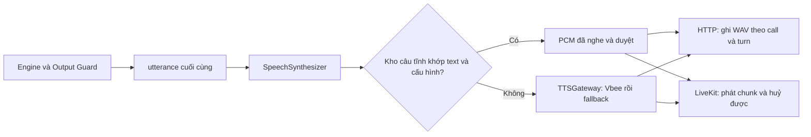

# Kế hoạch chuẩn hoá câu thoại và cache audio Vbee — 07/10/2026

Mục tiêu: câu cố định chỉ sinh giọng khi dựng hoặc đổi phiên bản audio; các cuộc gọi sau phát lại đúng bản đã nghe và duyệt. Câu chứa dữ liệu lịch hẹn vẫn sinh TTS từ `utterance` cuối cùng của Engine. Câu hỏi thông thường giữ các biến thể hữu hạn để lời thoại tự nhiên; mỗi biến thể được dựng audio riêng.

Trạng thái: **đã rà văn bản, registry và luồng TTS; chưa sửa Engine, chưa thu audio mới, chưa bật cache**. Đây là kế hoạch và bộ review để chốt câu trước khi triển khai. Không đánh dấu task 05/10 Done khi chưa nghe lại đủ các kịch bản.

## 1. Căn cứ và phạm vi

- [Contract AIHR-PC-001 rev 1.1](../../../tailieu/callbot-contract-vi.md): §1.1.1–§1.1.10, §1.2.1–§1.2.2; §4.1.3 yêu cầu audio đọc đúng `utterance`; §5.3 tính latency đến khi tải xong audio; §5.4 quy định báo chi phí theo format chương trình.
- [PRD v2.1, 05/10/2026](../../../tailieu/PRD-CallBot-VinMec-v2_1.pdf): R-23, R-25, R-29, R-30; R-38/R-39; R-42 và GC-NAT-01–05. Bản PRD đang có trong `tailieu` là v2.1, mới hơn v1.6 được nhắc ở đầu kế hoạch TTS.
- [tts-w3-w6.md](tts-w3-w6.md), task **T2 05/10 · Đường A — Rà soát và chuẩn hoá câu thoại toàn bộ kịch bản**: nghe đủ 7 kịch bản, sửa tại template, chốt câu tĩnh, dựng audio và manifest. Nối cache vào pipeline là việc tiếp theo, phải đo trước/sau.
- [Evidence 29/09](../evidence/tts-utterance-fidelity.md) và phiếu nghe local: đã sinh 34 câu nhưng bảng chấm nghe vẫn trống; template đã thay đổi nên audio cũ không đủ chứng minh snapshot hiện tại.

Phạm vi gồm Identity, Confirm, Cancel, Transfer, Reschedule, No-answer, Booking và các nhánh hỏi lại, im lặng, lời đáp mơ hồ/mâu thuẫn, hết slot, slot bị lấy, ngày không hợp lệ, ghi Clinic lỗi, output guard thay câu an toàn. HTTP và LiveKit dùng cùng catalog và cơ chế cache; nghiệp vụ tiếp tục ở cùng Engine.

## 2. Kết quả rà hiện trạng

Snapshot code: `9e48549`. Xem [review toàn bộ câu](tts-utterance-review-2026-10-07.md), [CSV câu tĩnh](tts-utterance-review-2026-10-07.csv), [CSV nhánh renderer](tts-renderer-branches-2026-10-07.csv).

| Phát hiện | Ý nghĩa / việc cần làm |
|---|---|
| 116 nguyên văn câu tĩnh khác nhau, 15 renderer; 24 nhóm có 4 cách nói | Cache theo từng nguyên văn được duyệt; không gom mọi câu của một nhóm vào một audio. Registry tĩnh dùng text làm key nên ID alias có thể dùng chung asset. |
| Tổng câu tĩnh hiện tại 8.227 ký tự | Ước tính quota cho một lần dựng một giọng ở snapshot hiện tại. Đây chưa phải chi phí tiền, chưa gồm audio động để audit, câu ghép im lặng hoặc câu phải sinh lại. |
| Audit cũ tạo 34 dòng, bỏ sót 90 ID/biến thể ngoài tập đã phân loại | Mở rộng từ registry và nhánh renderer; coverage thiếu phải khiến kiểm tra thất bại, không chỉ in cảnh báo. |
| Có biến thể cho chào đầu, chuyển máy và khung đọc lại | R-42 yêu cầu các nhóm an toàn giữ cố định. `greeting()` thông thường đã trả v0; handoff và chuyển máy có đường chọn biến thể. Cần rà call site, cố định các nhóm được yêu cầu và bỏ biến thể không còn sử dụng khỏi catalog thu. |
| `speak_datetime()` và `attendance_facts()` chưa có dấu phẩy đã đề xuất ở evidence 29/09 | Thêm dấu câu trong Engine rồi nghe lại. Không xử lý dấu câu tại TTS. |
| OFFER_SLOTS có tổ hợp renderer dài 285 ký tự; SILENCE_REPROMPT tương ứng 320 | Đây là tổ hợp tham số hợp lệ trong renderer, chưa chứng minh đạt được E2E. Rút câu mời và kiểm các đường thực tế; không coi câu gốc dưới 300 là đủ. |
| RESCHEDULED_DONE hiện chỉ đọc thời gian | PRD R-29 còn yêu cầu khoa và cơ sở khi báo đổi xong. Việc bổ sung dữ liệu phải có nguồn tin cậy và metadata guard; không tự ghép dữ liệu phỏng đoán ở TTS. |
| AudioArtifactStore.cached_url có sẵn | Chỉ reuse cùng `call_id` + `turn` + hash text để retry. Cuộc gọi khác vẫn sinh lại; chưa có kho audio tĩnh dùng chung giữa các cuộc gọi. |
| SpeechSynthesizer gọi gateway cho cả sync và stream | Đây là điểm nối kho audio tĩnh chung. Cache riêng trong endpoint HTTP sẽ không tiết kiệm cho LiveKit. |
| HTTP và LiveKit đang tính tts_cost từ số ký tự được phát | Khi hit cache phải ghi chi phí provider bằng 0, tránh báo sai savings. Tách chi phí dựng audio khỏi chi phí request trong cuộc gọi. |

Số nhánh trong CSV renderer: 435 dòng, mỗi dòng lấy mẫu dài nhất của một tổ hợp tham số. Dữ liệu gồm 11 lịch seed × 3 cơ sở, 14 slot seed × 3 cơ sở, v0–v3, các prefix, ngày kín, action BOOK/RESCHEDULE và remaining mẫu 0/12. Đây là review tĩnh trên fixture, chưa phải 435 audio đã nghe hoặc bằng chứng mọi tổ hợp đều xuất hiện trong cuộc gọi.

## 3. Chốt chính sách lời thoại

| Nhóm | Chính sách câu chữ | Chính sách audio |
|---|---|---|
| Chào mở đầu outbound/inbound, handoff | Một câu chuẩn mỗi tình huống; luôn công bố AI và hỏi mở khi có thể xác minh | Thu nguyên câu và cache |
| Hỏi tên/ngày sinh, giới thiệu lại, hỏi lại ý, hỏi ngày mong muốn, giữ máy | Giữ 3–4 biến thể đã duyệt của nhóm có biến thể; phản hồi phù hợp ngữ cảnh | Thu/cache từng nguyên văn; không gọi LLM viết lại |
| Nhắc im lặng | Giữ cố định phần SILENCE và nguyên câu đang chờ theo R-08.c | SILENCE riêng có thể cache khi thực sự là utterance. SILENCE_REPROMPT với câu hỏi tĩnh: dựng nguyên câu ghép; với câu hỏi động: TTS |
| Đọc lại lịch theo R-03/R-30, xác nhận hủy lần hai | Cố định cấu trúc và câu hỏi an toàn; dữ liệu lấy từ Clinic/context đã được guard cho phép | Câu hủy tĩnh thu sẵn; câu có ngày giờ/khoa/cơ sở TTS động |
| Chuyển nhân viên | Một câu chuẩn mỗi lý do cần nói; không biến thể ngẫu nhiên | Thu/cache nguyên câu |
| Câu an toàn CONFIRMED_SAFE/CANCELLED_SAFE/RESCHEDULED_SAFE/BOOKED_SAFE | Cố định; chỉ được phát khi có receipt thành công | Thu/cache, luôn sau Output Guard |
| Đề xuất slot, báo đã đặt/đổi/xác nhận với ngày giờ, lý do ngày đã qua/hôm nay | Cấu trúc gọn, thông tin chính xác và ngắt nhịp rõ | TTS động ở giai đoạn đầu |

“Cố định để cache” nghĩa là một catalog nguyên văn có phiên bản. Nó không bắt mọi cuộc gọi dùng duy nhất một cách hỏi. Engine chọn trong tập câu duyệt; cache tìm audio của chính text được chọn. R-42 vẫn kiểm tra ít nhất 3 cách nói ở nhóm được phép và tránh lặp nguyên câu khi không thuộc ngoại lệ.

Các renderer `ASK_DATE_AGAIN` nhánh INVALID/TOO_BROAD × 2 action có 4 câu hữu hạn, không chứa ngày. Có thể đăng ký thành static để cache ở đợt kế tiếp. `CANCELLED_DONE` trùng nguyên văn `CANCELLED_SAFE`: dùng chung asset và giữ nguyên quyền phát theo receipt.

## 4. Review cần ưu tiên

Review đầy đủ từng câu/biến thể và cả 15 renderer nằm trong các file kèm theo. Các ví dụ sau là đề xuất để nghe thử, chưa phải câu đã chốt:

| Câu | Đề xuất | Mục đích |
|---|---|---|
| GREETING_OUTBOUND | Dạ, em chào anh chị. Em là trợ lý ảo AI của tổng đài Vinmec. Anh chị cho em xin họ và tên đầy đủ ạ? | Ngắn hơn, hỏi rõ họ tên đầy đủ, giữ giới thiệu AI |
| GREETING_INBOUND | Dạ, tổng đài Vinmec xin nghe. Em là trợ lý ảo AI. Anh chị cho em xin họ và tên đầy đủ ạ? | Một câu chuẩn dễ nghe |
| ASK_DOB | Dạ, anh chị cho em xin ngày, tháng, năm sinh ạ. | Ngắt nhịp 3 thành phần tại Engine |
| ASK_DOB_DECLINED | Dạ, em cần đối chiếu ngày sinh trước khi hỗ trợ. Anh chị cho em xin đủ ngày, tháng, năm sinh ạ. | Nói rõ thông tin cần đọc, không kết thúc bằng “cho em xin ạ” |
| TRANSFER | Dạ, em xin chuyển máy tới nhân viên để hỗ trợ anh chị ạ. | Rút câu, cố định theo R-42 |
| ROUNDS_EXHAUSTED_TRANSFER | Dạ, lịch cũ của anh chị vẫn giữ nguyên. Em xin chuyển máy tới nhân viên để tìm giờ phù hợp ạ. | Tách trạng thái lịch cũ và bước tiếp theo |
| GOODBYE_UNREACHABLE | Dạ, em xin kết thúc cuộc gọi. Em chào anh chị ạ. | Không hứa gọi lại khi chưa có scheduler |
| Ngày giờ | 3 giờ 30 chiều, thứ Tư ngày 14 tháng 10, tại Vinmec Times City | Có khoảng nghỉ; vẫn giữ thứ/ngày/giờ/cơ sở |
| OFFER_SLOTS khi ngày kín | Dạ, thứ Tư ngày 14 tháng 10 đã kín. Em còn khung 1: 10 giờ 30 sáng, thứ Năm ngày 15 tháng 10; khung 2: 3 giờ 30 chiều cùng ngày. Anh chị chọn khung nào ạ? | Giảm chữ lặp khi cùng ngày; khi khác ngày vẫn đọc đủ mỗi ngày |

Không bỏ khoa/thời gian/cơ sở bắt buộc để lấy câu ngắn. Với các câu CANCEL_CHOICE/CANCEL_CONFLICT/CANCEL_REASON_NOTED, giữ yêu cầu “hủy lịch” nếu logic hiện tại cần; chỉ bỏ ngoặc kép ở template khi audio thử chứng minh ngắt lạ. Không đổi quy tắc đồng ý/hủy hai lượt trong task sửa lời thoại.

Ngưỡng nội bộ đề xuất: câu hỏi thông thường khoảng 40–100 ký tự; đọc lịch/slot cố gắng ≤ 250 ký tự. PRD yêu cầu dưới 300, vì vậy gate nên là **< 300**, chặt hơn adapter Vbee cho phép tối đa 300. Với SILENCE hiện dài 34 ký tự cộng một khoảng trắng, câu đang chờ phải **≤ 264** để câu ghép ≤ 299; mục tiêu 250 để có dư địa. Thời lượng phát dài là vấn đề trải nghiệm riêng, không phải trần HTTP 8 giây.

## 5. Các bước thực hiện và đầu ra

### Bước A — Hoàn thiện catalog và coverage (Hưng + Hoàn, khoảng 0,5 ngày)

1. Mở rộng `scripts/tts_fidelity_audit.py` từ 5 sang 7 kịch bản; lấy câu tĩnh trực tiếp từ registry, không hardcode lại text. Theo dõi alias cùng nguyên văn để tránh sinh hai lần.
2. Với renderer, khai báo bộ case gồm mọi nhánh tham số có ý nghĩa: v0–v3 đang còn dùng, BOOK/RESCHEDULE, 1/2 slot, cùng/khác ngày, giờ có/không có phút, clinic dài, khoa dài, ngày kín, prefix, còn/hết khung, câu hỏi mơ hồ, im lặng và receipt thành công. Loại tổ hợp không đạt được qua manager khỏi danh sách nghe production, nhưng giữ kiểm tra biên ở renderer.
3. Cập nhật catalog khi sửa câu hoặc bỏ biến thể. Phát hiện template/nhánh mới chưa phân loại phải làm lệnh audit thất bại.
4. Xuất bảng chứa ID, variant, nhánh, text thực, số ký tự, hash text, cache policy và trạng thái nghe. Không lấy file WAV cũ chỉ vì trùng tên ID.

Đầu ra: `--dry-run` phủ registry và mọi nhánh đã khai báo, bảng mới không còn ID chưa phân loại; ranh giới câu tĩnh/động rõ. Booking được audit ngay trong đợt này dù vào bộ chấm tuần 5.

### Bước B — Sửa và chốt văn bản (Hoàn + Hưng, khoảng 0,5–1 ngày)

1. Áp review trong `templates.py`; sửa call site chọn biến thể trong manager/questions/inbound đối với nhóm cố định theo R-42. Giữ selector cho nhóm được phép; kiểm việc xoay v0–v3 không tự bảo đảm “không lặp” cho mọi số lượt.
2. Ngắt nhịp ngày sinh, thời gian, cơ sở; rút OFFER_SLOTS và prefix; kiểm cả SILENCE_REPROMPT. Câu có một/two slot phải đúng loại câu hỏi, không hỏi “chọn khung nào” khi chỉ có một khung.
3. Giữ mẫu xác nhận hủy lần hai; không thêm câu xác nhận thừa khi khách chọn rõ giờ theo R-23/R-29. Sau xác minh, đi tiếp ý định đã lưu theo R-43, không hỏi lại nhu cầu vô ích.
4. Bổ sung khoa/cơ sở ở RESCHEDULED_DONE nếu triển khai R-29 đầy đủ; cập nhật source registry/guard và kiểm receipt. Tách commit này khỏi sửa dấu câu để dễ review.
5. Chốt danh sách câu cố định bằng snapshot nguyên văn của catalog đã duyệt và hash. Đổi lời sau này phải đổi asset/manifest trong cùng thay đổi; tránh test chép lại hàm render mà không kiểm hành vi.

Đầu ra: diff trước/sau, catalog ứng viên cuối; không câu render/nhắc im lặng ≥ 300 trên miền đã kiểm, không mất thông tin bắt buộc. Câu chữ được review trước khi trả quota Vbee.

### Bước C — Thu Vbee và nghe nghiệm thu (Hưng, khoảng 0,5–1 ngày)

1. Kiểm cấu hình effective của môi trường đích, không chỉ đọc YAML. Baseline YAML hiện là `hn_female_ngochuyen_full_48k-fhg`, speed 1.0, PCM16 mono 8 kHz, bitrate 128. Giữ baseline này cho đợt đầu; không tự đổi giọng dựa trên suy đoán và làm phí quota.
2. Sinh trực tiếp bằng Vbee cho câu cố định đã chốt; một request mỗi nguyên văn duy nhất. Script build có dry-run báo số câu/ký tự, resume theo hash toàn bộ cấu hình, và chỉ sinh phần đổi hoặc thiếu. Không dùng gateway fallback để vô tình đóng gói giọng ElevenLabs dưới nhãn Vbee.
3. Sinh audio mẫu của renderer theo bộ case đã chốt. Đây là audio audit, không đưa ngày/giờ mẫu vào kho static runtime. Dựng nguyên câu SILENCE_REPROMPT cho các câu hỏi tĩnh thực sự có thể được nhắc lại.
4. Xuất `index.html` nghe từng câu và `listening_sheet.csv`. Mỗi dòng chấm: đúng chữ 1/0; thêm/bớt/sai chữ; tự nhiên 1–5; ngắt nghỉ; tốc độ; audio bị cắt; người nghe và ngày review.
5. Câu chưa đạt quay về sửa Engine, xuất `utterance` mới và chỉ sinh lại câu bị đổi. Không chỉnh transcript tại TTS, không cắt audio để che chữ sai.
6. Nghe từng nguyên văn static và từng nhánh dynamic đại diện, gồm ngày/giờ/khoa khó đọc. Thêm đánh giá PRD GC-NAT-05: 3 người nghe, 20 cuộc gọi mẫu, trung bình ≥ 4/5. Audit tự động/hash chứng minh đúng text đầu vào; người nghe mới chứng minh audio đọc đúng và tự nhiên.

Đầu ra: 100% câu/nhánh trong catalog nghe có kết quả; 0 lỗi fidelity chưa xử lý; audio PCM/WAV kiểm được; manifest chỉ nhận dòng đã nghe và đạt. Các cột nghe hiện chưa điền, không dùng kết quả sinh thành công thay kết quả nghe.

### Bước D — Dựng kho audio có phiên bản (Hưng, khoảng 0,5 ngày)

Tạo script dự kiến `scripts/tts_build_static.py` và cấu hình `config/tts_static.yaml`. Kho dự kiến:

```text
assets/tts/static/<catalog_version>/
  manifest.json
  <cache_key>.wav
```

Manifest dự kiến gồm `schema_version`, `catalog_version`, commit template, text nguyên văn/hash text, aliases của ID/variant, provider thực tế, endpoint/API mode không chứa secret, model/voice, speed, bitrate, sample rate, encoding/channels, thời lượng, số ký tự, đường dẫn, hash file audio, trạng thái nghe, người nghe, thời điểm dựng. Câu tĩnh không chứa dữ liệu bệnh nhân.

Khóa cache dự kiến:

```text
SHA256(canonical_json({
  exact_text, provider, api_mode_or_model, voice,
  speed, bitrate, sample_rate, encoding, channels, schema_version
}))
```

Không lowercase, bỏ dấu, gộp khoảng trắng, sửa dấu câu hoặc tìm gần đúng text. Khác một ký tự thì miss. `template_id` phục vụ truy vết; hash nguyên văn và cấu hình mới quyết định audio nào đúng. Phiên bản catalog dùng để chọn/release kho; audio hash dùng phát hiện hỏng/đổi file.

Build chỉ ghi thành công khi WAV có frames > 0, PCM16 mono 8 kHz, checksum đúng và metadata không thiếu. Viết atomically; manifest không công bố entry chưa hoàn tất. Kho release nằm tách `audio_dir` của các cuộc gọi để `purge_older_than()` không xoá nó. Kho đóng gói trong image hoặc artifact immutable tải về trước khởi động; không fetch audio qua mạng trong request chỉ để tiết kiệm Vbee.

Đầu ra: kho ứng viên có thể kiểm tra offline; dry-run và resume không gọi Vbee cho entry đã đúng hash. Không ghi API token/app credentials vào manifest, log hoặc git.

### Bước E — Nối cache cho HTTP và LiveKit (Hưng, khoảng 1 ngày)

Đây là task code tiếp theo sau đầu ra 05/10. Nhánh gợi ý `feature/tts-static-audio-cache`; phần sửa template dùng nhánh riêng `fix/tts-utterance-standardization`, review/evidence dùng `docs/tts-w4-gate` theo kế hoạch TTS.



1. Thêm store dự kiến `src/speech/tts/static_cache.py`, truyền vào `SpeechSynthesizer` trong `src/speech/bundle.py`; không đưa logic câu thoại vào transport.
2. Sync: exact match + cấu hình + asset valid → `AudioSegment` từ PCM có metadata cache; miss/lỗi đọc/hash sai → gateway synthesize đúng text. Giữ `AudioArtifactStore.save()` để HTTP có URL theo call/turn sẵn sàng ngay, giữ cache retry đang có.
3. Stream: cùng lookup; hit → decode WAV header trước, yield PCM theo chunk phù hợp (ví dụ 20 ms = 320 byte ở 8 kHz PCM16), chừa cơ hội scheduler/cancel giữa chunk; không bơm toàn bộ câu một lượt vào queue. AudioSource vẫn lo nhịp phát và backpressure.
4. Mỗi lượt có handle/cờ huỷ riêng; cancel cache không ảnh hưởng lượt mới. Tiếp tục `clear_queue()` tại CallBridge khi nói chen. Cache không đổi logic partial turn/receipt.
5. Cache hit không gọi provider hay fallback; miss theo luồng hiện có. Tắt tính năng bằng cờ cấu hình phải trở về đường đang chạy. Không tự ghi mọi câu động vào cache dùng chung trong giai đoạn đầu.
6. Cache lookup xử lý `utterance` đã qua guard, không được dùng câu DONE_SAFE/TRANSFER thay một text bị miss. Asset tồn tại không có nghĩa câu được phép nói.
7. Câu hệ thống lỗi ghi sẵn theo R-39/GC-STR-05 là nhánh tích hợp riêng: đăng ký template và action Engine tương ứng, kiểm không báo lỗi thay cho thành công đã ghi. Không phát thêm một audio ngoài `utterance` HTTP. Không trộn yêu cầu này với fallback đọc cùng text.

Đầu ra: cùng câu/cấu hình được dùng trong hai cuộc gọi khác nhau không phát sinh request Vbee; câu động tiếp tục synthesize; barge-in dừng cả cache và provider đúng cách.

### Bước F — Kiểm chứng, đo và release (Hưng + Hoàn + Việt, khoảng 0,5 ngày)

Kiểm tra có ý nghĩa cho thay đổi này:

| Kiểm chứng | Điều kiện đạt |
|---|---|
| Coverage toàn registry và nhánh | Không bỏ sót ID/nguyên văn; renderer mới chưa phân loại fail gate |
| Text/audio fidelity | HTTP `/calls` và `/turn` gửi/phát đúng `utterance`; cùng đầu vào HTTP/stream ghép đúng văn bản; nghe lại đạt |
| Cache giữa cuộc gọi | Nhiều call_id dùng câu tĩnh cùng config: provider call count = 0 sau khi đã có asset |
| Invalidation | Đổi text/dấu câu/voice/speed/rate/encoding/bitrate/schema → miss; không dùng file cũ |
| Asset lỗi/missing | Checksum/WAV sai, file thiếu → synthesize đúng text hoặc lỗi chuẩn; không phát câu khác |
| Safety | Không tiết lộ trước identity, không đề xuất slot ngoài snapshot, không “đã hủy/đã đổi” trước receipt 200 |
| R-42 | Câu cố định giống nhau; nhóm biến thể ≥ 3 cách nói trong 5 cuộc mẫu, hỏi lại phù hợp và không lặp sai quy định |
| SILENCE_REPROMPT | Nguyên câu ghép được đọc đủ; mọi câu < 300, đúng phân nhánh inbound/outbound |
| LiveKit cancel | Không phát chunk sau cancel; queue được xoá; huỷ lượt cũ không huỷ lượt mới; fallback/error giữa câu giữ semantics |
| HTTP readiness | WAV 8 kHz mono tải ngay; mode=text vẫn audio_url null; không có URL trỏ tới file chưa hoàn tất |
| Chi phí | Hit cache provider cost = 0; miss và build tính theo usage thật/config giá; không suy phí từ thời lượng phát |

Chạy nhóm test liên quan `tests/engine/`, output guard, HTTP audio fidelity, `tests/speech/`, gateway và `tests/transports/livekit/`; kiểm các eval regression đang có cho 7 scenario. Số lượt test và pass thực tế ghi khi triển khai, không ghi kết quả dự kiến thành PASS.

Đo trên cùng môi trường đích và cùng bộ cuộc gọi tổng hợp trước/sau: tắt/bật cache, cold start và warm, cùng voice/speed/rate, cùng các câu dynamic. Ghi HTTP latency bao gồm download audio; LiveKit thời gian từ khách dứt lời đến âm đầu và TTS TTFA; p50/p95; cache hit/miss; Vbee request count; billed characters; fallback/error. Có thể bắt đầu 20 cuộc × 7 scenario (140 cuộc, chọn số lượt từng scenario cố định), báo số mẫu thực tế. Không đánh giá p95 bằng vài câu thử, không gọi bộ local là harness ẩn của mentor.

Thêm metadata vào `AudioSegment`/TTS stream info và span: `cache_hit`, `cache_key`, `catalog_version`, `billed_characters`, `cost_usd`. Giữ provider/voice gốc mô tả nguồn asset. Không đưa nội dung lời bệnh nhân vào trace để phục vụ cache. Chi phí build được báo riêng; không tự tuyên bố format chấm điểm sẽ chấp nhận một cách phân bổ khi §5.4 chưa được đối chiếu với format của chương trình.

Release staging trước, kiểm hit/miss và audio; đóng gói catalog với template cùng phiên bản rồi đưa prod theo quy trình repo. Rollback bằng tắt cache hoặc quay lại cặp template/catalog cũ, không thay Clinic Mock.

## 6. Đo chi phí và kỳ vọng

```text
S = tổng ký tự static duy nhất được dựng
B = tổng ký tự static lẽ ra bị tính phí trong tập cuộc gọi
H = tổng ký tự static thực sự hit cache trong tập cuộc gọi
R = ký tự phải sinh lại khi sửa/chốt audio

Ký tự provider tiết kiệm ròng = H - S - R
Tỉ lệ giảm ký tự TTS runtime = H / tổng ký tự TTS baseline
```

Nếu đơn giá đồng nhất và quota tính theo ký tự, nhân với đơn giá tài khoản để ước tính tiền; nếu gói quota/giá khác, dùng usage và cơ chế của chính tài khoản. Không đặt một % tiết kiệm cố định khi chưa có tần suất câu trong cuộc gọi và giá effective. Nhiều biến thể vẫn tiết kiệm: mỗi biến thể trả quota một lần khi dựng, dùng lại nhiều lần.

Cache chỉ loại bỏ thời gian gọi/sinh Vbee của câu hit. Thời gian STT, Engine, lưu/tải file và playout vẫn tồn tại; không hứa toàn lượt xuống dưới một con số khi chưa đo. Mục tiêu cụ thể là **không có request provider cho static hit**, giữ fidelity, giảm p95 đo được mà không làm câu động hay fallback xấu đi.

## 7. Tiến độ đề xuất và điều kiện hoàn tất

| Mốc đề xuất, giờ Việt Nam | Việc | Điều kiện chuyển bước |
|---|---|---|
| 07/10 | Review toàn bộ câu và thống nhất nhóm cố định/biến thể; sửa điểm ưu tiên | Catalog văn bản được chốt để thu; rõ các việc guard/Engine riêng |
| 08/10 | Thu Vbee, nghe, sửa/sinh lại phần lỗi; dựng manifest | Không entry chưa nghe được đưa vào release |
| 09/10 | Nối cache chung, kiểm HTTP/LiveKit/cancel, benchmark và diễn tập | Có bằng chứng zero provider call cho hit và fidelity/parity pass |
| Trước Gate W4 10/10 | Hoàn thiện evidence và kiểm môi trường đích | Task 05/10 chỉ Done khi nghe đủ, sửa xong và có catalog/audio/manifest; cache runtime có acceptance riêng |
| Trước Booking được chấm tuần 5 | Regression lại sau thay đổi Engine cuối tuần | Booking và asset không bị lệch phiên bản; bổ sung câu mới nếu có |

Ước lượng tổng 3–4 ngày công, phụ thuộc vòng nghe/sửa; các mốc 08–09/10 khá sát nếu có nhiều câu phải sửa hoặc Engine thay đổi đồng thời. Không bỏ bước nghe để kịp gate. Phân vai theo kế hoạch hiện tại: Hưng phụ trách TTS/build/cache/evidence; Hoàn phụ trách template/call site/guard; Việt hỗ trợ end-to-end và barge-in. Đây là phân công đề xuất, chưa phải thông báo đã gửi cho thành viên.

Kết thúc đợt chuẩn hoá khi đủ 7 kịch bản đã được nghe và có kết quả; mọi câu lỗi đã sửa tại Engine và nghe lại; nhóm cố định/biến thể tuân theo PRD; không câu vượt ngưỡng; có catalog, hash, audio và manifest nhất quán. Kết thúc đợt cache khi HTTP/LiveKit cùng dùng kho, static hit không gọi Vbee, lỗi/miss/cancel xử lý đúng và số đo latency/cost trước/sau đã ghi vào evidence.
