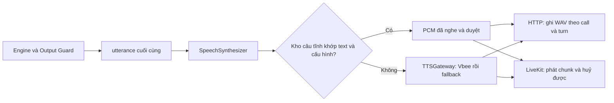

# Kế hoạch chuẩn hoá câu thoại và cache audio Vbee — 07/10/2026

**Người thực hiện duy nhất: Hưng.** Hưng phụ trách toàn bộ các bước rà soát, sửa template Engine, thu và kiểm audio, dựng kho, tích hợp cache, kiểm chứng và evidence.

Mục tiêu: câu cố định chỉ sinh giọng khi dựng hoặc đổi phiên bản audio; các cuộc gọi sau phát lại đúng bản đã nghe và duyệt. Câu chứa dữ liệu lịch hẹn vẫn sinh TTS từ `utterance` cuối cùng của Engine. Câu hỏi thông thường giữ các biến thể hữu hạn để lời thoại tự nhiên; mỗi biến thể được dựng audio riêng.

Trạng thái: **đã sửa lời thoại, thu và được Hưng xác nhận nghe đạt 73 audio; đã đóng gói release `2026-10-08-v1` và nối cache cho HTTP/LiveKit, bật mặc định trong code**. Chưa deploy/restart môi trường đang chạy. Không đánh dấu task 05/10 Done khi chưa nghe lại đủ các kịch bản. Giai đoạn đầu dùng lại audio câu cố định; cache câu có dữ liệu động để đợt sau.

## 1. Căn cứ và phạm vi

- [Contract AIHR-PC-001 rev 1.1](../../../tailieu/callbot-contract-vi.md): §1.1.1–§1.1.10, §1.2.1–§1.2.2; §4.1.3 yêu cầu audio đọc đúng `utterance`; §5.3 tính latency đến khi tải xong audio; §5.4 quy định báo chi phí theo format chương trình.
- [PRD v2.1, 05/10/2026](../../../tailieu/PRD-CallBot-VinMec-v2_1.pdf): R-23, R-25, R-29, R-30; R-38/R-39; R-42 và GC-NAT-01–05. Bản PRD đang có trong `tailieu` là v2.1, mới hơn v1.6 được nhắc ở đầu kế hoạch TTS.
- [tts-w3-w6.md](tts-w3-w6.md), task **T2 05/10 · Đường A — Rà soát và chuẩn hoá câu thoại toàn bộ kịch bản**: nghe đủ 7 kịch bản, sửa tại template, chốt câu tĩnh, dựng audio và manifest. Nối cache vào pipeline là việc tiếp theo, phải đo trước/sau.
- [Evidence 29/09](../evidence/tts-utterance-fidelity.md) và phiếu nghe local: đã sinh 34 câu nhưng bảng chấm nghe vẫn trống; template đã thay đổi nên audio cũ không đủ chứng minh snapshot hiện tại.

Phạm vi gồm Identity, Confirm, Cancel, Transfer, Reschedule, No-answer, Booking và các nhánh hỏi lại, im lặng, lời đáp mơ hồ/mâu thuẫn, hết slot, slot bị lấy, ngày không hợp lệ, ghi Clinic lỗi, output guard thay câu an toàn. HTTP và LiveKit dùng cùng catalog và cơ chế cache; nghiệp vụ tiếp tục ở cùng Engine.

## 2. Kết quả rà hiện trạng

**Cập nhật sau chuẩn hoá 08/10:** [danh sách câu gửi PM](../evidence/tts-static-cache/tts-utterances-pm-review-2026-10-12.md), [catalog JSON hiện tại](../evidence/tts-static-cache/tts-utterance-catalog-2026-10-08.json). Registry có 76 nguyên văn tĩnh: 73 câu trong đợt thu, 3 mẫu dự phòng chưa có call site được hoãn thu; 16 nhóm hỏi đáp có 3 biến thể, 15 renderer và 7 mảnh nội dung. Đợt thu có 4.690 ký tự, 8/73 câu mở bằng “Dạ”. Trước sửa là 124 câu, 85 câu mở bằng “Dạ”; các con số trong bảng dưới thuộc snapshot 07/10 và được giữ để đối chiếu.

Snapshot review cũ: `9e48549`. [CSV review 07/10](../evidence/tts-static-cache/tts-utterance-review-2026-10-07.csv) là baseline công cụ catalog dùng đối chiếu thay đổi. Phần review renderer đã gộp vào cuối plan này; không giữ thêm CSV renderer trùng nội dung.

| Phát hiện | Ý nghĩa / việc cần làm |
|---|---|
| 116 nguyên văn câu tĩnh khác nhau, 15 renderer; 24 nhóm có 4 cách nói | Cache theo từng nguyên văn được duyệt; không gom mọi câu của một nhóm vào một audio. Registry tĩnh dùng text làm key nên ID alias có thể dùng chung asset. |
| Tổng câu tĩnh hiện tại 8.227 ký tự | Ước tính quota cho một lần dựng một giọng ở snapshot hiện tại. Đây chưa phải chi phí tiền, chưa gồm audio động để audit, câu ghép im lặng hoặc câu phải sinh lại. |
| Audit cũ tạo 34 dòng, bỏ sót 90 ID/biến thể ngoài tập đã phân loại | Mở rộng từ registry và nhánh renderer; coverage thiếu phải khiến kiểm tra thất bại, không chỉ in cảnh báo. |
| Có biến thể cho chào đầu, chuyển máy và khung đọc lại | R-42 yêu cầu các nhóm an toàn giữ cố định. Câu chào đầu đi qua `ask()` rồi `choose_static()`, nên runtime đang chọn biến thể dù helper `greeting()` trả câu gốc. Cần chốt các nhóm được yêu cầu giữ cố định và bỏ biến thể không còn sử dụng khỏi catalog thu. |
| `speak_datetime()` và `attendance_facts()` chưa có dấu phẩy đã đề xuất ở evidence 29/09 | Thêm dấu câu trong Engine rồi nghe lại. Không xử lý dấu câu tại TTS. |
| OFFER_SLOTS có tổ hợp renderer dài 285 ký tự; SILENCE_REPROMPT tương ứng 320 | Đây là tổ hợp tham số hợp lệ trong renderer, chưa chứng minh đạt được E2E. Rút câu mời và kiểm các đường thực tế; không coi câu gốc dưới 300 là đủ. |
| RESCHEDULED_DONE hiện chỉ đọc thời gian | PRD R-29 còn yêu cầu khoa và cơ sở khi báo đổi xong. Việc bổ sung dữ liệu phải có nguồn tin cậy và metadata guard; không tự ghép dữ liệu phỏng đoán ở TTS. |
| AudioArtifactStore.cached_url có sẵn | Chỉ reuse cùng `call_id` + `turn` + hash text để retry. Cuộc gọi khác vẫn sinh lại; chưa có kho audio tĩnh dùng chung giữa các cuộc gọi. |
| SpeechSynthesizer gọi gateway cho cả sync và stream | Đây là điểm nối kho audio tĩnh chung. Cache riêng trong endpoint HTTP sẽ không tiết kiệm cho LiveKit. |
| HTTP và LiveKit đang tính tts_cost từ số ký tự được phát | Khi hit cache phải ghi chi phí provider bằng 0, tránh báo sai savings. Tách chi phí dựng audio khỏi chi phí request trong cuộc gọi. |

Số nhánh trong CSV renderer: 435 dòng, mỗi dòng lấy mẫu dài nhất của một tổ hợp tham số. Dữ liệu gồm 11 lịch seed × 3 cơ sở, 14 slot seed × 3 cơ sở, v0–v3, các prefix, ngày kín, action BOOK/RESCHEDULE và remaining mẫu 0/12. Đây là review tĩnh trên fixture, chưa phải 435 audio đã nghe hoặc bằng chứng mọi tổ hợp đều xuất hiện trong cuộc gọi.

## 3. Chốt chính sách lời thoại

| Nhóm | Chính sách câu chữ | Chính sách audio |
|---|---|---|
| Chào mở đầu outbound/inbound, handoff | Một câu chuẩn mỗi tình huống; luôn công bố AI và hỏi mở khi có thể xác minh | Thu nguyên câu và cache |
| Hỏi tên/ngày sinh, giới thiệu lại, hỏi lại ý, hỏi ngày mong muốn, giữ máy | Giữ 3 biến thể đã chuẩn hoá của nhóm có biến thể; phản hồi phù hợp ngữ cảnh | Thu/cache từng nguyên văn; không gọi LLM viết lại |
| Nhắc im lặng | Giữ cố định phần SILENCE và nguyên câu đang chờ theo R-08.c | SILENCE riêng có thể cache khi thực sự là utterance. SILENCE_REPROMPT với câu hỏi tĩnh: dựng nguyên câu ghép; với câu hỏi động: TTS |
| Đọc lại lịch theo R-03/R-30, xác nhận hủy lần hai | Cố định cấu trúc và câu hỏi an toàn; dữ liệu lấy từ Clinic/context đã được guard cho phép | Câu hủy tĩnh thu sẵn; câu có ngày giờ/khoa/cơ sở TTS động |
| Chuyển nhân viên | Một câu chuẩn mỗi lý do cần nói; không biến thể ngẫu nhiên | Thu/cache nguyên câu |
| Câu an toàn CONFIRMED_SAFE/CANCELLED_SAFE/RESCHEDULED_SAFE/BOOKED_SAFE | Cố định; chỉ được phát khi có receipt thành công | Thu/cache, luôn sau Output Guard |
| Đề xuất slot, báo đã đặt/đổi/xác nhận với ngày giờ, lý do ngày đã qua/hôm nay | Cấu trúc gọn, thông tin chính xác và ngắt nhịp rõ | TTS động ở giai đoạn đầu |

“Cố định để cache” nghĩa là một catalog nguyên văn có phiên bản. Nó không bắt mọi cuộc gọi dùng duy nhất một cách hỏi. Engine chọn trong tập câu duyệt; cache tìm audio của chính text được chọn. R-42 vẫn kiểm tra ít nhất 3 cách nói ở nhóm được phép và tránh lặp nguyên câu khi không thuộc ngoại lệ.

Các renderer `ASK_DATE_AGAIN` nhánh INVALID/TOO_BROAD × 2 action có 4 câu hữu hạn, không chứa ngày. Có thể đăng ký thành static để cache ở đợt kế tiếp. `CANCELLED_DONE` trùng nguyên văn `CANCELLED_SAFE`: dùng chung asset và giữ nguyên quyền phát theo receipt.

## 4. Review cần ưu tiên

Review toàn bộ câu tĩnh sau sửa nằm trong [danh sách gửi PM](../evidence/tts-static-cache/tts-utterances-pm-review-2026-10-12.md). Đã thu 73 câu tĩnh và Hưng xác nhận nghe đạt; các ví dụ renderer bên dưới lấy từ Engine hiện tại và mới chuẩn hoá văn bản, chưa có kết quả nghe renderer.

| Câu | Nguyên văn hiện tại / mẫu renderer | Mục đích |
|---|---|---|
| GREETING_OUTBOUND | Em chào anh chị. Em là trợ lý ảo AI của tổng đài Vinmec. Anh chị cho em xin họ và tên đầy đủ ạ? | Chào cố định, công bố AI, hỏi mở họ tên |
| GREETING_INBOUND | Tổng đài Vinmec xin nghe. Em là trợ lý ảo AI. Anh chị cho em xin họ và tên đầy đủ ạ? | Chào cố định theo chiều inbound |
| ASK_DOB | Anh chị cho em xin ngày, tháng, năm sinh ạ. | Bỏ Dạ đầu câu; ngắt nhịp đủ ngày, tháng, năm |
| ASK_DOB_DECLINED | Em cần đối chiếu ngày sinh trước khi hỗ trợ. Anh chị cho em xin đủ ngày, tháng, năm sinh ạ. | Mẫu dự phòng hoãn thu; nói rõ thông tin cần cung cấp |
| TRANSFER | Em xin chuyển máy tới nhân viên để hỗ trợ anh chị ạ. | Cố định, gọn, không thêm từ đáp lễ |
| ROUNDS_EXHAUSTED_TRANSFER | Lịch cũ của anh chị vẫn giữ nguyên. Em xin chuyển máy tới nhân viên để tìm giờ phù hợp ạ. | Giữ rõ lịch cũ và bước chuyển máy |
| GOODBYE_UNREACHABLE | Em xin kết thúc cuộc gọi. Em chào anh chị ạ. | Không hứa gọi lại khi chưa có scheduler |
| Ngày giờ | 3 giờ 30 chiều, thứ Tư ngày 14 tháng 10, tại Vinmec Times City | Dấu phẩy ngắt ngày giờ/cơ sở ngay trong Engine |
| OFFER_SLOTS khi ngày kín | Thứ Tư ngày 14 tháng 10 đã kín lịch. Gần nhất có khung 1: 10 giờ 30 sáng, thứ Năm ngày 15 tháng 10; khung 2: 3 giờ 30 chiều cùng ngày. Anh chị chọn khung nào ạ? | Mẫu renderer: hai slot cùng ngày đọc ngày một lần; khác ngày đọc đủ từng ngày |

Không bỏ khoa/thời gian/cơ sở bắt buộc để lấy câu ngắn. Với các câu CANCEL_CHOICE/CANCEL_CONFLICT/CANCEL_REASON_NOTED, giữ yêu cầu “hủy lịch” nếu logic hiện tại cần; chỉ bỏ ngoặc kép ở template khi audio thử chứng minh ngắt lạ. Không đổi quy tắc đồng ý/hủy hai lượt trong task sửa lời thoại.

Ngưỡng nội bộ đề xuất: câu hỏi thông thường khoảng 40–100 ký tự; đọc lịch/slot cố gắng ≤ 250 ký tự. PRD yêu cầu dưới 300, vì vậy gate nên là **< 300**, chặt hơn adapter Vbee cho phép tối đa 300. Với SILENCE hiện dài 34 ký tự cộng một khoảng trắng, câu đang chờ phải **≤ 264** để câu ghép ≤ 299; mục tiêu 250 để có dư địa. Thời lượng phát dài là vấn đề trải nghiệm riêng, không phải trần HTTP 8 giây.

## 5. Các bước thực hiện và đầu ra

### Bước A — Hoàn thiện catalog và coverage (Hưng, khoảng 0,5 ngày)

**Tiến độ 08/10 — đã xong bước xuất danh mục:** thêm `scripts/tts_utterance_catalog.py`, đọc nguyên văn từ registry và nhóm biến thể của Engine, gộp các ID cùng text, xuất CSV/JSON/Markdown vào `docs/evidence/tts-static-cache/`, số ký tự, hash text, tham chiếu nguồn và chính sách audio. Đã kiểm đủ 124 text tĩnh và 15 renderer, 6 test pass, Ruff lint/format pass. Chạy `python scripts/tts_utterance_catalog.py --date 2026-10-08 --dry-run` để kiểm mà không ghi file; bỏ `--dry-run` để xuất lại. Cả hai chế độ không gọi Vbee.

Catalog này là snapshot văn bản để review; trạng thái duyệt audio hiện tại nằm trong manifest release ở bước D. Sau sửa, chào đầu/chuyển máy còn một câu và catalog không còn cờ có biến thể ở nhóm cố định. Câu báo thành công giữ metadata receipt. Renderer động và mảnh nội dung không được tự coi là static. `CANCELLED_DONE` dùng chung audio với `CANCELLED_SAFE`; `SILENCE_REPROMPT` với câu hỏi tĩnh cần liệt kê nguyên câu ghép ở phần tiếp theo. Chưa hoàn tất audit mọi nhánh renderer và các câu ghép nhắc im lặng thực tế; script fidelity cũ vẫn có phạm vi 5 kịch bản (đã cập nhật ID nhóm gộp để tiếp tục chạy), chưa nghe audio; toàn bộ Bước A/task 05/10 chưa được đánh dấu Done.

1. Mở rộng `scripts/tts_fidelity_audit.py` từ 5 sang 7 kịch bản; lấy câu tĩnh trực tiếp từ registry, không hardcode lại text. Theo dõi alias cùng nguyên văn để tránh sinh hai lần.
2. Với renderer, khai báo bộ case gồm mọi nhánh tham số có ý nghĩa: v0–v3 đang còn dùng, BOOK/RESCHEDULE, 1/2 slot, cùng/khác ngày, giờ có/không có phút, clinic dài, khoa dài, ngày kín, prefix, còn/hết khung, câu hỏi mơ hồ, im lặng và receipt thành công. Loại tổ hợp không đạt được qua manager khỏi danh sách nghe production, nhưng giữ kiểm tra biên ở renderer.
3. Cập nhật catalog khi sửa câu hoặc bỏ biến thể. Phát hiện template/nhánh mới chưa phân loại phải làm lệnh audit thất bại.
4. Xuất bảng chứa ID, variant, nhánh, text thực, số ký tự, hash text, cache policy và trạng thái nghe. Không lấy file WAV cũ chỉ vì trùng tên ID.

Đầu ra: `--dry-run` phủ registry và mọi nhánh đã khai báo, bảng mới không còn ID chưa phân loại; ranh giới câu tĩnh/động rõ. Booking được audit ngay trong đợt này dù vào bộ chấm tuần 5.

### Bước B — Sửa và chốt văn bản (Hưng, khoảng 0,5–1 ngày)

**Đã thực hiện phần sửa lời 08/10 (Hưng):** [danh sách câu gửi PM](../evidence/tts-static-cache/tts-utterances-pm-review-2026-10-12.md), [CSV nguyên văn để thu](../evidence/tts-static-cache/tts-static-shortlist-2026-10-08.csv), [đối chiếu 125 ID/alias cũ](../evidence/tts-static-cache/tts-static-reduction-map-2026-10-08.csv). Chào đầu/chuyển máy giữ một câu; hỏi đáp giữ ba cách nói; gộp ba cặp nhóm cùng mục đích. Ba nhóm chưa có call site còn một mẫu dự phòng mỗi nhóm và hoãn thu. Engine chọn trong tập ba câu, ưu tiên câu chưa nói trong lịch sử và tránh mở liên tiếp bằng “Dạ” khi có lựa chọn khác; không thêm trạng thái phiên. Các renderer đọc lại an toàn chỉ nhận v0; manager không chọn biến thể cho chúng. Câu huỷ giữ từ khoá và hai lượt xác nhận; báo thành công giữ receipt. Ngắt nhịp ngày sinh/ngày giờ/cơ sở, rút prefix và câu mời slot, chỉ đọc ngày một lần khi hai slot cùng ngày, một slot hỏi có/không. Bỏ lời hứa gọi lại. Số câu mở bằng “Dạ” của danh sách thu giảm 85 → 8; text đợt thu 4.690 ký tự. Đã thu, được Hưng xác nhận nghe đạt và đóng gói audio ở bước C/D.

1. Áp review trong `templates.py`; sửa call site chọn biến thể trong manager/questions/inbound đối với nhóm cố định theo R-42. Giữ selector cho nhóm được phép; kiểm việc xoay v0–v2 không tự bảo đảm “không lặp” cho mọi số lượt.
2. Ngắt nhịp ngày sinh, thời gian, cơ sở; rút OFFER_SLOTS và prefix; kiểm cả SILENCE_REPROMPT. Câu có một/two slot phải đúng loại câu hỏi, không hỏi “chọn khung nào” khi chỉ có một khung.
3. Giữ mẫu xác nhận hủy lần hai; không thêm câu xác nhận thừa khi khách chọn rõ giờ theo R-23/R-29. Sau xác minh, đi tiếp ý định đã lưu theo R-43, không hỏi lại nhu cầu vô ích.
4. Bổ sung khoa/cơ sở ở RESCHEDULED_DONE nếu triển khai R-29 đầy đủ; cập nhật source registry/guard và kiểm receipt. Tách commit này khỏi sửa dấu câu để dễ review.
5. Chốt danh sách câu cố định bằng snapshot nguyên văn của catalog đã duyệt và hash. Đổi lời sau này phải đổi asset/manifest trong cùng thay đổi; tránh test chép lại hàm render mà không kiểm hành vi.

Đầu ra: diff trước/sau, catalog ứng viên cuối; không câu render/nhắc im lặng ≥ 300 trên miền đã kiểm, không mất thông tin bắt buộc. Câu chữ được review trước khi trả quota Vbee.

### Bước C — Thu Vbee và nghe nghiệm thu (Hưng, khoảng 0,5–1 ngày)

**Tiến độ 08/10:** đã thêm `scripts/tts_build_static.py` và thu đủ **73/73 audio ứng viên**, bằng 73 request thành công cho **4.690 ký tự nguyên văn**. Giữ giọng Ngọc Huyền, speed 1.0, PCM16 mono 8 kHz. Tổng thời lượng 4 phút 37 giây. Đã kiểm WAV, checksum và khóa text/cấu hình cho toàn bộ file; chạy lại nhận 73 file dùng lại, 0 câu cần sinh. Đây là số ký tự đã gửi; chưa đối soát số điểm thực tế trừ trên tài khoản. 69 test builder/catalog/provider pass; Ruff pass. [Evidence đợt thu](../evidence/tts-static-cache/tts-static-build-2026-10-08.json).

**Duyệt nghe 08/10:** Hưng xác nhận trong hội thoại: “tôi nghe và ổn hết rồi, không cần phiếu nghe csv hay html đâu”. Dùng xác nhận này để duyệt toàn bộ 73 audio đợt thu; không yêu cầu điền CSV/HTML. [Manifest release](../../assets/tts/static/2026-10-08-v1/manifest.json) ghi `approval.method=owner_confirmation`, người/ngày/lời xác nhận, và `listening_status=PASS` cho từng câu. Phiếu ứng viên cũ không phải nguồn duyệt của release này. Câu đổi trong tương lai cần nghe lại trước khi release.

Audio ứng viên vẫn ở `temp/tts/static-candidate/`. Kho release có 73 WAV và `manifest.json` trong `assets/tts/static/2026-10-08-v1/`, được Dockerfile đóng vào image chung cho HTTP/LiveKit. Ba mẫu dự phòng vẫn hoãn thu; câu ghép nhắc im lặng và audit renderer/7 kịch bản còn trong phạm vi rà soát tiếp theo.

Sau dọn file kiểm tra, kho ứng viên chỉ giữ 73 WAV và `build_manifest.json` để resume không phải gọi Vbee lại. Đã xoá HTML/CSV nghe, log/thư mục test và các bản catalog CSV/Markdown trùng JSON. Tài liệu đọc gồm plan này, danh sách gửi PM và evidence JSON; các CSV/JSON đầu vào của công cụ vẫn được giữ.

Tên 73 WAV đã đổi sang `NNN_TEMPLATE_ID_cac-tu-dau-khong-dau.wav`, ví dụ `001_ASK_CHANGE_OR_CANCEL_anh-chi-muon-doi-lich-hay-huy-lich.wav`. Số thứ tự khớp trang nghe; mã `_v1`/`_v2` phân biệt cách nói. Trang nghe, CSV và manifest đã cập nhật đường dẫn. Đổi tên giữ nguyên audio/checksum/khóa cache/kết quả review và không gọi Vbee; 24 test builder pass sau thay đổi.

```powershell
# Kiểm hash/file đã có; không ghi file, không gọi Vbee.
.venv/Scripts/python.exe scripts/tts_build_static.py --date 2026-10-08 --dry-run

# Đổi tên file đã thu để dễ đối chiếu; không gọi Vbee.
.venv/Scripts/python.exe scripts/tts_build_static.py --date 2026-10-08 --rename-files

# Chỉ gọi Vbee cho câu thiếu, đổi text/cấu hình hoặc file hỏng.
.venv/Scripts/python.exe scripts/tts_build_static.py --date 2026-10-08 --synthesize
```

1. Kiểm cấu hình effective của môi trường đích, không chỉ đọc YAML. Baseline YAML hiện là `hn_female_ngochuyen_full_48k-fhg`, speed 1.0, PCM16 mono 8 kHz, bitrate 128. Giữ baseline này cho đợt đầu; không tự đổi giọng dựa trên suy đoán và làm phí quota.
2. Sinh trực tiếp bằng Vbee cho câu cố định đã chốt; một request mỗi nguyên văn duy nhất. Script build có dry-run báo số câu/ký tự, resume theo hash toàn bộ cấu hình, và chỉ sinh phần đổi hoặc thiếu. Không dùng gateway fallback để vô tình đóng gói giọng ElevenLabs dưới nhãn Vbee.
3. Sinh audio mẫu của renderer theo bộ case đã chốt. Đây là audio audit, không đưa ngày/giờ mẫu vào kho static runtime. Dựng nguyên câu SILENCE_REPROMPT cho các câu hỏi tĩnh thực sự có thể được nhắc lại.
4. Công cụ build có thể xuất `index.html` và `listening_sheet.csv` để hỗ trợ nghe. Theo chỉ dẫn Hưng, đợt này ghi xác nhận đã nghe đạt trực tiếp vào manifest release; không cần nộp phiếu CSV/HTML.
5. Câu chưa đạt quay về sửa Engine, xuất `utterance` mới và chỉ sinh lại câu bị đổi. Không chỉnh transcript tại TTS, không cắt audio để che chữ sai.
6. Nghe từng nguyên văn static và từng nhánh dynamic đại diện, gồm ngày/giờ/khoa khó đọc. Thêm đánh giá PRD GC-NAT-05: 3 người nghe, 20 cuộc gọi mẫu, trung bình ≥ 4/5. Audit tự động/hash chứng minh đúng text đầu vào; người nghe mới chứng minh audio đọc đúng và tự nhiên.

Đầu ra cho 73 câu cố định: Hưng xác nhận nghe đạt; WAV/checksum/khóa text và cấu hình đã kiểm; manifest release ghi xác nhận này. Audit nhánh renderer và các cuộc gọi đầy đủ vẫn còn; không suy kết quả nghe từ việc sinh thành công.

### Bước D — Dựng kho audio có phiên bản (Hưng, khoảng 0,5 ngày)

**Đã thực hiện 08/10:** `scripts/tts_release_static.py` kiểm lại catalog/Engine, cấu hình và toàn bộ WAV/hash, ghi xác nhận nghe của owner và đóng gói atomically. Không gọi provider; không ghi đè release đã có. `config/tts_static.yaml` chọn release `2026-10-08-v1`. Kho chứa audio và manifest, không đóng gói CSV/HTML:

```text
assets/tts/static/2026-10-08-v1/
  manifest.json
  001_ASK_CHANGE_OR_CANCEL_anh-chi-muon-doi-lich-hay-huy-lich.wav
  ... (73 WAV)
```

Manifest gồm `schema_version`, `catalog_version`, revision/hash template, text nguyên văn/hash text, aliases của ID/variant, provider thực tế, endpoint/API mode không chứa secret, model/voice, speed, bitrate, sample rate, encoding/channels, thời lượng, số ký tự, đường dẫn, hash file audio, trạng thái nghe, người nghe, thời điểm dựng và xác nhận của owner. Câu tĩnh không chứa dữ liệu bệnh nhân. Usage lúc dựng tách khỏi cost của lượt phát lại.

Khóa cache dùng chung bởi builder/runtime (`inference.tts.static_identity`):

```text
SHA256(canonical_json({
  exact_text, provider, api_mode_or_model, voice,
  speed, bitrate, sample_rate, encoding, channels, schema_version
}))
```

Không lowercase, bỏ dấu, gộp khoảng trắng, sửa dấu câu hoặc tìm gần đúng text. Khác một ký tự thì miss. `template_id` phục vụ truy vết; hash nguyên văn và cấu hình mới quyết định audio nào đúng. Phiên bản catalog dùng để chọn/release kho; audio hash dùng phát hiện hỏng/đổi file.

Build chỉ ghi thành công khi WAV có frames > 0, PCM16 mono 8 kHz, checksum đúng và metadata không thiếu. Viết atomically; manifest không công bố entry chưa hoàn tất. Kho release nằm tách `audio_dir` của các cuộc gọi để `purge_older_than()` không xoá nó. Kho đóng gói trong image hoặc artifact immutable tải về trước khởi động; không fetch audio qua mạng trong request chỉ để tiết kiệm Vbee.

Đầu ra: kho ứng viên có thể kiểm tra offline; dry-run và resume không gọi Vbee cho entry đã đúng hash. Không ghi API token/app credentials vào manifest, log hoặc git.

### Bước E — Nối cache cho HTTP và LiveKit (Hưng, khoảng 1 ngày)

**Đã thực hiện 08/10 trên nhánh đang làm:** `src/speech/tts/static_cache.py` đọc manifest release và kiểm text/hash/cấu hình/PASS/WAV/checksum khi khởi tạo. Store giữ PCM bất biến trong RAM, dùng chung giữa các bundle trong một process. `SpeechSynthesizer` dùng store cho cả sync HTTP và stream LiveKit; miss tiếp tục gateway/fallback hiện có. File thiếu/hỏng lúc nạp không được phát. Thay release cần restart để nạp lại PCM đã kiểm.

HTTP: câu trúng cache trả `audio_url` dạng `/audio-static/<cache_key>.wav`, phục vụ thẳng WAV đã kiểm checksum từ RAM, không ghi file theo lượt; cùng câu luôn cùng URL nên retry vẫn đúng. Câu miss vẫn lưu WAV theo call/turn như cũ. LiveKit phát chunk PCM 20 ms, có cơ hội huỷ trước mỗi chunk; state huỷ riêng từng lượt và CallBridge vẫn xả queue khi nói chen. Span ở cả hai transport ghi `cache_hit`, khóa/cache version và `billed_characters=0`, `cost_usd=0` trên hit; không suy số điểm billed cho câu động.

`TTS_STATIC_ENABLED=false` tắt cache; `TTS_STATIC_DIRECTORY` chọn phiên bản khác. Thay nguyên văn hoặc voice/speed/rate/bitrate/encoding/schema sẽ miss. `Dockerfile` đóng cùng kho audio vào image của hai service; không tải file audio qua mạng trong request. Chưa thực hiện deploy hoặc restart service đang chạy.



1. Store `src/speech/tts/static_cache.py` được truyền vào `SpeechSynthesizer` trong `src/speech/bundle.py`; không đưa logic câu thoại vào transport.
2. Sync: exact match + cấu hình + asset valid → `AudioSegment` từ PCM có metadata cache; miss/lỗi đọc/hash sai → gateway synthesize đúng text. Hit trả URL tĩnh `/audio-static/<cache_key>.wav` (sửa theo review 08/10); miss giữ `AudioArtifactStore.save()` và cache retry theo call/turn.
3. Stream: cùng lookup; hit → decode WAV header trước, yield PCM theo chunk phù hợp (ví dụ 20 ms = 320 byte ở 8 kHz PCM16), chừa cơ hội scheduler/cancel giữa chunk; không bơm toàn bộ câu một lượt vào queue. AudioSource vẫn lo nhịp phát và backpressure.
4. Mỗi lượt có handle/cờ huỷ riêng; cancel cache không ảnh hưởng lượt mới. Tiếp tục `clear_queue()` tại CallBridge khi nói chen. Cache không đổi logic partial turn/receipt.
5. Cache hit không gọi provider hay fallback; miss theo luồng hiện có. Tắt tính năng bằng cờ cấu hình phải trở về đường đang chạy. Không tự ghi mọi câu động vào cache dùng chung trong giai đoạn đầu.
6. Cache lookup xử lý `utterance` đã qua guard, không được dùng câu DONE_SAFE/TRANSFER thay một text bị miss. Asset tồn tại không có nghĩa câu được phép nói.
7. Câu hệ thống lỗi ghi sẵn theo R-39/GC-STR-05 là nhánh tích hợp riêng: đăng ký template và action Engine tương ứng, kiểm không báo lỗi thay cho thành công đã ghi. Không phát thêm một audio ngoài `utterance` HTTP. Không trộn yêu cầu này với fallback đọc cùng text.

Đầu ra: cùng câu/cấu hình được dùng trong hai cuộc gọi khác nhau không phát sinh request Vbee; câu động tiếp tục synthesize; barge-in dừng cả cache và provider đúng cách.

### Bước F — Kiểm chứng, đo và release (Hưng, khoảng 0,5 ngày)

**Kiểm chứng code 08/10:** 767 test pass, 9 skip, 0 fail trong các nhóm TTS provider/gateway, speech, HTTP, LiveKit, tracing, builder/catalog và config. Tất cả 73 utterance phát PCM giống nhau qua sync/stream, không gọi provider/fallback. Test HTTP/Core kiểm hai call_id và các turn: URL WAV 8 kHz mono tải ngay, hit có cost/characters bằng 0, readback ngày giờ vẫn gọi provider, mode=text giữ audio_url null. Test LiveKit kiểm PCM/frame, nói chen xả queue và lượt mới phát lại được. Test invalidation/config/file/PASS và chia sẻ store giữa hai bundle đã pass. Các skip thuộc dependency/fixture tuỳ chọn, xem [evidence](../evidence/tts-static-cache/tts-static-build-2026-10-08.json).

Đã kiểm cấu hình effective hiện tại: provider Vbee, cache bật, 73 asset hợp lệ. Chưa build/deploy image hoặc đo latency/billing trên môi trường thật; phần đo/gate đủ 7 kịch bản vẫn còn. Để áp dụng vào Docker đang chạy, rebuild/restart cả hai service bằng `docker compose up -d --build bot livekit-worker` trong môi trường cần áp dụng. Với compose prod, dùng image mới theo quy trình deploy của repo. Không cần gửi lại 73 câu tới Vbee.

Kiểm tra có ý nghĩa cho thay đổi này:

| Kiểm chứng | Điều kiện đạt |
|---|---|
| Coverage toàn registry và nhánh | Không bỏ sót ID/nguyên văn; renderer mới chưa phân loại fail gate |
| Text/audio fidelity | HTTP `/calls` và `/turn` gửi/phát đúng `utterance`; cùng đầu vào HTTP/stream ghép đúng văn bản; nghe lại đạt |
| Cache giữa cuộc gọi | Nhiều call_id dùng câu tĩnh cùng config: provider call count = 0 sau khi đã có asset |
| Invalidation | Đổi text/dấu câu/voice/speed/rate/encoding/bitrate/schema → miss; không dùng file cũ |
| Asset lỗi/missing | Checksum/WAV sai, file thiếu → synthesize đúng text hoặc lỗi chuẩn; không phát câu khác |
| Safety | Không tiết lộ trước identity, không đề xuất slot ngoài snapshot, không “đã hủy/đã đổi” trước receipt 200 |
| R-42 | Câu cố định giống nhau; nhóm biến thể ≥ 3 cách nói trong 5 cuộc mẫu, hỏi lại phù hợp và không lặp sai quy định |
| SILENCE_REPROMPT | Nguyên câu ghép được đọc đủ; mọi câu < 300, đúng phân nhánh inbound/outbound |
| LiveKit cancel | Không phát chunk sau cancel; queue được xoá; huỷ lượt cũ không huỷ lượt mới; fallback/error giữa câu giữ semantics |
| HTTP readiness | WAV 8 kHz mono tải ngay; mode=text vẫn audio_url null; không có URL trỏ tới file chưa hoàn tất |
| Chi phí | Hit cache provider cost = 0; miss và build tính theo usage thật/config giá; không suy phí từ thời lượng phát |

Chạy nhóm test liên quan `tests/engine/`, output guard, HTTP audio fidelity, `tests/speech/`, gateway và `tests/transports/livekit/`; kiểm các eval regression đang có cho 7 scenario. Số lượt test và pass thực tế ghi khi triển khai, không ghi kết quả dự kiến thành PASS.

Đo trên cùng môi trường đích và cùng bộ cuộc gọi tổng hợp trước/sau: tắt/bật cache, cold start và warm, cùng voice/speed/rate, cùng các câu dynamic. Ghi HTTP latency bao gồm download audio; LiveKit thời gian từ khách dứt lời đến âm đầu và TTS TTFA; p50/p95; cache hit/miss; Vbee request count; billed characters; fallback/error. Có thể bắt đầu 20 cuộc × 7 scenario (140 cuộc, chọn số lượt từng scenario cố định), báo số mẫu thực tế. Không đánh giá p95 bằng vài câu thử, không gọi bộ local là harness ẩn của mentor.

Thêm metadata vào `AudioSegment`/TTS stream info và span: `cache_hit`, `cache_key`, `catalog_version`, `billed_characters`, `cost_usd`. Giữ provider/voice gốc mô tả nguồn asset. Không đưa nội dung lời bệnh nhân vào trace để phục vụ cache. Chi phí build được báo riêng; không tự tuyên bố format chấm điểm sẽ chấp nhận một cách phân bổ khi §5.4 chưa được đối chiếu với format của chương trình.

Release staging trước, kiểm hit/miss và audio; đóng gói catalog với template cùng phiên bản rồi đưa prod theo quy trình repo. Rollback bằng tắt cache hoặc quay lại cặp template/catalog cũ, không thay Clinic Mock.

## 6. Đo chi phí và kỳ vọng

```text
S = tổng ký tự static duy nhất được dựng
B = tổng ký tự static lẽ ra bị tính phí trong tập cuộc gọi
H = tổng ký tự static thực sự hit cache trong tập cuộc gọi
R = ký tự phải sinh lại khi sửa/chốt audio

Ký tự provider tiết kiệm ròng = H - S - R
Tỉ lệ giảm ký tự TTS runtime = H / tổng ký tự TTS baseline
```

Nếu đơn giá đồng nhất và quota tính theo ký tự, nhân với đơn giá tài khoản để ước tính tiền; nếu gói quota/giá khác, dùng usage và cơ chế của chính tài khoản. Không đặt một % tiết kiệm cố định khi chưa có tần suất câu trong cuộc gọi và giá effective. Nhiều biến thể vẫn tiết kiệm: mỗi biến thể trả quota một lần khi dựng, dùng lại nhiều lần.

Cache chỉ loại bỏ thời gian gọi/sinh Vbee của câu hit. Thời gian STT, Engine, lưu/tải file và playout vẫn tồn tại; không hứa toàn lượt xuống dưới một con số khi chưa đo. Mục tiêu cụ thể là **không có request provider cho static hit**, giữ fidelity, giảm p95 đo được mà không làm câu động hay fallback xấu đi.

## 7. Tiến độ đề xuất và điều kiện hoàn tất

| Mốc đề xuất, giờ Việt Nam | Việc | Điều kiện chuyển bước |
|---|---|---|
| 07/10 | Review toàn bộ câu và thống nhất nhóm cố định/biến thể; sửa điểm ưu tiên | Catalog văn bản được chốt để thu; rõ các việc guard/Engine riêng |
| 08/10 | Thu Vbee, nghe, sửa/sinh lại phần lỗi; dựng manifest | Không entry chưa nghe được đưa vào release |
| 09/10 | Nối cache chung, kiểm HTTP/LiveKit/cancel, benchmark và diễn tập | Có bằng chứng zero provider call cho hit và fidelity/parity pass |
| Trước Gate W4 10/10 | Hoàn thiện evidence và kiểm môi trường đích | Task 05/10 chỉ Done khi nghe đủ, sửa xong và có catalog/audio/manifest; cache runtime có acceptance riêng |
| Trước Booking được chấm tuần 5 | Regression lại sau thay đổi Engine cuối tuần | Booking và asset không bị lệch phiên bản; bổ sung câu mới nếu có |

Ước lượng tổng 3–4 ngày công do Hưng thực hiện, phụ thuộc vòng nghe/sửa; các mốc 08–09/10 khá sát nếu có nhiều câu phải sửa hoặc Engine thay đổi đồng thời. Không bỏ bước nghe để kịp gate. Hưng phụ trách cả template/call site/guard, TTS/build/cache/evidence và kiểm chứng end-to-end/barge-in; các bước được thực hiện tuần tự theo điều kiện chuyển bước.

Kết thúc đợt chuẩn hoá khi đủ 7 kịch bản đã được nghe và có kết quả; mọi câu lỗi đã sửa tại Engine và nghe lại; nhóm cố định/biến thể tuân theo PRD; không câu vượt ngưỡng; có catalog, hash, audio và manifest nhất quán. Kết thúc đợt cache khi HTTP/LiveKit cùng dùng kho, static hit không gọi Vbee, lỗi/miss/cancel xử lý đúng và số đo latency/cost trước/sau đã ghi vào evidence.


## 8. Review renderer trước sửa (snapshot 07/10)

Bảng dưới giữ nguyên mẫu trước sửa để đối chiếu; không dùng nó làm transcript thu hiện tại. Catalog JSON và Engine là nguồn lời thoại sau sửa.

Độ dài dưới đây là lớn nhất quan sát được trên 11 lịch seed × 3 tên cơ sở, 14 slot seed × 3 tên cơ sở, v0–v3 và các nhánh tham số. Không chứng minh trần cho mọi dữ liệu tương lai. OFFER_SLOTS dùng 2 slot cùng cơ sở, khác ID, remaining mẫu 0/12; có tổ hợp tham số hợp lệ ở renderer nhưng manager có thể không phát ra. Khi triển khai phải bổ sung kiểm tra các nhánh thực sự đạt được qua Engine và miền dữ liệu triển khai.

| Renderer | Nhánh tham số kiểm | Max ký tự | Ví dụ dài nhất | Hướng sửa / cache |
|---|---:|---:|---|---|
| `APPOINTMENT_SUMMARY` | 4 | 177 | Cảm ơn anh chị. Lịch khám Nội tổng quát của anh chị là 3 giờ 30 chiều thứ Tư ngày 14 tháng 10 tại Phòng khám Đa khoa Trung tâm ạ. Anh chị có đến khám được theo lịch này không ạ? | Rút phần dẫn; giữ khoa, thứ/ngày/giờ/cơ sở và câu hỏi đến khám. Cố định khung đọc lịch theo R-42; TTS động. |
| `ATTENDANCE_READBACK` | 4 | 148 | Dạ, em xin xác nhận thông tin lịch khám Nội tổng quát 3 giờ 30 chiều thứ Tư ngày 14 tháng 10 tại Phòng khám Đa khoa Trung tâm. Anh chị đồng ý chứ ạ? | Cố định khung; chỉ hỏi khi cần theo R-23. Thêm dấu phẩy quanh thời gian/cơ sở; TTS động. |
| `ATTENDANCE_REREAD` | 4 | 174 | Dạ, em xin xác nhận thông tin lịch khám Nội tổng quát 3 giờ 30 chiều thứ Tư ngày 14 tháng 10 tại Phòng khám Đa khoa Trung tâm. Anh chị có đến khám được theo lịch này không ạ? | Cố định khung đọc lại; không biến thể hóa phần an toàn; TTS động. |
| `CANCEL_READBACK` | 4 | 181 | Dạ, em xin xác nhận thông tin lịch khám Nội tổng quát 3 giờ 30 chiều thứ Tư ngày 14 tháng 10 tại Phòng khám Đa khoa Trung tâm. Anh chị chắc chắn muốn hủy lịch khám này đúng không ạ? | Giữ nguyên câu CANCEL_RECONFIRM ở đuôi; cố định phần đọc lịch. Không cache ngày giờ; TTS động. |
| `CONFIRMED_DONE` | 1 | 133 | Dạ, em đã xác nhận lịch khám 2 giờ 30 chiều thứ Hai ngày 19 tháng 10 tại Phòng khám Đa khoa Trung tâm cho anh chị. Hẹn gặp anh chị ạ. | Thêm ngắt nhịp; thông tin từ receipt; TTS động, sau ghi thành công. |
| `KEEP_APPOINTMENT` | 4 | 188 | Lịch cũ được giữ nguyên ạ. Em xin nhắc lại: lịch khám Nội tổng quát 3 giờ 30 chiều thứ Tư ngày 14 tháng 10 tại Phòng khám Đa khoa Trung tâm. Anh chị có đến khám được theo lịch này không ạ? | Rút câu dẫn; giữ đầy đủ lịch cũ và không nói đã xác nhận khi chưa có receipt; TTS động. |
| `OFFER_SLOTS` | 288 | 285 | Dạ, em đọc lần lượt hai khung một để anh chị dễ nhớ ạ. Dạ, thứ Tư ngày 14 tháng 10 đã kín lịch. Em tìm được các khung gần nhất: khung 1 là 10 giờ 30 sáng thứ Năm ngày 15 tháng 10; khung 2 là 3 giờ 30 chiều thứ Năm ngày 15 tháng 10. Ngoài ra còn 12 khung khác. Anh chị chọn khung nào ạ? | Rút lead, prefix và phần đếm còn lại; kiểm tất cả full_date/invite/remaining. Tối đa 2 khung; TTS động. |
| `ASK_DATE_AGAIN` | 16 | 92 | Dạ, hôm nay là thứ Tư ngày 14 tháng 10. Anh chị muốn đổi sang hôm nay hay thứ Tư tuần sau ạ? | PAST/TODAY có ngày động: TTS. INVALID/TOO_BROAD × 2 action là 4 câu hữu hạn: có thể đăng ký static và cache sau refactor riêng. |
| `SLOT_OFFER_READBACK` | 96 | 212 | Dạ, em đọc lần lượt hai khung một để anh chị dễ nhớ ạ. Dạ, thứ Tư ngày 14 tháng 10 đã kín lịch. Em xin nhắc lại khung trống: chiều thứ Năm ngày 15 tháng 10 còn khung 3 giờ 30 chiều. Anh chị đổi sang giờ đó nhé ạ? | Tránh lặp buổi (chiều ... 3 giờ chiều); cố định khung đọc ngày giờ; TTS động. |
| `SLOT_READBACK` | 8 | 135 | Dạ, em nhắc lại thông tin đổi lịch sang 10 giờ 30 sáng thứ Năm ngày 15 tháng 10 tại Phòng khám Đa khoa Trung tâm. Anh chị đồng ý chứ ạ? | Cố định khung đọc lại theo R-30; giữ thời gian/cơ sở; TTS động. |
| `SLOT_READBACK_DA` | 2 | 125 | Dạ, anh chị đồng ý đổi lịch sang 10 giờ 30 sáng thứ Năm ngày 15 tháng 10 không ạ? Nếu đồng ý, anh chị nói “đồng ý” giúp em ạ. | Một câu có/không cho câu đáp mơ hồ; bỏ ngoặc kép trong template nếu nghe ngắt lạ. TTS động. |
| `CANCELLED_DONE` | 1 | 38 | Dạ, em đã hủy lịch khám cho anh chị ạ. | Cùng text với CANCELLED_SAFE; dùng chung asset, giữ metadata success và guard. |
| `RESCHEDULED_DONE` | 1 | 83 | Dạ, em đã đổi lịch khám sang 10 giờ 30 sáng thứ Năm ngày 15 tháng 10 cho anh chị ạ. | PRD R-29 yêu cầu khoa/cơ sở trong báo kết quả; hiện chỉ có thời gian. Bổ sung nguồn dữ liệu tin cậy và guard trong thay đổi Engine riêng; TTS động. |
| `BOOKED_DONE` | 1 | 73 | Dạ, em đã đặt lịch 10 giờ 30 sáng thứ Năm ngày 15 tháng 10 cho anh chị ạ. | Giữ thông tin slot đã ghi; thêm ngắt nhịp; TTS động. |
| `SILENCE_REPROMPT` | 1 | 320 | Alo, anh chị còn nghe máy không ạ? Dạ, em đọc lần lượt hai khung một để anh chị dễ nhớ ạ. Dạ, thứ Tư ngày 14 tháng 10 đã kín lịch. Em tìm được các khung gần nhất: khung 1 là 10 giờ 30 sáng thứ Năm ngày 15 tháng 10; khung 2 là 3 giờ 30 chiều thứ Năm ngày 15 tháng 10. Ngoài ra còn 12 khung khác. Anh chị chọn khung nào ạ? | Phụ thuộc nguyên văn câu đang chờ. Câu hỏi tĩnh: prebuild nguyên câu ghép; câu hỏi động: TTS. Không chỉ phát SILENCE thay cả utterance. |

## 9. Kiểm chứng phần sửa lời 08/10

- Ruff lint/format đạt trên các file đổi. Bộ kiểm gồm toàn bộ `tests/engine`, HTTP `test_calls`, eval nhãn biến thể và catalog: **3.911 pass, 1 skip; 1 fail ở upload audio 48 kHz do môi trường thiếu `soxr`**, nằm ngoài phần template/selector. Các kiểm tra xác minh, huỷ hai lượt, receipt, chọn đúng slot, guard và HTTP gửi đúng `utterance` sang TTS đều pass; không gọi provider trả phí.
- Kiểm độ dài trên 11 lịch seed × 3 cơ sở và 14 slot seed; 26.208 tổ hợp OFFER_SLOTS (hai slot cùng/khác ngày, prefix, v0–v3, remaining 0/12, ngày kín, lời mời BOOK/RESCHEDULE). Max OFFER_SLOTS **237 ký tự**, SILENCE_REPROMPT ghép câu dài nhất **272 ký tự**; các renderer kiểm đều <300. Đây là miền fixture tổng hợp, chưa chứng minh mọi tổ hợp đạt được qua manager hoặc trần cho mọi tên cơ sở/khoa tương lai.
- Bổ sung kiểm ba biến thể sau khôi phục context, tránh lặp khi số lượt nhảy ba bước, tránh “Dạ” liên tiếp khi còn lựa chọn; readback an toàn từ chối v1 cũ; câu ghép slot dài kèm prefix vẫn <300 trên fixture kiểm. Các test lời bot cũ được cập nhật theo text mới; lời người gọi giữ nguyên.
- Tập ba câu hữu hạn không tự chứng minh GC-NAT-03 cho mọi cuộc gọi: khi cả ba đã dùng, selector quay vòng và tránh câu bot gần nhất. Cần audit các đường đạt được và nghe cuộc gọi mẫu; không đánh dấu R-42/task 05/10 Done ở giai đoạn này.
- R-29: câu báo đổi xong đã đọc cơ sở từ slot nguồn; bổ sung khoa từ dữ liệu ghi tin cậy vẫn là thay đổi nguồn/guard riêng ở Bước B.4. Không suy đoán khoa từ ID slot. Phần này cần hoàn tất trước khi nghiệm thu đầy đủ R-29.
- Tiếp theo: hoàn thiện audit đủ 7 kịch bản và liệt kê câu ghép im lặng; nghe renderer/các câu ghép cần bổ sung. Kho 73 câu cố định đã được Hưng xác nhận nghe đạt và có `listening_status=PASS` trong manifest release.

## 10. Xử lý review 08/10

Review đọc commit `3f3f4a4` (plan 07/10). Các ý về số liệu cũ, `*_VERIFY_FIRST`, biến thể câu chào và `GOODBYE_UNREACHABLE` hứa gọi lại đã được xử lý trong `77be770`.

- **Độ dài < 300 trên toàn registry:** `tests/engine/test_utterance_length.py` quét 76 câu tĩnh và cả 15 renderer trên toàn bộ lịch/slot seed của Clinic Mock x 3 cơ sở, thêm ngày giờ dài nhất ("12 giờ 45 chiều, Chủ nhật ngày 27 tháng 12"), và ghép nhắc im lặng với mọi câu. Renderer mới chưa khai báo miền dữ liệu làm test fail. Dài nhất hiện tại: SILENCE_REPROMPT 276, OFFER_SLOTS 241 ký tự. Các test cũ thống nhất ngưỡng `< 300`.
- **Audio thiếu trong image:** test kiểm `Dockerfile` COPY đúng thư mục release đang cấu hình và `.dockerignore` không loại nó. Không nạp được manifest, cấu hình lệch, hoặc nạp thiếu asset giờ ghi `logger.error` (`TTS_STATIC_MANIFEST_UNAVAILABLE`, `TTS_STATIC_MANIFEST_MISMATCH`, `TTS_STATIC_ASSETS_SKIPPED`) thay vì warning.
- **HTTP chép WAV mỗi lượt khi trúng cache:** trước đây mỗi hit vẫn mã hoá và ghi WAV + file hash theo call/turn (đo ~3,5 ms, 59 KB/lượt). Giờ hit trả `/audio-static/<cache_key>.wav`: route công khai như `/audio/*`, trả bytes WAV đã kiểm checksum từ RAM, `Cache-Control: immutable`; cache key lạ, sai định dạng hoặc `manifest.json` trả 404. Câu động không đổi.
- **Còn mở:** `_rounds_exhausted()` dùng chung cho đặt lịch mới nên nói "Lịch cũ của anh chị vẫn giữ nguyên" với người chưa có lịch (đã tái hiện: inbound đặt lịch, hết 2 vòng). Sửa cùng đợt sửa logic BOOK; cần 2 câu tĩnh mới và release audio mới.
