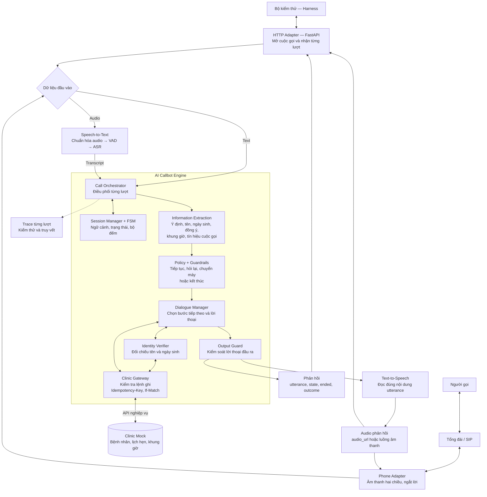
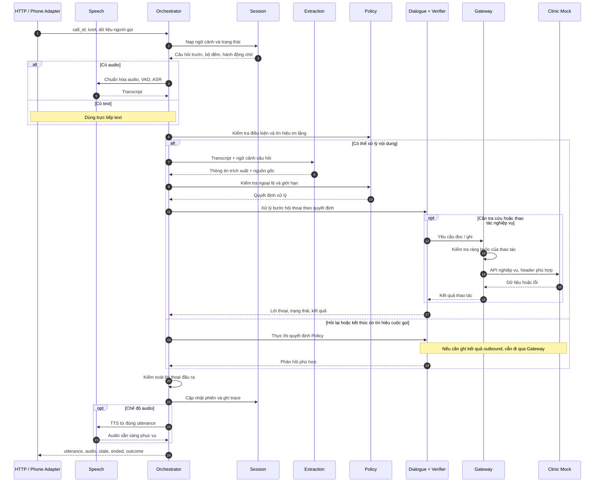
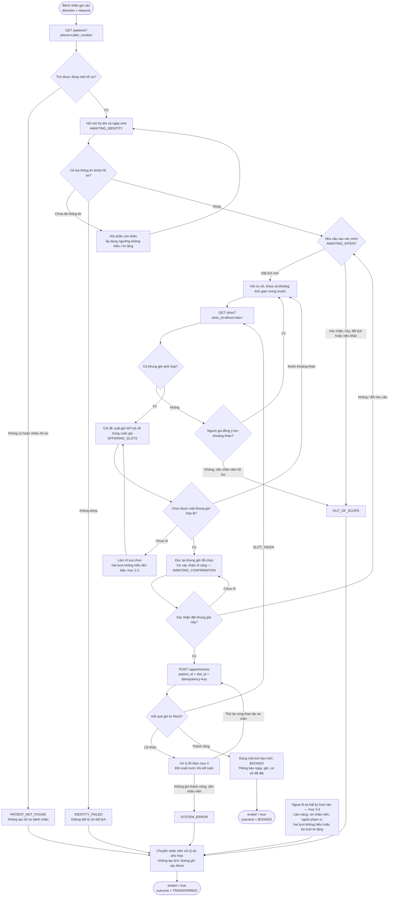
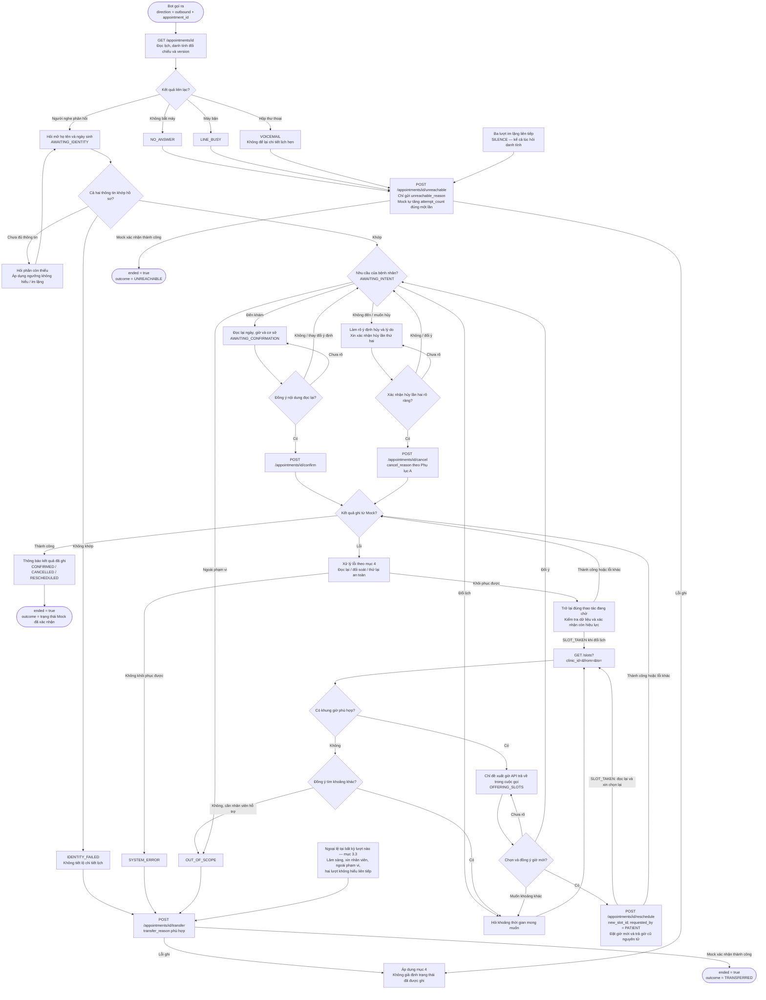
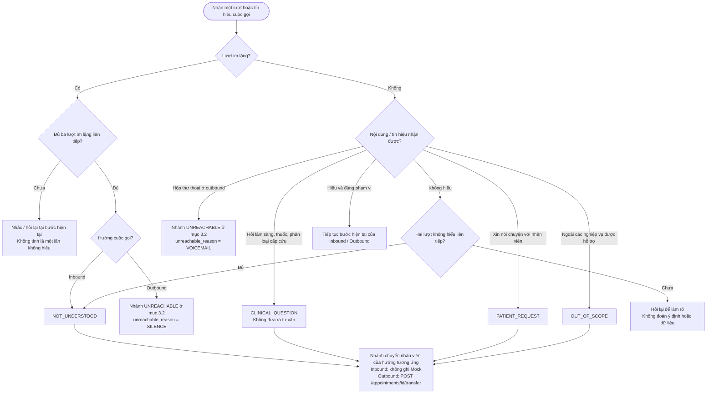

# AI Callbot Vinmec — Kiến trúc và luồng hoạt động

Tài liệu mô tả **kiến trúc đích**  ngày 16/09/2026.

Mở file bằng trình xem Markdown hỗ trợ Mermaid để hiển thị sơ đồ.

## 1. Kiến trúc tổng thể

HTTP phục vụ chấm điểm; điện thoại phục vụ cuộc gọi thực. Cả hai dùng chung một lõi nghiệp vụ. Clinic Mock là nguồn duy nhất có thẩm quyền về trạng thái lịch hẹn.

Các ranh giới trách nhiệm:

- **Session Manager** giữ trạng thái hội thoại và bản đọc tạm của dữ liệu cần thiết; không tạo kho trạng thái lịch hẹn độc lập.
- **Information Extraction** trích thông tin từ lời người gọi theo câu bot vừa hỏi; không nhận hồ sơ danh tính chuẩn để suy đoán câu trả lời.
- **Verifier** đối chiếu tên và ngày sinh; số điện thoại chỉ phục vụ tra cứu.
- **Policy và Gateway** kiểm soát quyết định và lệnh ghi. Nếu dùng LLM, LLM không được bỏ qua các kiểm soát này.
- **Output Guard** kiểm tra lời thoại trước khi gửi hoặc tổng hợp tiếng nói, đặc biệt với thông tin lịch hẹn và nội dung lâm sàng.
- **Phone Adapter** chuyển đổi tín hiệu điện thoại sang giao diện chung của lõi; việc chuyển máy thật cần tích hợp với tổng đài.

## 2. Một lượt hội thoại được xử lý như thế nào?

Sơ đồ mô tả lượt sau khi đã mở phiên. Các bước đọc/ghi Clinic Mock chỉ thực hiện khi nghiệp vụ cần.

Trong HTTP audio mode, `audio_url` phải sẵn sàng khi trả phản hồi và đọc đúng `utterance`. Hai endpoint chấm điểm phải phản hồi trong 8 giây; phép đo độ trễ của harness tính cả việc tải audio. Đây là yêu cầu hợp đồng, chưa phải kết quả đo của repo.

## 3. Luồng nghiệp vụ Inbound và Outbound

Hai luồng dưới đây mô tả nghiệp vụ đích, đối chiếu [contract Rev 1.1 §1–§4 và Phụ lục A](https://callbot-contract-site-rev11.vercel.app/#s1) ngày 18/09/2026. Contract có bảy nhóm tình huống: xác minh danh tính, xác nhận đến khám, hủy, chuyển nhân viên, đổi lịch, không liên lạc được và đặt lịch mới. Inbound chỉ hỗ trợ đặt lịch mới; Outbound xử lý lịch hẹn có sẵn.

Mọi lượt chờ người gọi trả lời đều đi qua kiểm tra ngoại lệ ở mục 3.3, kể cả khi chưa xác minh danh tính. Mọi API đọc/ghi đều áp dụng xử lý lỗi ở mục 4. Các nút “thành công” chỉ được đi tới sau khi Mock xác nhận; không suy ra thành công từ lời người gọi hoặc trạng thái hội thoại.

### 3.1. Inbound — Bệnh nhân gọi vào đặt lịch mới

Đầu vào: `direction=inbound`, `caller_number`, không có `appointment_id`. Số điện thoại chỉ dùng tìm hồ sơ; phải xác minh cả họ tên và ngày sinh trước khi đề xuất lịch. Sơ đồ dùng các endpoint nghiệp vụ dưới tiền tố `/v1`.

Inbound chuyển máy không gọi `/appointments/{id}/transfer` vì chưa có lịch hẹn. Harness kiểm tra `outcome=TRANSFERRED` và nhật ký không có lệnh ghi cho cuộc gọi; không chấm `transfer_reason` của nhánh này (§2.1). Lý do vẫn được giữ trong ngữ cảnh/trace để nhân viên tiếp nhận. Nếu tạo lịch bị timeout và chưa rõ kết quả, phải đối soát theo mục 4 trước khi chọn nhánh kết thúc; không thể coi là “chưa tạo” chỉ vì chưa nhận được phản hồi.

### 3.2. 

Đầu vào: `direction=outbound`, `appointment_id`. Danh sách gọi trong ngày có thể lấy từ `GET /appointments?date=&clinic_id=`; mỗi phiên chỉ được ghi vào lịch hẹn đã chỉ định lúc bắt đầu. HTTP harness cấp trực tiếp mã này, không cần thực sự quay số. Trong sơ đồ, `/appointments/id` viết gọn cho `/appointments/{appointment_id}` của phiên; các endpoint nằm dưới `/v1`.

Nhánh xác nhận chỉ thành công khi Mock có `CONFIRMED`, `confirmed_at` và `confirmed_via=callbot`. Nhánh hủy phải có `CANCELLED` và `cancel_reason`; “không đến được” chưa đủ để ghi hủy nếu thiếu xác nhận lần hai. Nhánh đổi phải có `RESCHEDULED`, `new_slot_id` và đã giải phóng khung giờ cũ; không tách thành hủy lịch cũ rồi đặt mới (§1.1.3–§1.1.6, §2.2).

`NO_ANSWER` và `LINE_BUSY` là tín hiệu của cuộc gọi điện thoại thực; câu người nghe nói “tôi đang bận” không tự chứng minh máy bận. Trên đường HTTP chấm điểm, harness tạo `VOICEMAIL` bằng clip lời chào và `SILENCE` bằng `silence_ms > 0` (§4.2.5). Việc gọi lại ở lần sau không có lịch hay số lần tối đa được contract quy định; sơ đồ chỉ mô tả một lần liên lạc.

### 3.3. Ngoại lệ được kiểm tra trong suốt hai luồng

Hai bộ đếm độc lập và chỉ đếm chuỗi liên tiếp của loại tương ứng. Im lặng không được tính vào ngưỡng hai lần không hiểu. Contract không quy định một số lần thử danh tính riêng; khi dữ liệu còn thiếu có thể hỏi tiếp, nhưng danh tính không khớp phải chuyển ngay và mọi lượt vẫn chịu các ngưỡng trên (§1.1.1–§1.1.2, §1.1.5, §1.1.7–§1.1.9).

| Tình huống chuyển nhân viên | `transfer_reason` | Ràng buộc |
|---|---|---|
| Tên hoặc ngày sinh không khớp; người nghe không xác minh được là bệnh nhân | `IDENTITY_FAILED` | Không đọc sẵn tên/ngày sinh để người nghe đồng ý; không tiết lộ chi tiết lịch. |
| Inbound không tìm được duy nhất một hồ sơ | `PATIENT_NOT_FOUND` | Không tạo bệnh nhân mới. |
| Thanh toán, bảo hiểm, chuyển tuyến, quy trình đơn thuốc; hoặc nghiệp vụ không thuộc hướng gọi đang xử lý | `OUT_OF_SCOPE` | Không thực hiện quy trình ngoài phạm vi (§1.2.3). |
| Chẩn đoán, giải thích triệu chứng, tư vấn thuốc, quyết định lâm sàng hoặc phân loại cấp cứu | `CLINICAL_QUESTION` | Chuyển mỗi khi gặp; không tự trả lời (§1.2.1, SF-04). |
| Hai lượt không hiểu liên tiếp; hoặc Inbound im lặng ba lượt liên tiếp | `NOT_UNDERSTOOD` | Không đoán để tiếp tục nghiệp vụ. |
| Người gọi chủ động xin gặp nhân viên | `PATIENT_REQUEST` | Chuyển theo yêu cầu. |
| Lỗi hệ thống không thể khôi phục | `SYSTEM_ERROR` | Xử lý tình trạng ghi chưa rõ trước khi báo kết quả; xem mục 4. |

### 3.4. Đối chiếu độ bao phủ contract

| Nhóm tình huống / điều khoản | Inbound | Outbound |
|---|---|---|
| Khai báo hướng gọi — §1.1.8 | Không có `appointment_id`; tra theo `caller_number`. | Có `appointment_id` chỉ định. |
| Xác minh — §1.1.1–§1.1.2, §1.1.9; SF-03 | Tìm đúng một hồ sơ, hỏi mở tên + ngày sinh, đối chiếu cả hai trước khi đề xuất. | Hỏi mở tên + ngày sinh, đối chiếu cả hai trước khi tiết lộ lịch. |
| Xác nhận đến khám — §1.1.3 | Chuyển ngoài phạm vi. | Đọc lại ngày, giờ, cơ sở; chỉ ghi sau khi bệnh nhân đồng ý. |
| Hủy — §1.1.4; SF-05 | Chuyển ngoài phạm vi. | Xác nhận lần hai rõ ràng; ghi lý do hợp lệ. |
| Chuyển nhân viên — §1.1.5, §1.2.1, §1.2.3; SF-04 | `TRANSFERRED`, không có lệnh ghi Mock. | `/transfer` với lý do hợp lệ. |
| Đổi lịch — §1.1.6; SF-02 | Chuyển ngoài phạm vi. | Chỉ dùng giờ `/slots` trả về trong cuộc gọi; đặt mới và trả cũ nguyên tử. |
| Không liên lạc được — §1.1.7, §4.2.5 | Ba lượt im lặng → chuyển `NOT_UNDERSTOOD`, không tạo lịch. | `NO_ANSWER`, `VOICEMAIL`, `LINE_BUSY`, `SILENCE` → `/unreachable`; không để chi tiết trên voicemail. |
| Đặt mới — §1.1.9–§1.1.10; SF-01–SF-02 | Chọn giờ hợp lệ, xác nhận rõ ràng, tạo đúng một lịch `BOOKED`. | Ngoài phạm vi luồng gọi ra; chuyển nhân viên. |
| Trạng thái kết thúc — §2.1–§2.3 | `BOOKED` hoặc `TRANSFERRED` theo hai nhánh trên. | Trạng thái Mock của đúng lịch đang gọi; các nhánh ở mục 3.2. |
| Lỗi API, ghi an toàn — §4.2.2–§4.2.5, Phụ lục A; SF-01 | Chống tạo trùng; xử lý slot bị chiếm và kết quả chưa rõ. | Chống ghi sai lịch/lặp thao tác; xung đột phiên bản và retry `/unreachable`. |

Các nhánh hết giờ phù hợp, tìm khoảng khác và đối soát timeout là cách xử lý thiết kế để hoàn chỉnh luồng; contract không ấn định số lần tìm lại, retry hay mã lý do riêng cho “hết giờ trống”. Sơ đồ dùng chuyển `OUT_OF_SCOPE` khi yêu cầu không thể hoàn tất trong phạm vi hỗ trợ, hoặc `PATIENT_REQUEST` nếu người gọi xin gặp nhân viên; không tự tạo thêm giá trị enum.

## 4. Ngoại lệ API và nguyên tắc ghi dữ liệu

### 4.1. Điều kiện trước khi ghi và trạng thái kết thúc

Mọi lệnh ghi phải có `Idempotency-Key`; hợp đồng khuyến nghị `If-Match` với phiên bản vừa đọc khi cập nhật bản ghi đã có. Gateway kiểm tra đúng lịch hẹn, đúng khung giờ được `/slots` trả về trong cuộc gọi và đủ xác nhận cho hành động. Clinic Mock là nguồn duy nhất có thẩm quyền về trạng thái lịch hẹn; chỉ giữ bản đọc tạm trong ngữ cảnh. Bot không được gọi `/_harness/*` (§4.2.2–§4.2.4).

| Thao tác | Điều kiện / dữ liệu bắt buộc | Kết quả thành công |
|---|---|---|
| Inbound tạo lịch | Đúng bệnh nhân đã xác minh, `slot_id` hợp lệ, xác nhận rõ ràng khung giờ. | Đúng một bản ghi `BOOKED`. |
| Outbound xác nhận | Danh tính đã xác minh; bệnh nhân đồng ý sau khi đọc lại ngày, giờ, cơ sở. | `CONFIRMED`, có `confirmed_at`, `confirmed_via=callbot`. |
| Outbound hủy | Danh tính đã xác minh; xác nhận hủy lần hai rõ ràng. `cancel_reason`: `PATIENT_UNAVAILABLE`, `NO_LONGER_NEEDED`, `WENT_ELSEWHERE`, `COST`, `UNSPECIFIED`. | `CANCELLED` và lý do. Không suy đoán lý do; dùng `UNSPECIFIED` khi không xác định được. |
| Outbound đổi lịch | Giờ mới hợp lệ và bệnh nhân đồng ý; `new_slot_id`, `requested_by=PATIENT`. | `RESCHEDULED`, `new_slot_id`; khung giờ cũ được giải phóng trong cùng thao tác. |
| Outbound chuyển nhân viên | `transfer_reason` theo mục 3.3. Có thể chuyển trước khi xác minh. | `TRANSFERRED` và lý do. |
| Outbound không liên lạc được | Body chỉ có `unreachable_reason`: `NO_ANSWER`, `VOICEMAIL`, `LINE_BUSY`, `SILENCE`. Không yêu cầu xác minh. | Mock nguyên tử ghi `UNREACHABLE`, lý do, tăng `attempt_count` đúng một và tăng `version`. Bot không gửi `attempt_count`. |
| Inbound chuyển nhân viên | Lý do theo mục 3.3; không gọi API ghi. | Phản hồi cuối `TRANSFERRED`; không tạo lịch, không ghi Mock. |

Khi `ended=true`, `outcome` phải thuộc đúng bảy trạng thái contract: `CONFIRMED`, `CANCELLED`, `RESCHEDULED`, `TRANSFERRED`, `UNREACHABLE`, `BOOKED`, `SCHEDULED`. `SCHEDULED` biểu thị lịch chưa thay đổi, thường bị chấm thất bại trừ khi kịch bản mong đợi; không được dùng để che lỗi ghi. `state` hội thoại là enum riêng: `AWAITING_IDENTITY`, `AWAITING_INTENT`, `AWAITING_CONFIRMATION`, `OFFERING_SLOTS`, `CLOSING`, `ENDED` (§2.2–§2.3, Phụ lục A).

### 4.2. Xử lý toàn bộ mã lỗi trong contract

| Tình huống | Hành vi của luồng |
|---|---|
| `409 SLOT_TAKEN` khi đặt/đổi | Đọc lại `/slots`, đề xuất lại và xin chọn/xác nhận giờ mới. Không retry mù khung giờ cũ, không tự chọn giờ thay thế. |
| `409 VERSION_CONFLICT` | Đọc lại lịch hẹn, kiểm tra trạng thái và thao tác còn phù hợp; thử lại với `If-Match` mới. Với `/unreachable`, contract yêu cầu giữ nguyên `Idempotency-Key` cho cùng lần liên lạc. Nếu dữ liệu ảnh hưởng nội dung đã xác nhận thay đổi, phải làm rõ/xác nhận lại trước khi ghi. |
| Gửi lại `/unreachable` đã thành công | Mock kiểm tra khóa idempotency trước phiên bản; cùng khóa trả lại 200 cũ dù `If-Match` đã cũ, không tăng `attempt_count` lần hai. Sau 409, đọc lại và dùng cùng khóa; không coi 409 là thành công (§4.2.5). |
| `400 INVALID_REQUEST` | Kiểm tra và sửa request; riêng `/unreachable` không gửi `attempt_count`. Nếu không khôi phục được, xử lý `SYSTEM_ERROR`. |
| `401 BAD_KEY` | Lỗi xác thực API, không phải sai danh tính bệnh nhân. Xử lý `SYSTEM_ERROR`; không lặp lại vô hạn với khóa lỗi. |
| `404 NOT_FOUND` | Không ghi sang một lịch khác để thay thế; xử lý `SYSTEM_ERROR` khi tài nguyên cần thiết không tồn tại. Riêng tra cứu Inbound thành công nhưng không có đúng một hồ sơ đi nhánh `PATIENT_NOT_FOUND`. |
| `429 RATE_LIMITED` / `503 UPSTREAM` | Có thể thử lại có giới hạn theo chính sách vận hành; giữ khóa cho cùng thao tác và bảo đảm thời hạn phản hồi HTTP. Không khôi phục được thì xử lý `SYSTEM_ERROR`. Contract không ấn định số lần hay khoảng chờ retry. |
| Timeout / mất phản hồi khi ghi | Kết quả chưa rõ không đồng nghĩa ghi thất bại. Đối soát/thử lại cùng thao tác với cùng khóa; không tạo lịch Inbound thứ hai, không tăng số lần liên lạc lần nữa, không thông báo thành công khi chưa có bằng chứng. |
| Không thể ghi `/transfer` hoặc `/unreachable` | Bàn giao lỗi hệ thống cho nhân viên/vận hành, giữ trace để đối soát; không tuyên bố Mock đã có `TRANSFERRED`/`UNREACHABLE`. Contract không định nghĩa một outcome lỗi riêng hay quy trình dự phòng khi Mock mất hoàn toàn; đây không phải nhánh hoàn tất nghiệp vụ thành công. |

Giữ nguyên khóa khi thử lại cùng một thao tác; nếu người gọi chọn khung giờ khác hoặc xác nhận một hành động mới thì đó là thao tác mới, không dùng lại khóa với payload khác. Cách phục hồi các lỗi ngoài ví dụ `SLOT_TAKEN` và `/unreachable` là chính sách thiết kế; danh sách mã lỗi lấy từ [Phụ lục A](https://callbot-contract-site-rev11.vercel.app/#sa).

### 4.3. Các ràng buộc xuyên suốt và kiểm tra kết quả

Năm lỗi nghiêm trọng phải được chặn ở cả hai hướng: ghi sai lịch (SF-01), đề xuất giờ không do `/slots` trả về trong cuộc gọi (SF-02), tiết lộ lịch trước xác minh (SF-03), tư vấn lâm sàng/thuốc/phân loại cấp cứu (SF-04), hủy khi chưa có xác nhận lần hai (SF-05). Harness kiểm tra trạng thái cuối của Mock cùng nhật ký ghi và phản hồi từng lượt; với Inbound chuyển máy, kiểm tra `outcome` và không có lệnh ghi (§2.1, §3).

Chỉ dùng dữ liệu tổng hợp do chương trình cung cấp, kể cả kiểm thử cục bộ. Cuộc gọi demo thực chỉ tới nhân viên chương trình hoặc đồng đội đã đồng ý nhận cuộc gọi; không gọi bệnh nhân thật hoặc số điện thoại trong dữ liệu tổng hợp (§1.2.2, §1.3.3). Hai transport phải dùng cùng lõi nghiệp vụ ở mục 1; đường HTTP chấm điểm và yêu cầu audio/thời hạn phản hồi vẫn áp dụng như mục 2 (§1.3, §4.1).

## 5. Hiện trạng triển khai

Đối chiếu mã nguồn ngày 16/09/2026; đây không phải xác nhận hệ thống đã chạy end-to-end.

| Thành phần | Hiện trạng |
|---|---|
| [HTTP router](../../src/callbot/transports/http/calls.py) | Hai endpoint gọi `CallOrchestrator` thật (F-02, [evidence](../evidence/f02-http-engine.md)); chỉ text mode, `mode=audio` trả 501. Mã lỗi thứ tự lượt / đối soát: [http-api.md](http-api.md). |
| [Session Manager](../../src/callbot/engine/session/manager.py) | Redis tạm thời, TTL, khóa theo `call_id`, replay, nhật ký lệnh Clinic và xóa nội dung sau khi ghi Clinic (F-03, [evidence](../evidence/f03-session-store.md), [vận hành](session-operations.md)). |
| [Call Orchestrator](../../src/callbot/engine/orchestrator.py) | Điều phối lượt với `extraction.InformationExtractor`; `engine/nlu` đã xoá (F-04, [evidence](../evidence/f04-information-extraction-http.md)). |
| [Information Extraction](../../src/callbot/engine/extraction/extractor.py) | Nối vào Orchestrator; IE chỉ nhận `TurnContext` (không hồ sơ bệnh nhân). NER tên few-shot gọi [LLM gateway](llm-gateway.md), chọn OpenAI/Gemini/Groq/OpenRouter, tắt mặc định ([hướng dẫn](name-ner.md)); fallback intent/agreement chưa có adapter. |
| [Dialogue Manager](../../src/callbot/engine/dialogue/manager.py) | Điều phối theo `question_id`, `agreement`, `slot_choice`; bằng chứng xác nhận; `SLOT_TAKEN` đề xuất lại. Bước danh tính (T-02, [evidence](../evidence/t02-identity-dialogue.md)): lượt 0 rẽ nhánh theo tra cứu hồ sơ, nhận tên + ngày sinh gộp / ngày sinh trước, câu hỏi lại riêng cho ngày sinh không hợp lệ. Chưa dùng LLM. |
| [Identity Verifier](../../src/callbot/engine/verification/identity.py) | T-01 ([evidence](../evidence/t01-identity-verifier.md)): hai pha theo luồng PDF — `prepare()` ở lượt 0 chuẩn hóa số gọi đến, đọc hồ sơ qua Gateway (lần duy nhất), giữ `{patient_id, full_name, dob}` trong `CallContext.identity_reference`; `verify()` đối chiếu không I/O, inbound đòi đúng một hồ sơ khớp cả hai. Nhánh "không có ứng viên → không hỏi tên" chờ T-02 nối `PrepareResult.transfer_reason` vào `opening()`. |
| [Policy](../../src/callbot/engine/policy/policy_engine.py) | Bộ đếm theo thiết kế IE §6.1; im lặng: outbound `UNREACHABLE`, inbound chuyển máy. Danh tính dùng chung ngưỡng §1.1.5 (IE §6.2); không nhớ / không cung cấp hai lần → `IDENTITY_FAILED`; tra cứu lượt 0 thất bại → chuyển máy ở lượt 1. |
| [Clinic Gateway](../../src/callbot/engine/tools/clinic_gateway.py) | Kiểm tra FSM + guardrail + bằng chứng trước mọi lệnh ghi; có `/unreachable`, hủy gửi `confirmed=true`. F-05 ([evidence](../evidence/f05-clinic-gateway.md)): đọc hết trang, chuẩn hóa slot/patient/appointment, lỗi ba lớp không lộ `httpx`, `FakeClinicAPI` hành xử như mock, contract test fake ↔ mock thật. |
| [Speech pipeline](../../src/callbot/speech/pipeline.py) | Có STT pipeline; xử lý streaming và ngắt lời còn TODO. |
| [TTS](../../src/inference/tts/base.py) | Có interface và `NullTTS`, chưa sinh tiếng nói thật. |
| Phone Adapter | Chưa có transport điện thoại trong repo. |
| Output Guard | Là phần của thiết kế đích; chưa có một bước kiểm tra đầu ra tập trung trong Orchestrator. |

## 6. Tài liệu đối chiếu

- [Hợp đồng — phạm vi và hai kênh dùng chung lõi](https://callbot-contract-site-rev11.vercel.app/#s1).
- [Hợp đồng — trạng thái kết thúc và cách chấm Inbound chuyển máy](https://callbot-contract-site-rev11.vercel.app/#s2).
- [Hợp đồng — năm lỗi nghiêm trọng SF-01–SF-05](https://callbot-contract-site-rev11.vercel.app/#s3).
- [Hợp đồng — API, trạng thái và thao tác unreachable](https://callbot-contract-site-rev11.vercel.app/#s4).
- [Hợp đồng — enum và mã lỗi](https://callbot-contract-site-rev11.vercel.app/#sa).
- [Hợp đồng — thay đổi Rev 1.1](https://callbot-contract-site-rev11.vercel.app/#sc).
- [Thiết kế Information Extraction](information-extraction-design.md).
- [Tài liệu Clinic Mock](clinic-mock.md).
