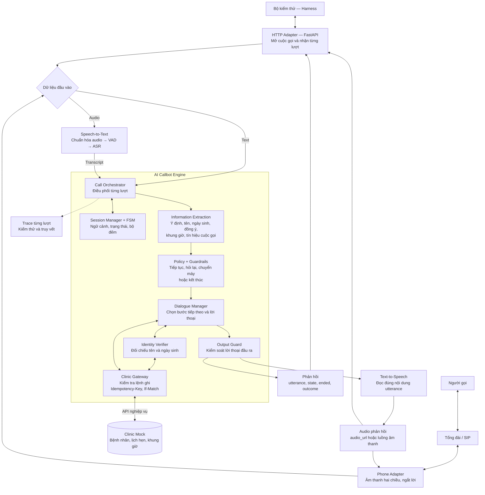
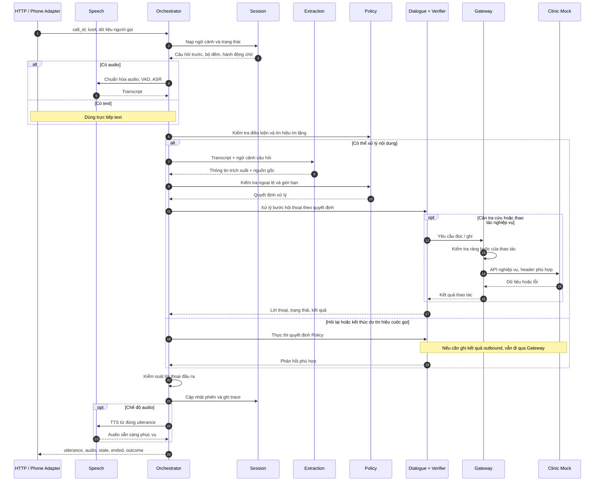
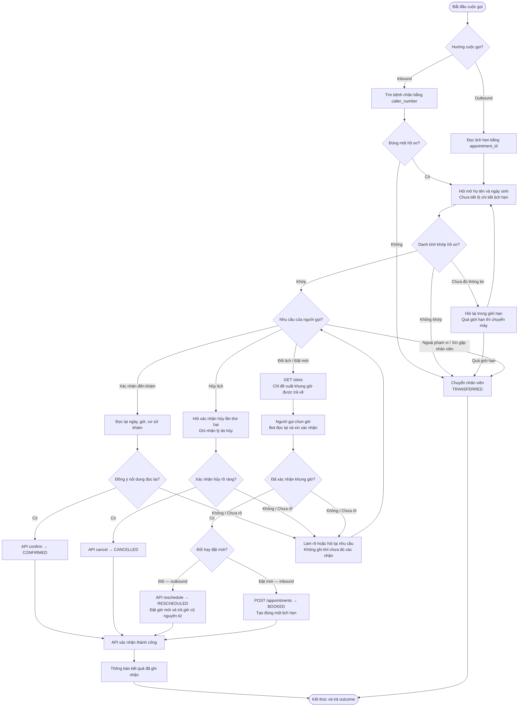

# AI Callbot Vinmec — Kiến trúc và luồng hoạt động

Tài liệu mô tả **kiến trúc đích** theo [hợp đồng AIHR-PC-001 Rev 1.1](https://callbot-contract-site-rev11.vercel.app/), đối chiếu mã nguồn ngày 16/09/2026. Các sơ đồ không có nghĩa là toàn bộ thành phần đã được tích hợp; xem [hiện trạng triển khai](#5-hiện-trạng-triển-khai).

Mở file bằng trình xem Markdown hỗ trợ Mermaid để hiển thị sơ đồ.

## 1. Kiến trúc tổng thể

HTTP phục vụ chấm điểm; điện thoại phục vụ cuộc gọi thực. Cả hai dùng chung một lõi nghiệp vụ. Clinic Mock là nguồn duy nhất có thẩm quyền về trạng thái lịch hẹn.

Các ranh giới trách nhiệm:

- **Session Manager** giữ trạng thái hội thoại và bản đọc tạm của dữ liệu cần thiết; không tạo kho trạng thái lịch hẹn độc lập.
- **Information Extraction** trích thông tin từ lời người gọi theo câu bot vừa hỏi; không nhận hồ sơ danh tính chuẩn để suy đoán câu trả lời.
- **Verifier** đối chiếu tên và ngày sinh; số điện thoại chỉ phục vụ tra cứu.
- **Policy và Gateway** kiểm soát quyết định và lệnh ghi. Nếu dùng LLM, LLM không được bỏ qua các kiểm soát này.
- **Output Guard** kiểm tra lời thoại trước khi gửi hoặc tổng hợp tiếng nói, đặc biệt với thông tin lịch hẹn và nội dung lâm sàng.
- **Phone Adapter** chuyển đổi tín hiệu điện thoại sang giao diện chung của lõi; việc chuyển máy thật cần tích hợp với tổng đài.

## 2. Một lượt hội thoại được xử lý như thế nào?

Sơ đồ mô tả lượt sau khi đã mở phiên. Các bước đọc/ghi Clinic Mock chỉ thực hiện khi nghiệp vụ cần.

Trong HTTP audio mode, `audio_url` phải sẵn sàng khi trả phản hồi và đọc đúng `utterance`. Hai endpoint chấm điểm phải phản hồi trong 8 giây; phép đo độ trễ của harness tính cả việc tải audio. Đây là yêu cầu hợp đồng, chưa phải kết quả đo của repo.

## 3. Luồng nghiệp vụ chính

Sơ đồ dưới áp dụng khi người gọi đang phản hồi. Các ngoại lệ ở mục 4 được kiểm tra trong suốt cuộc gọi, kể cả trước khi xác minh xong.

Nhánh xác nhận, hủy và đổi lịch dành cho outbound có lịch hẹn. Inbound trong phạm vi hợp đồng chỉ hỗ trợ đặt lịch mới; yêu cầu khác chuyển nhân viên. Các đường tới kết quả thành công ở trên giả định API ghi thành công; lỗi được xử lý theo mục 4.

## 4. Ngoại lệ và nguyên tắc ghi dữ liệu

| Tình huống | Hành vi đích |
|---|---|
| Không hiểu hai lượt liên tiếp | Chuyển nhân viên với `NOT_UNDERSTOOD`. |
| Outbound: không bắt máy, máy bận, voicemail hoặc ba lượt im lặng liên tiếp | Gọi `POST /appointments/{id}/unreachable` với lý do tương ứng. Mock ghi `UNREACHABLE` và tự tăng `attempt_count`; bot không gửi giá trị này. |
| Inbound: ba lượt im lặng liên tiếp | Trả `TRANSFERRED` với `NOT_UNDERSTOOD`; không tạo lịch hẹn và không ghi vào Mock. |
| Danh tính không khớp | Chuyển với `IDENTITY_FAILED`, không tiết lộ lịch hẹn. |
| Inbound không tìm được đúng một hồ sơ | Chuyển với `PATIENT_NOT_FOUND`; không tạo bệnh nhân mới. |
| Yêu cầu tư vấn lâm sàng | Chuyển với `CLINICAL_QUESTION`; không chẩn đoán, tư vấn thuốc hoặc phân loại cấp cứu. |
| Ngoài phạm vi / xin gặp người thật | Chuyển với `OUT_OF_SCOPE` / `PATIENT_REQUEST`. |
| `SLOT_TAKEN` | Đọc lại giờ trống, đề xuất và xin xác nhận lại; không tự chọn giờ thay thế. |
| `VERSION_CONFLICT` | Đọc lại bản ghi, kiểm tra lại thao tác, thử với phiên bản mới và cùng khóa idempotency cho cùng thao tác. |
| Lỗi hệ thống không khôi phục được | Chuyển với `SYSTEM_ERROR`; không thông báo ghi thành công khi API chưa xác nhận. |

Im lặng được đếm riêng với không hiểu. Trên đường chấm điểm, `silence_ms > 0` xác định lượt im lặng; voicemail đến qua clip lời chào. `NO_ANSWER` và `LINE_BUSY` thuộc cuộc gọi điện thoại thực.

Mọi lệnh ghi phải có `Idempotency-Key`; hợp đồng khuyến nghị `If-Match` với phiên bản vừa đọc. Gateway phải kiểm tra đúng lịch hẹn, đúng khung giờ đã được trả về trong cuộc gọi và đủ xác nhận cho hành động. Outbound chuyển máy được ghi bằng API `/transfer`; inbound chuyển máy trước khi tạo lịch chỉ trả kết quả và không ghi vào Mock. Bot không được gọi `/_harness/*`.

Harness chấm trạng thái cuối cùng trong Mock, kết hợp nhật ký ghi và phản hồi từng lượt để kiểm tra lỗi nghiêm trọng. Với inbound chuyển máy, harness kiểm tra `outcome` và việc không có lệnh ghi cho cuộc gọi.

## 5. Hiện trạng triển khai

Đối chiếu mã nguồn ngày 16/09/2026; đây không phải xác nhận hệ thống đã chạy end-to-end.

| Thành phần | Hiện trạng |
|---|---|
| [HTTP router](../../src/callbot/transports/http/calls.py) | Hai endpoint gọi `CallOrchestrator` thật (F-02, [evidence](../evidence/f02-http-engine.md)); chỉ text mode, `mode=audio` trả 501. Mã lỗi thứ tự lượt / đối soát: [http-api.md](http-api.md). |
| [Session Manager](../../src/callbot/engine/session/manager.py) | PostgreSQL store, khóa theo `call_id`, replay, nhật ký lệnh Clinic, chặn đối soát (F-03, [evidence](../evidence/f03-session-store.md), [vận hành](session-operations.md)). |
| [Call Orchestrator](../../src/callbot/engine/orchestrator.py) | Điều phối lượt với `extraction.InformationExtractor`; `engine/nlu` đã xoá (F-04, [evidence](../evidence/f04-information-extraction-http.md)). |
| [Information Extraction](../../src/callbot/engine/extraction/extractor.py) | Nối vào Orchestrator; IE chỉ nhận `TurnContext` (không hồ sơ bệnh nhân). LLM fallback chưa bật. |
| [Dialogue Manager](../../src/callbot/engine/dialogue/manager.py) | Điều phối theo `question_id`, `agreement`, `slot_choice`; bằng chứng xác nhận; `SLOT_TAKEN` đề xuất lại. Chưa dùng LLM. |
| [Policy](../../src/callbot/engine/policy/policy_engine.py) | Bộ đếm theo thiết kế IE §6.1; im lặng: outbound `UNREACHABLE`, inbound chuyển máy. Chưa có giới hạn lần thử danh tính riêng (§6.2). |
| [Clinic Gateway](../../src/callbot/engine/tools/clinic_gateway.py) | Kiểm tra FSM + guardrail + bằng chứng trước mọi lệnh ghi; có `/unreachable`, hủy gửi `confirmed=true`. F-05 ([evidence](../evidence/f05-clinic-gateway.md)): đọc hết trang, chuẩn hóa slot/patient/appointment, lỗi ba lớp không lộ `httpx`, `FakeClinicAPI` hành xử như mock, contract test fake ↔ mock thật. |
| [Speech pipeline](../../src/callbot/speech/pipeline.py) | Có STT pipeline; xử lý streaming và ngắt lời còn TODO. |
| [TTS](../../src/callbot/speech/tts/base.py) | Có interface và `NullTTS`, chưa sinh tiếng nói thật. |
| Phone Adapter | Chưa có transport điện thoại trong repo. |
| Output Guard | Là phần của thiết kế đích; chưa có một bước kiểm tra đầu ra tập trung trong Orchestrator. |

## 6. Tài liệu đối chiếu

- [Hợp đồng — phạm vi và hai kênh dùng chung lõi](https://callbot-contract-site-rev11.vercel.app/#s1).
- [Hợp đồng — API, trạng thái và thao tác unreachable](https://callbot-contract-site-rev11.vercel.app/#s4).
- [Hợp đồng — thay đổi Rev 1.1](https://callbot-contract-site-rev11.vercel.app/#sc).
- [Thiết kế Information Extraction](information-extraction-design.md).
- [Tài liệu Clinic Mock](clinic-mock.md).
