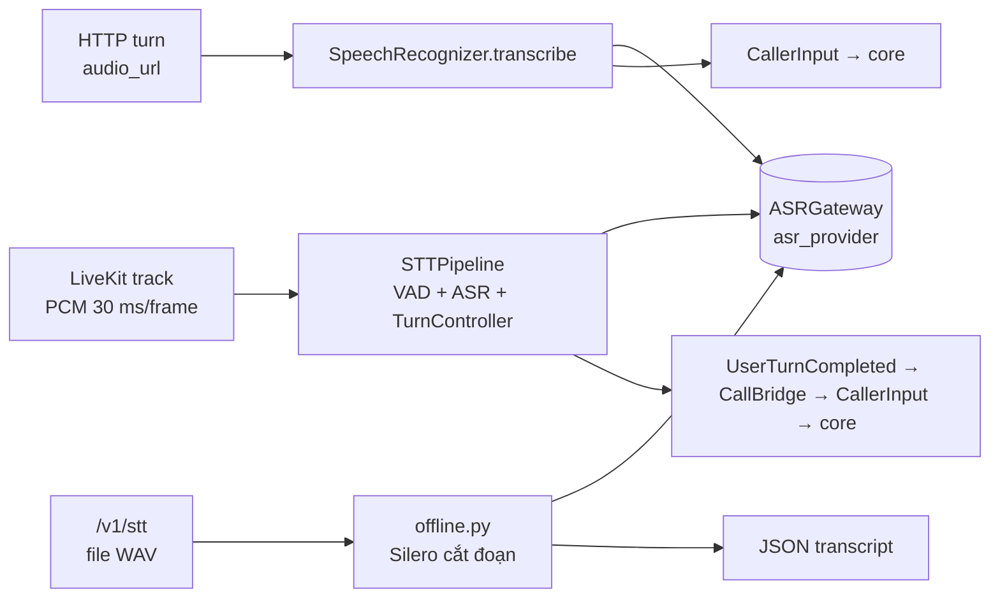
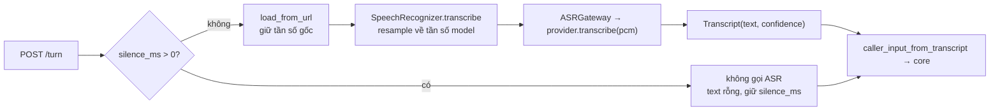
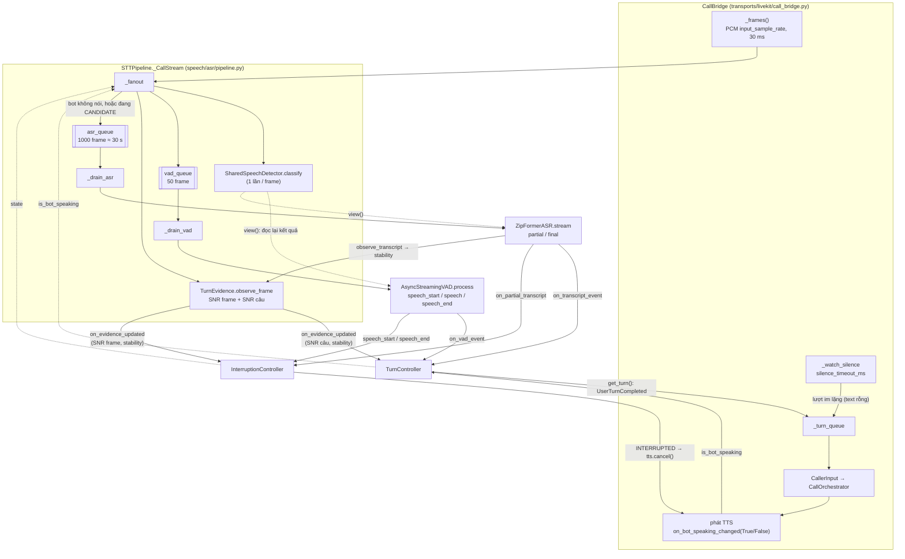
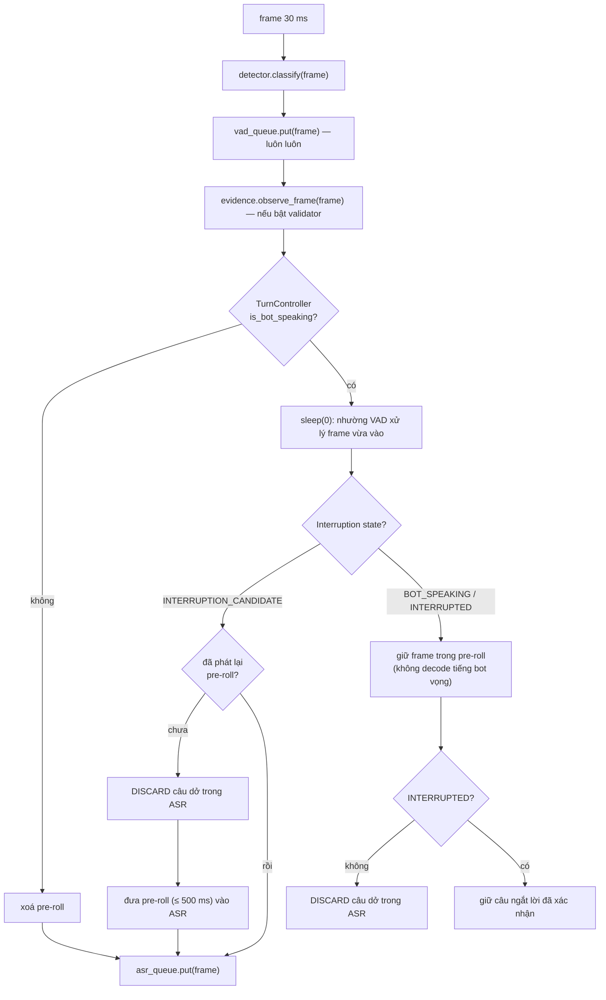
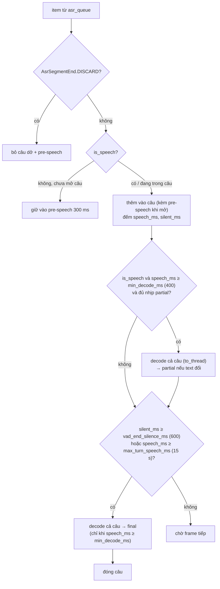
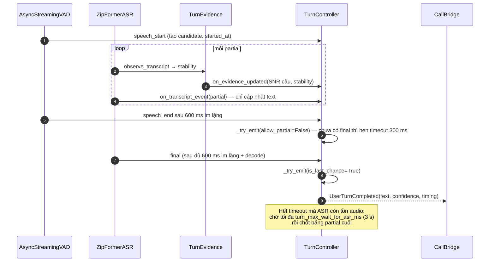
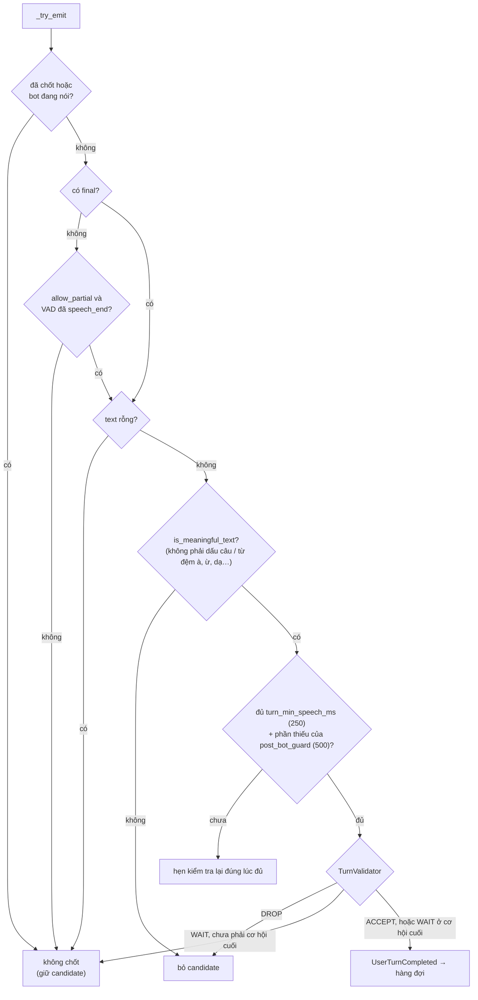
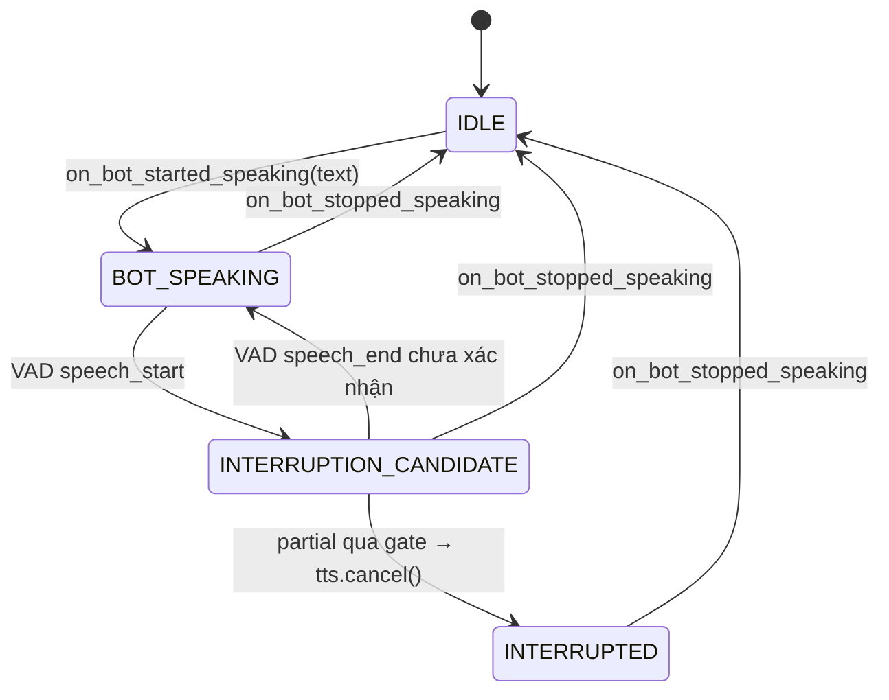

# Luồng STT (âm thanh → văn bản)

Đối chiếu với code trên `main` ngày 05/10/2026. Có ba đường STT, cùng dùng một ASR gateway
(`inference.asr`, provider chọn bằng `asr_provider` trong `config/speech.yaml`).

| Đường | Vào | Cắt câu | Chốt lượt | File chính |
|---|---|---|---|---|
| HTTP `POST /v1/calls/{id}/turn` (được chấm điểm) | một clip mỗi lượt (`audio_url`) | không — decode cả clip | harness quyết định | `callbot/transports/http/calls.py` |
| LiveKit (web call) | PCM liên tục | VAD | TurnController + Validator | `speech/asr/pipeline.py` |
| STT eval `/v1/stt` (công cụ PM) | file WAV | Silero cắt đoạn | — | `speech/asr/offline.py` |



## 1. Đường HTTP



- Rẽ nhánh ở `calls.py::_resolve_input`.
- Không có VAD: clip toàn nhiễu vẫn được decode.
- Lắp ở `speech/bundle.py::build_speech_bundle`, warm-up model lúc khởi động (`warm_up`).

## 2. Đường LiveKit

### 2.1 Thành phần (một bundle cho một cuộc gọi)

Lắp ở `speech/bundle.py::build_streaming_bundle`. Mọi thành phần đều có trạng thái, không dùng
chung giữa các cuộc gọi.

```
StreamingSpeechBundle
├── stt_pipeline: STTPipeline
│   ├── detector: SharedSpeechDetector(classifier theo vad_provider)
│   ├── vad: AsyncStreamingVAD(detector.view(), end_silence_ms=vad_end_silence_ms)
│   ├── asr: SpeechRecognizer ─ stream(silence_classifier=detector.view())
│   └── evidence: TurnEvidence (khi turn_validator_enabled; SNR luôn đo bằng Silero)
├── turn_controller: TurnController(validator)
├── validator: TurnValidator | None  ── CallBridge dùng lại cho InterruptionController
└── tts
```

### 2.2 Luồng dữ liệu tổng thể



Hai worker `_drain_vad` và `_drain_asr` chạy song song, mỗi worker có hàng đợi riêng. Hàng đợi
ASR rộng gấp 20 lần để decode chậm không chặn `_fanout` (nếu không VAD và barge-in đứng theo
ASR). ASR tồn ≥ 1 s audio thì log cảnh báo.

### 2.3 Định tuyến một frame (`_fanout`)



`DISCARD` là `AsrSegmentEnd.DISCARD` đặt vào hàng đợi ASR: ASR chỉ tự chốt câu khi thấy đủ
khoảng lặng, nên ngừng đưa frame thì phải báo bỏ câu dở, nếu không nó bị ghép vào câu sau
("ANH SINH" + "ANH SINH NGÀY ...").

### 2.4 ASR cắt câu và decode (`ZipFormerASR.stream`)

Chunked-offline: gom từng câu theo `silence_classifier` (chính là `detector.view()`, nên cùng
quyết định với VAD), decode lại **cả câu** mỗi lần phát partial.



- Câu dưới `min_decode_ms` tiếng nói không bao giờ được decode: ZipFormer bịa cả cụm từ từ "à"/"ờm".
- Nói liền quá `max_turn_speech_ms` thì chốt cưỡng bức và mở ngay câu mới.
- Tham số ZipFormer ở `config/asr.yaml`.

### 2.5 Chốt lượt (`TurnController`)

VAD và ASR cùng đẩy event vào; controller không tự đọc audio.



Điều kiện trong `_try_emit` — qua hết thì chốt:



`TurnValidator.evaluate`:

| Điều kiện | Quyết định |
|---|---|
| transcript dao động (`OSCILLATING`, vd. "đây"→"tại"→"đây") | DROP |
| ≤ 2 từ **và** SNR câu < `turn_validator_min_snr_db` (3 dB) | DROP |
| transcript hội tụ (`CONVERGING`) | ACCEPT |
| còn lại | WAIT ("cơ hội cuối" — có final hoặc hết timeout — coi như ACCEPT) |

Bot nói xong (`on_bot_speaking_changed(False)`): candidate nghe được trong lúc bot nói bị bỏ, trừ
khi đó là lần ngắt lời đã xác nhận (`preserve_candidate=True`) — khi đó chốt ngay nếu đã có final.

### 2.6 Ngắt lời (`InterruptionController`)



Gate (`InterruptionController._gate`) xét mỗi partial, và xét lại partial mới nhất trên mỗi frame
VAD còn là tiếng nói (`on_speech_frame`) — GipFormer chỉ phát partial khi chữ đổi, nên ngưỡng thời
lượng có thể đạt mà không có event ASR mới.

Điều kiện chặn (một điều kiện không qua là không ngắt):

1. Candidate kéo dài ≥ 200 ms.
2. `is_meaningful_text(partial)` (từ đệm "ừ/à/dạ" chỉ ngắt được khi là câu trả lời câu hỏi cuối).
3. Không phải tiếng bot vọng lại: trùng một đoạn từ liên tiếp của câu bot (khớp đúng khi < 3 từ,
   khớp mờ ≥ 70 khi dài hơn). Bỏ qua khi đường truyền đã cho thấy không vọng — policy `acoustic`:
   một câu bot phát 2 s mà VAD không mở ứng viên nào và mic lúc này không có bản sao tiếng bot.
4. SNR câu ≥ `interruption_min_snr_db`.
5. `TurnValidator` không DROP.

Đủ bằng chứng để ngắt (một trong các điều kiện):

- câu trả lời/lệnh ngắn rõ ràng (`is_short_answer`, ≥ 0,3 s, SNR ≥ 10 dB, ASR ≥ 0,7);
- ≥ 2 chữ có nghĩa và `TurnValidator` ACCEPT (hai partial hội tụ) hoặc final;
- ≥ 2 chữ có nghĩa, ≥ 0,4 s, SNR ≥ 10 dB, ASR ≥ 0,7 nếu chỉ 2 chữ — chỉ khi đường truyền không
  có tiếng vọng (có vọng thì vẫn đòi partial hội tụ).

Một chữ không phải câu trả lời ("ĐÂY", "MÌNH") không bao giờ tự ngắt lời bot. Số đo:
`docs/evidence/livekit-barge-in-confirmation-2026-10-10.md`.

Chỉ khi state là `INTERRUPTION_CANDIDATE` thì `_fanout` mới phát lại pre-roll và đưa audio vào
ASR — đó là cách ASR có partial để gate xét (xem 2.3). Xác nhận rồi thì `CallBridge.cancel()` xoá
hàng đợi phát và dừng vòng phát trước, sau đó mới đóng request TTS.

### 2.7 Lượt im lặng

`CallBridge._watch_silence` hỏi `TurnController.silence_elapsed_s()` — tính từ mốc muộn hơn
giữa lúc bot dứt lời và lần cuối VAD còn thấy tiếng nói; trả `None` khi bot đang nói hoặc đang
có câu dở. Đủ `silence_timeout_ms` thì đẩy `UserTurnCompleted(text="", silence_ms=…)` vào cùng
`_turn_queue`, core nhận như lượt im lặng của HTTP.

## 3. Cấu hình liên quan (`config/speech.yaml`)

| Khóa | Mặc định | Ảnh hưởng |
|---|---|---|
| `asr_provider` | `zipformer` | `zipformer` chạy cả hai đường; `elevenlabs_realtime` chỉ LiveKit; `gemini`, `phowhisper` chỉ HTTP |
| `vad_provider` | `silero` | classifier cho VAD + chốt câu ASR trên LiveKit (`energy` / `webrtc` / `silero`) |
| `vad_end_silence_ms` | 600 | im lặng để VAD phát `speech_end` **và** ASR phát final |
| `silero_min_silence_ms` | 500 | làm mượt nhãn của Silero |
| `turn_min_speech_ms` | 250 | lượt ngắn hơn bị bỏ |
| `turn_max_wait_after_vad_end_ms` | 300 | chờ final sau `speech_end` rồi chốt bằng partial |
| `turn_max_wait_for_asr_ms` | 3000 | chờ ASR xử lý hết phần tồn trước khi chốt bằng partial |
| `turn_post_bot_guard_ms` | 500 | câu bắt đầu sát lúc bot dứt lời phải dài thêm phần còn thiếu |
| `turn_validator_enabled`, `turn_validator_min_snr_db` | true, 3.0 | lọc lượt ảo giác |
| `interruption_min_snr_db` | 0.0 | lọc barge-in giả |

Tần số mẫu: HTTP giữ tần số gốc của clip; LiveKit dùng `input_sample_rate` trong
`config/livekit.yaml`. Pre-roll barge-in: `barge_in_preroll_ms` (500) cũng ở `livekit.yaml`.

## 4. Bản đồ file

| File | Vai trò |
|---|---|
| `speech/bundle.py` | lắp thành phần cho từng đường |
| `speech/asr/pipeline.py` | STTPipeline: fan-out frame, hai worker VAD/ASR |
| `speech/asr/recognizer.py` | nối ASR gateway, resample về tần số model |
| `speech/asr/vad/` | `shared.py` (phân loại một lần/frame), `silero.py`, `webrtc.py`, `energy.py`, `async_stream.py` (VAD) |
| `speech/turn/controller.py` | chốt lượt |
| `speech/turn/interruption.py` | xác nhận ngắt lời khi bot đang nói |
| `speech/turn/validator.py`, `speech/turn/evidence.py` | lọc lượt ảo giác (SNR + độ ổn định) |
| `inference/asr/providers/zipformer.py` | decode + `stream()` chunked-offline |
| `callbot/transports/livekit/call_bridge.py` | nhận frame, lượt im lặng, phát TTS, chuyển lượt cho core |
| `speech/asr/offline.py`, `speech/audio/preprocess.py` | đường STT eval |
